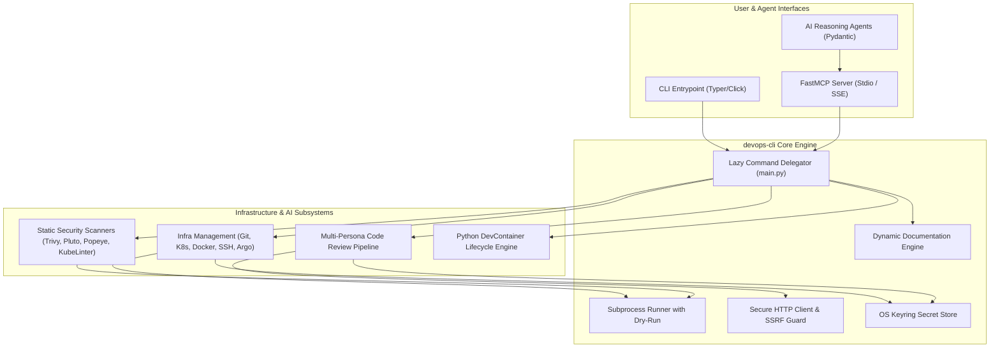
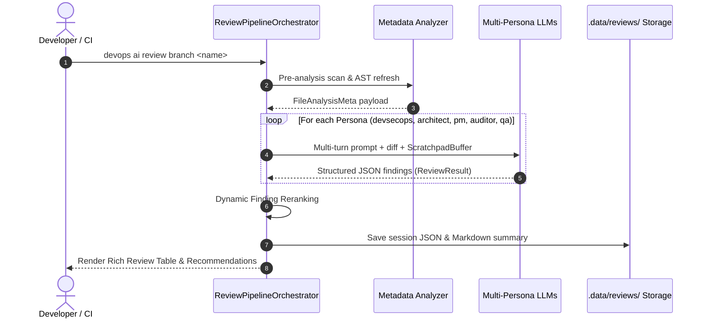
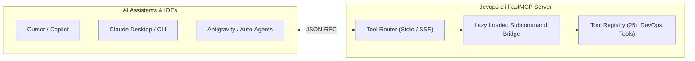
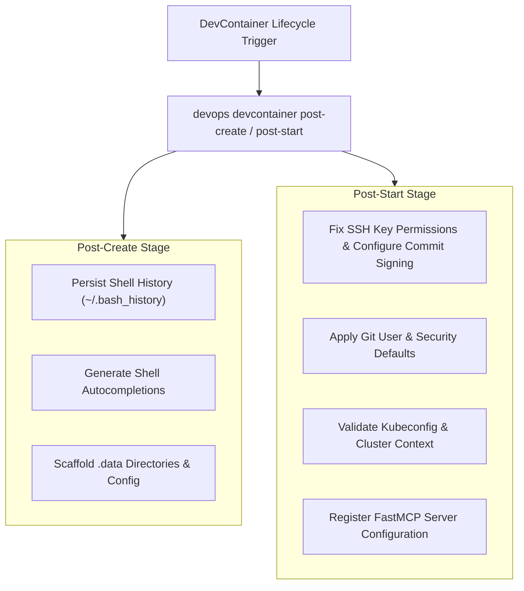

# System Architecture & Technical Design — devops-cli

This document outlines the architecture, subsystem design, data flow, and security boundaries of `devops-cli`.

---

## 1. High-Level System Architecture

`devops-cli` is architected as a modular infrastructure automation CLI and multi-agent code analysis platform.

---

## 2. Multi-Persona Code Review Pipeline

The Agentic Code Review engine splits code analysis across specialized domain personas with structured reasoning context; static scanners' findings are admitted against the code, and a person gives the verdicts.

### Review Personas & Specializations
- **`devsecops`**: Static vulnerability scanning, secret detection, and IAM least-privilege analysis.
- **`architect`**: Scalability, SOLID design principles, structural coupling, and boundary cohesion.
- **`pm`**: Feature completeness, requirement traceability, and non-functional guarantees.
- **`auditor`**: Compliance, governance, audit trail logging, and regulatory controls.
- **`qa`**: Edge cases, error handling paths, test mocking adherence, and regression risk.

---

## 3. FastMCP Integration & Bridge Architecture

`devops-cli` exposes its complete infrastructure and review capabilities over the **Model Context Protocol (FastMCP)**, enabling seamless integration with external AI IDEs, autonomous subagents, and Claude/Cursor tools.

---

## 4. Native DevContainer Lifecycle Engine

Replacing fragile bash scripts, `devops devcontainer post-create` and `devops devcontainer post-start` (wrapped together by `devops devcontainer run-lifecycle`) execute cross-platform Python lifecycle tasks:

---

## 5. Security & Threat Model

1. **Zero-Plaintext Secret Storage**:
   - Secrets are managed exclusively through OS Keyring (`keyring`), isolating API tokens and credentials from git commits, environment dumps, and config files.
2. **SSRF Guardrails (`devops_cli.http.egress`)**:
   - Every HTTP client is built by `devops_cli.http.client`. It resolves each host once, at the connect, and dials only the addresses its egress level admits (public, loopback or private), checked against RFC 1918, loopback, link-local and cloud metadata ranges. Kept pre-flight checks (Qdrant, kubectl manifest apply, container engine endpoint, config init wizard) call `vet_addresses` directly at their level. Cloud metadata is refused at every level, and TLS still verifies the hostname.
3. **Safe Subprocess Execution**:
   - All external binary invocations (`git`, `kubectl`, `trivy`, `docker`) use explicit argument arrays with `shell=False` and deterministic timeout boundaries.

---

## 6. SRE Reliability, Observability & Quality Gates

- **Structured Metrics & Telemetry**: Integrates with Prometheus query endpoints (`devops prometheus`) and Grafana dashboards (`devops grafana`) to monitor workstation and cluster health.
- **Gated CI Quality Gate**: Automated enforcement of Python 3.14 runtime, Ruff formatting, Mypy strict typing, documentation freshness, test coverage, and static security scanning (`devops ci`).
- **Releases by release-please**: release-please derives each version and the changelog from the Conventional Commit titles on `main`, and a person merges its release pull request ([`RELEASE_CYCLE.md`](RELEASE_CYCLE.md)). devops-cli holds no release code.

---

## 7. Universal Architectural Standards & Consistency Blueprint

To ensure complete stylistic cohesion, maintainability, and zero boilerplate project-wide, the codebase follows core architectural design patterns:

### 1. Declarative CLI Command Dispatch & OpenTelemetry Instrumentation
Every command is registered on a `new_typer()` app (`OTelTyper`, `devops_cli/core/cli.py`), which wraps it in a `cli.<command>` OpenTelemetry span:
- Each command handles `--dry-run` itself via `is_dry_run()` / `render_dry_run_result()`.
- Automatic OpenTelemetry span wrapping with standardized span attributes: the command, its command path and the number of arguments, never an argument value ([docs/TELEMETRY.md](docs/TELEMETRY.md)).
- The one exit seam: the wrapper reports a `DevOpsCLIError` that a command, or a callback that runs as a command, raises. It prints the error's message in one error line, with any Rich markup in it escaped, and exits with the error's `exit_code`, with no traceback. Every command app is a `new_typer()` app, so every command passes through it. An exception that is not a `DevOpsCLIError` propagates.
- Commands that offer machine-readable output declare their own `--format` (table/json/yaml via `devops_cli.output.serialization.emit_serialized`) or `--json` flag. There is no global `--format` option.

### 2. End-to-End Pydantic Resource Model Interoperability
Domain results are modelled with Pydantic in `devops_cli.models`. The REST routes define their own response models in `server/routes/`, and MCP tools return the CLI's text output:
- **Strict Typing**: Mandatory field descriptions, `Field(default_factory=...)` mutable defaults, and zero hardcoded synthetic scoring floats.
- **Bi-Directional JSON Schema Generation**: Clean schema generation for IDE completions and LLM tool calling.
- **Closed Tool Schemas**: An MCP tool and an agent schema refuse unknown arguments: `extra="forbid"` in Pydantic, `additionalProperties: false` in JSON Schema. The validation error names the arguments that the tool accepts.

### 3. Safe Subprocess Execution & Process Group Management
All external binaries run through `run_subprocess` / `run_subprocess_async` (`devops_cli.core.process`):
- Strict command argument list verification (rejecting hyphen-prefixed injection payloads) with `shell=False`.
- Explicit bounded timeouts (default 1800 s) with standardized `TimeoutExpired` domain error translation.
- An audit-record writer (`devops_cli.core.audit.record_audit_event`, `.data/logs/audit.jsonl`) records each write of a config file (`save_settings`). It is not yet called from command or subprocess execution.
- Deterministic mock isolation protocols for fast offline unit testing, dry-run reporting, environment isolation, and OpenTelemetry spans.
- **Child environment**: With `isolate_env=True`, the default, `build_subprocess_env` gives a child the allowed keys of the environment, without credentials. With `isolate_env=False`, it gives the full environment, credentials included. It puts the `env` of the caller on top. It refuses with `SecurityError` a caller key that `CONST_CODE_LOADING_ENV_PATTERNS` lists. The list holds the loader keys of glibc and macOS, `GCONV_PATH`, and the keys of bash and zsh that run code. It also holds the keys of Python, Node.js, Perl, Ruby and Java that load code. The bullets after this one describe the keys of each tool and library. An isolated child gets none of these keys from the environment, unless the caller names the key in `extra_allowed_keys` (`extra_allowed_env` of `run_subprocess`). Some keys that make a child run code still reach the child. `HOME` is one: zsh, Python and p11-kit read start-up files or modules below it. A caller that sets `HOME` gives a directory that it controls. `XDG_CONFIG_HOME` is another: git reads its configuration below it, and `devops openspec` sets it. `build_subprocess_env` also refuses a null byte in a caller key or value. Give a child only the keys that it needs, never a copy of `os.environ`.
- **Git child environment**: The guard refuses each `GIT_` key of a caller, but `GIT_TERMINAL_PROMPT` and the author and committer keys (#2483). Git reads configuration, programs and hooks from the other keys. A key that git adds later stays refused until a person reviews it. The guard also refuses `EDITOR`, `VISUAL`, `PAGER` and `LESSOPEN`, which a git child uses. A caller that must give git an option puts it in the arguments, for example `git -c core.sshCommand=...`, and never in the environment. The `git config --global` calls name `GIT_CONFIG_GLOBAL` in `extra_allowed_env`, so that they write the file that the person set.
- **Ssh child environment**: The guard refuses each `SSH_` key of a caller, and `SHELL` (#2633). `ssh`, `ssh-add`, `ssh-keygen` and git start the program of `SSH_ASKPASS`. `SSH_SK_PROVIDER`, `SSH_SK_HELPER` and `SSH_PKCS11_HELPER` load a library or start a helper. `SSH_AUTH_SOCK` names the agent that gets a private key, and `SHELL` names the program that `ssh` runs for a `ProxyCommand`. A key that OpenSSH adds later stays refused until a person reviews it. `DISPLAY`, `HOME` and `XAUTHORITY` still reach the child: they name no program for `ssh`.
- **Gh and kubectl child environment**: The guard refuses `GH_BROWSER`, `BROWSER`, `GH_EDITOR`, `GH_PAGER`, `GH_PATH`, `KUBE_EDITOR` and `KUBECTL_EXTERNAL_DIFF` from a caller (#2672). `gh` and `kubectl` start the program that each key names, and `GH_PATH` becomes the git credential helper that git starts. `GH_CONFIG_DIR` and `KUBECONFIG` still reach the child: callers set both on purpose, and a caller names a file that it controls. A configuration directory can hold a `gh` alias that starts a program, and a kubeconfig can name an `exec` credential plug-in. A caller that takes either path from an untrusted source must check it first. A key that `gh` or `kubectl` adds later is not refused until a person reviews it.
- **Uv and npm child environment**: The guard refuses `UV_PYTHON`, `UV_PYTHON_INSTALL_DIR`, `UV_PROJECT_ENVIRONMENT`, `VIRTUAL_ENV`, `npm_config_script_shell`, `npm_config_node_options`, `npm_config_git`, `npm_config_editor`, `npm_config_init_module`, `npm_config_shell`, `npm_config_python` and `PYTHON` from a caller (#2673). `uv` starts the interpreter or the environment that the first four keys name. `npm` starts the shell, the git program or the editor that its keys name, passes the options of `npm_config_node_options` to `node`, and loads the module of `npm_config_init_module`. node-gyp, which `npm install` runs for a native package, starts the interpreter of `npm_config_python` and of `PYTHON`. npm reads the spelling with a hyphen, as `npm_config_script-shell`, as the same key, so the guard refuses it too. The guard accepts the other `npm_config_` keys, because `devops install-tools` sets some of them. `npm_config_userconfig`, `npm_config_globalconfig` and `UV_CONFIG_FILE` name a file that can start a program, and a caller names a file that it controls. A caller that takes such a path from an untrusted source must check it first. An isolated child gets no `VIRTUAL_ENV`, no `UV_PROJECT_ENVIRONMENT` and no `npm_config_` key from the environment. It still gets the other `UV_` keys of the person, `UV_PYTHON` and `UV_PYTHON_INSTALL_DIR` included, although the guard refuses both from a caller: the gate of a CI runner needs them to keep the environment that `uv sync` built (#1735). The environment of the person is as trusted as `PATH` for these two keys. A key that `uv` or `npm` adds later is not refused until a person reviews it.
- **File-write child environment**: The guard refuses `SSLKEYLOGFILE`, `QLOGDIR`, `NODE_V8_COVERAGE`, `NODE_REDIRECT_WARNINGS` and each `LD_` key from a caller (#2674). These keys load no code. They make the child write a file that the caller names. `SSLKEYLOGFILE` makes `curl`, `git` over HTTPS and the `ssl` module of Python write the TLS secrets of each connection, and a person who reads the file can decrypt the recorded traffic. `QLOGDIR` makes `curl` write a QUIC log. `NODE_V8_COVERAGE` and `NODE_REDIRECT_WARNINGS` make Node.js write coverage data and its warnings. `LD_DEBUG_OUTPUT` and `LD_PROFILE_OUTPUT` make the glibc loader write debug text and a profile. The pattern `LD_*` also refuses the other loader keys. The guard also refuses `PYTEST_ADDOPTS` and `npm_config_logs_dir` (#2747). With `--junitxml=<path>` in `PYTEST_ADDOPTS`, pytest wrote a JUnit file at the path. With `npm_config_logs_dir` or `npm_config_logs-dir`, npm wrote its debug log into the directory. `npm_config_cache` stays accepted, because `devops install-tools` sets it. npm writes cache files and, when `npm_config_logs_dir` is not set, its debug log below that directory. A caller that takes the cache path from an untrusted source must check the path first. `PYTHONDUMPREFSFILE` and `GPGRT_TRACE_FILE` stay accepted: no probe made a child write a file with them. A key that a tool adds later is not refused until a person reviews it.
- **Library child environment**: The guard refuses each `OPENSSL` key and each `KRB5` key of a caller (#2503). The OpenSSL keys `OPENSSL_CONF`, `OPENSSL_CONF_INCLUDE`, `OPENSSL_MODULES` and `OPENSSL_ENGINES` choose the provider or engine that each program with OpenSSL loads. `KRB5_CONFIG` can name plug-in modules in the same way. The guard also refuses `GSS_MECH_CONFIG`, `SASL_PATH`, `PYTHONEXECUTABLE` and `__PYVENV_LAUNCHER__`. A key that a library adds later stays refused until a person reviews it. A key that loads no module, for example `SSL_CERT_FILE`, stays accepted.
- **Subprocess spans**: A subprocess span holds the program and the number of its arguments. It holds the arguments only when `telemetry.capture_command_args` turns them on ([docs/TELEMETRY.md](docs/TELEMETRY.md)).
- **LLM inference spans**: AI inference spans omit prompt and response previews by default, and Logfire scrubs private host patterns. They record previews only when `telemetry.capture_llm_content` turns them on ([docs/TELEMETRY.md](docs/TELEMETRY.md)).
- **Process groups**: Start a child with `start_new_session=True`, and stop it by its process group (`os.killpg`), as `_terminate_process_group` in `src/devops_cli/sandbox/host.py` does. Do not signal a pid below 2, the own process group (`os.getpgrp()`) or a process group below 2.
- **Shared container**: Never set `RLIMIT_NPROC`: Linux counts it for the real user across the container, so it starves VS Code Server and the shells. Never set `O_NONBLOCK` on descriptors 0, 1 or 2: it corrupts the terminal.

### 4. Multi-Stage Workflow Architecture
The review workflow runs as `ReviewPipelineOrchestrator` methods (pre-analysis, payload init, persona review, re-ranking, reporting):
- **The report**: `review/report.py` renders review.md (`render_markdown`) and the terminal view (`render_console`) from one frozen `ReportInput`. It reads no orchestrator attribute and opens no file. `generate_consolidated_report` collects, deduplicates and persists the session, reads the review history and the knowledge-base drift that the report shows, and builds the input one time.
- Standardized stage lifecycle hooks (`before_stage`, `after_stage`, `on_stage_error`).
- Scratchpad buffer reasoning state handover between stages.
- **Workspace from the caller**: the command layer reads the working directory one time and gives it down. The orchestrator takes the absolute path of the reviewed directory (`target_dir`) and the `ToolExecutor` of its analyzers, evidence tools and canaries through its constructor, and no stage takes them again. The command layer makes one `SandboxToolExecutor` for each review, and an orchestrator that gets no executor makes one (`SECURITY.md`, item 7). A scanner takes the tree, the target or the directory that it starts in from its caller, and a scanner entry point has no default for it. No module under `ai/review/`, `review/` or `security/` reads `Path.cwd()` or `os.getcwd()`, names `DEFAULT_CURRENT_PATH`, or gives a parameter the default `Path(".")`: the ast-grep rule `review-cwd-read` holds this in the `constructs` row of `devops ci`. `get_repo_origin_name` takes the root of its repository from its caller and reads only the origin remote of that root. A command that has no `--repo` gives it `find_repo_root(Path.cwd())`, and an invariant test holds the parameter to no default. An allowed root of a boundary check, such as the review boundary of `devops review path` and the paths of `devops review export-feedback`, is the directory that the command gives.

### 5. HTTP Connection Management & Security Broker
`HttpClientBroker` (`devops_cli.http.broker`) serves Vault with HTTP/2 and W3C `traceparent` injection. Its clients, and the shared LLM connection pool in `devops_cli.http.pool`, are built by `devops_cli.http.client`, so each address they dial is checked at the connect and on every redirect hop (see SSRF Guardrails above):
- Native HTTP/2 connection pooling with persistent keepalive and backoff retries where supported.
- Connect-time egress checks by level (public, loopback-allowed, private-allowed), with cloud metadata addresses refused at every level.
- Automatic W3C `traceparent` header injection for distributed trace waterfalls.
- A client backs off with jitter on HTTP 429 and obeys `Retry-After`. It caches idempotent reads under `.data/` or in Valkey.

### 6. Files
Check the size of a file before you read it into memory (`MAX_REPOMAP_FILE_SIZE_BYTES`, 50 MiB). Resolve a path inside a root with `safe_resolve_subpath` (`devops_cli.core.paths`), which refuses a symlink or `..` that leaves the root.
