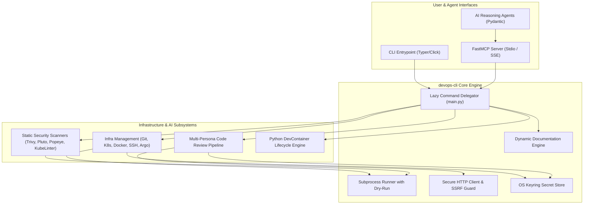
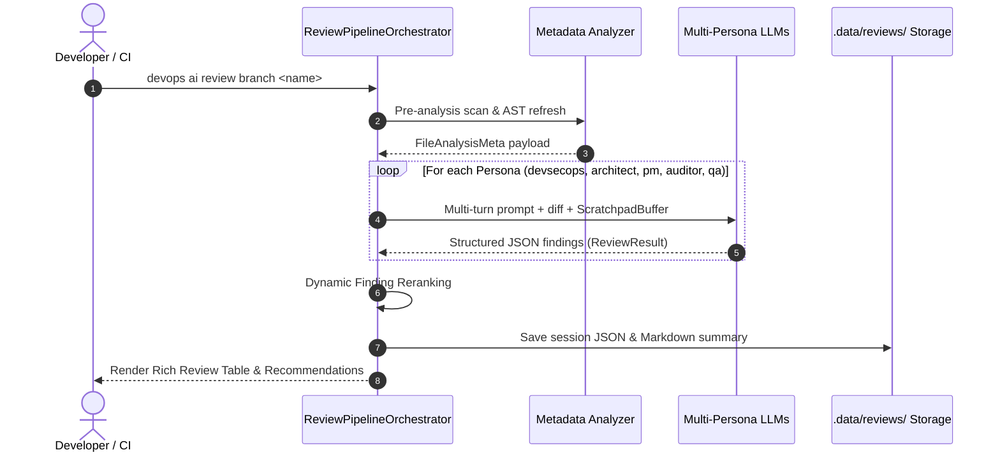
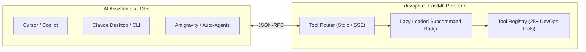
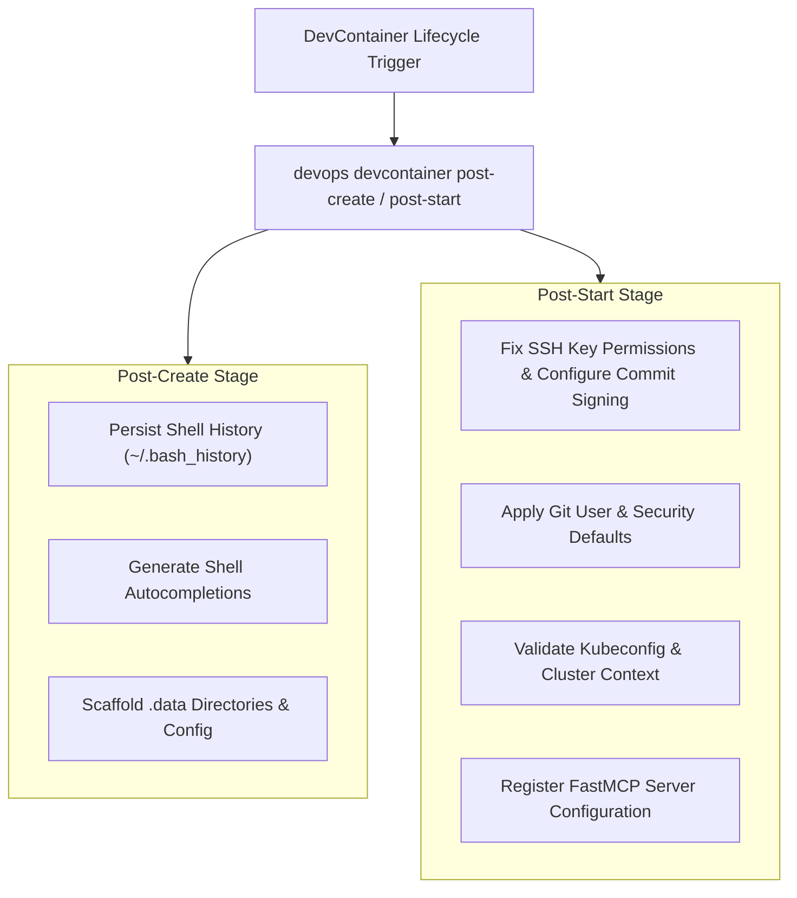

# System Architecture & Technical Design — devops-cli

This document outlines the architecture, subsystem design, data flow, and security boundaries of `devops-cli`.

---

## 1. High-Level System Architecture

`devops-cli` is architected as a modular infrastructure automation CLI and multi-agent code analysis platform.

---

## 2. Multi-Persona Code Review Pipeline

The Agentic Code Review engine splits code analysis across specialized domain personas with structured reasoning context; static scanners' findings are admitted against the code, and a person gives the verdicts.

### Review Personas & Specializations
- **`devsecops`**: Static vulnerability scanning, secret detection, and IAM least-privilege analysis.
- **`architect`**: Scalability, SOLID design principles, structural coupling, and boundary cohesion.
- **`pm`**: Feature completeness, requirement traceability, and non-functional guarantees.
- **`auditor`**: Compliance, governance, audit trail logging, and regulatory controls.
- **`qa`**: Edge cases, error handling paths, test mocking adherence, and regression risk.

---

## 3. FastMCP Integration & Bridge Architecture

`devops-cli` exposes its complete infrastructure and review capabilities over the **Model Context Protocol (FastMCP)**, enabling seamless integration with external AI IDEs, autonomous subagents, and Claude/Cursor tools.

---

## 4. Native DevContainer Lifecycle Engine

Replacing fragile bash scripts, `devops devcontainer post-create` and `devops devcontainer post-start` (wrapped together by `devops devcontainer run-lifecycle`) execute cross-platform Python lifecycle tasks:

---

## 5. Security & Threat Model

1. **Zero-Plaintext Secret Storage**:
   - Secrets are managed exclusively through OS Keyring (`keyring`), isolating API tokens and credentials from git commits, environment dumps, and config files.
2. **SSRF Guardrails (`devops_cli.http.egress`)**:
   - HTTP clients built by `devops_cli.http.client` resolve each host once, at the connect, and dial only the addresses their egress level admits (public, loopback or private), checked against RFC 1918, loopback, link-local and cloud metadata ranges. Cloud metadata is refused at every level, and TLS still verifies the hostname.
3. **Safe Subprocess Execution**:
   - All external binary invocations (`git`, `kubectl`, `trivy`, `docker`) use explicit argument arrays with `shell=False` and deterministic timeout boundaries.

---

## 6. SRE Reliability, Observability & Quality Gates

- **Structured Metrics & Telemetry**: Integrates with Prometheus query endpoints (`devops prometheus`) and Grafana dashboards (`devops grafana`) to monitor workstation and cluster health.
- **Gated CI Quality Gate**: Automated enforcement of Python 3.14 runtime, Ruff formatting, Mypy strict typing, documentation freshness, test coverage, and static security scanning (`devops ci`).
- **Releases by release-please**: release-please derives each version and the changelog from the Conventional Commit titles on `main`, and a person merges its release pull request ([`RELEASE_CYCLE.md`](RELEASE_CYCLE.md)). devops-cli holds no release code.

---

## 7. Universal Architectural Standards & Consistency Blueprint

To ensure complete stylistic cohesion, maintainability, and zero boilerplate project-wide, the codebase follows core architectural design patterns:

### 1. Declarative CLI Command Dispatch & OpenTelemetry Instrumentation
Every command is registered on a `new_typer()` app (`OTelTyper`, `devops_cli/core/cli.py`), which wraps it in a `cli.<command>` OpenTelemetry span:
- Each command handles `--dry-run` itself via `is_dry_run()` / `render_dry_run_result()`.
- Automatic OpenTelemetry span wrapping with standardized span attributes: the command, its command path and the number of arguments, never an argument value ([docs/TELEMETRY.md](docs/TELEMETRY.md)).
- The one exit seam: the wrapper reports a `DevOpsCLIError` that a command, or a callback that runs as a command, raises. It prints the error's message in one error line, with any Rich markup in it escaped, and exits with the error's `exit_code`, with no traceback. Every command app is a `new_typer()` app, so every command passes through it. An exception that is not a `DevOpsCLIError` propagates.
- Commands that offer machine-readable output declare their own `--format` (table/json/yaml via `devops_cli.output.serialization.emit_serialized`) or `--json` flag. There is no global `--format` option.

### 2. End-to-End Pydantic Resource Model Interoperability
Domain results are modelled with Pydantic in `devops_cli.models`. The REST routes define their own response models in `server/routes/`, and MCP tools return the CLI's text output:
- **Strict Typing**: Mandatory field descriptions, `Field(default_factory=...)` mutable defaults, and zero hardcoded synthetic scoring floats.
- **Bi-Directional JSON Schema Generation**: Clean schema generation for IDE completions and LLM tool calling.
- **Closed Tool Schemas**: An MCP tool and an agent schema refuse unknown arguments: `extra="forbid"` in Pydantic, `additionalProperties: false` in JSON Schema. The validation error names the arguments that the tool accepts.

### 3. Safe Subprocess Execution & Process Group Management
All external binaries run through `run_subprocess` / `run_subprocess_async` (`devops_cli.core.process`):
- Strict command argument list verification (rejecting hyphen-prefixed injection payloads) with `shell=False`.
- Explicit bounded timeouts (default 1800 s) with standardized `TimeoutExpired` domain error translation.
- An audit-record writer (`devops_cli.core.audit.record_audit_event`, `.data/logs/audit.jsonl`) records each write of a config file (`save_settings`). It is not yet called from command or subprocess execution.
- Deterministic mock isolation protocols for fast offline unit testing, dry-run reporting, environment isolation, and OpenTelemetry spans.
- **Child environment**: With `isolate_env=True`, the default, `build_subprocess_env` gives a child the allowed keys of the environment, without credentials. With `isolate_env=False`, it gives the full environment, credentials included. It puts the `env` of the caller on top. It refuses with `SecurityError` a caller key that `CONST_CODE_LOADING_ENV_PATTERNS` lists. The list holds the loader keys of glibc and macOS, `GCONV_PATH`, and the bash start-up, function and trace keys. Other keys that make a child run code reach the child, for example `PYTHONPATH`, `NODE_OPTIONS` and `ZDOTDIR` (#2429). `build_subprocess_env` also refuses a null byte in a caller key or value. Give a child only the keys that it needs, never a copy of `os.environ`.
- **Subprocess spans**: A subprocess span holds the program and the number of its arguments. It holds the arguments only when `telemetry.capture_command_args` turns them on ([docs/TELEMETRY.md](docs/TELEMETRY.md)).
- **LLM inference spans**: AI inference spans omit prompt and response previews by default, and Logfire scrubs private host patterns. They record previews only when `telemetry.capture_llm_content` turns them on ([docs/TELEMETRY.md](docs/TELEMETRY.md)).
- **Process groups**: Start a child with `start_new_session=True`, and stop it by its process group (`os.killpg`), as `_terminate_process_group` in `src/devops_cli/sandbox/host.py` does. Do not signal a pid below 2, the own process group (`os.getpgrp()`) or a process group below 2.
- **Shared container**: Never set `RLIMIT_NPROC`: Linux counts it for the real user across the container, so it starves VS Code Server and the shells. Never set `O_NONBLOCK` on descriptors 0, 1 or 2: it corrupts the terminal.

### 4. Multi-Stage Workflow Architecture
The review workflow runs as `ReviewPipelineOrchestrator` methods (pre-analysis, payload init, persona review, re-ranking, reporting), and `ai/review/stages/` holds `reporting.py`:
- Partitioned into single-responsibility stage modules under `stages/` (e.g. `reporting.py`).
- Standardized stage lifecycle hooks (`before_stage`, `after_stage`, `on_stage_error`).
- Scratchpad buffer reasoning state handover between stages.
- **Workspace from the caller**: the command layer reads the working directory one time and gives it down. The orchestrator takes the absolute path of the reviewed directory (`target_dir`) and the `ToolExecutor` of its analyzers, evidence tools and canaries through its constructor, and no stage takes them again. The command layer makes one `SandboxToolExecutor` for each review, and an orchestrator that gets no executor makes one (`SECURITY.md`, item 7). A scanner takes the tree, the target or the directory that it starts in from its caller. No module under `ai/review/`, `review/` or `security/` reads `Path.cwd()` or `os.getcwd()`: the ast-grep rule `review-cwd-read` holds this in the `constructs` row of `devops ci`. An allowed root of a boundary check, such as the review boundary of `devops review path` and the paths of `devops review export-feedback`, is the directory that the command gives.

### 5. HTTP Connection Management & Security Broker
`HttpClientBroker` (`devops_cli.http.broker`) serves Vault with HTTP/2 and W3C `traceparent` injection. Its clients, and the shared LLM connection pool in `devops_cli.http.pool`, are built by `devops_cli.http.client`, so each address they dial is checked at the connect and on every redirect hop (see SSRF Guardrails above). The GitHub, vulnerability-lookup and Cloudflare clients still create their own `httpx2` clients until #1381 moves them:
- Native HTTP/2 connection pooling with persistent keepalive and backoff retries where supported.
- Connect-time egress checks by level (public, loopback-allowed, private-allowed), with cloud metadata addresses refused at every level.
- Automatic W3C `traceparent` header injection for distributed trace waterfalls.
- A client backs off with jitter on HTTP 429 and obeys `Retry-After`. It caches idempotent reads under `.data/` or in Valkey.

### 6. Files
Check the size of a file before you read it into memory (`MAX_REPOMAP_FILE_SIZE_BYTES`, 50 MiB). Resolve a path inside a root with `safe_resolve_subpath` (`devops_cli.core.paths`), which refuses a symlink or `..` that leaves the root.
