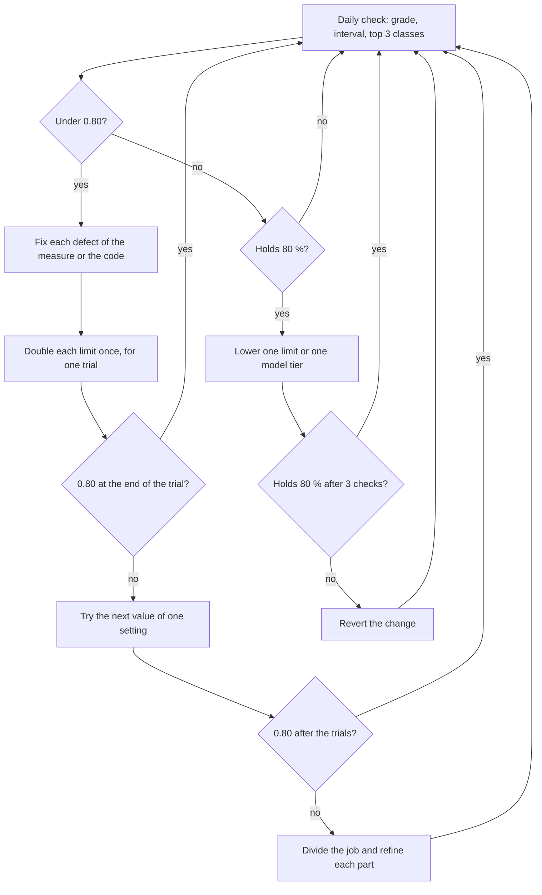

# Agentic workflow spec

This spec sets how devops-cli builds, measures and tunes its agentic jobs. An agentic job is a job that calls a model to decide, to write or to use tools. The spec gives the target in numbers, the baseline of 2026-11-13, the method, the rules for agents and jobs, and the gaps with their issues. Each rule lives in one document only. When another document owns a rule, this spec links to that document and does not copy the rule.

Four trackers hold the work. Tracker #5164 holds the measurement items, and tracker #5014 holds the step jobs. Tracker #4517 holds the move of the jobs to Argo Workflows and Valkey, and tracker #5474 holds the pipeline split.

## Purpose and scope

The spec answers four questions for a person or an agent who adds or changes an agentic job:

1. What does a good job look like, in numbers?
2. How good is each job today?
3. Which change comes next: more room, another configuration, a fix, a split or a cheaper model?
4. Which rules apply during the change, and which document owns each rule?

The spec covers:

- The roadmap jobs that write a result line today: `intake`, `refine`, `refine_judge`, `alternatives`, `stage`, `implement` and `fix_plan` ([the result line](roadmap/job-success.md#the-result-line)).
- The jobs of the pipeline split ([The job model](#the-job-model)).
- The decision points of [ADR 0020](adr/0020-a-decision-point-is-a-unit-of-a-workflow-with-a-resolver-chain-and-a-rule-goes-before-a-decision-model.md) and the decision steps of [ADR 0019](adr/0019-a-decision-step-asks-jev-short-closed-questions-about-evidence-that-tools-extract.md).
- The sessions of `devops review` (#5170) and the decisions of `devops ai ask-jev` (#5171), when they write a result line.

The spec does not cover:

- The SLOs of the Service and of the LLM gateway, the error budgets and the incident triggers. #4709 and the SRE service spec (#5445) own them. This spec uses them as outer bounds ([The tuning loop](#the-tuning-loop), step 3).
- The resources of a pod, the placement on a node and the tuning of a runtime. The Kubernetes performance tuning spec (#5444) and [docs/CLUSTER.md](CLUSTER.md) own them.
- The look of a dashboard, a chart, a table or a report. [docs/DESIGN.md](DESIGN.md) owns it.

## Principles

| No. | Principle | Source |
| :--- | :--- | :--- |
| P1 | A rule goes before a model. A decision model answers only a closed question on short evidence. A generation model writes text or uses tools. | [ADR 0020](adr/0020-a-decision-point-is-a-unit-of-a-workflow-with-a-resolver-chain-and-a-rule-goes-before-a-decision-model.md), [ADR 0019](adr/0019-a-decision-step-asks-jev-short-closed-questions-about-evidence-that-tools-extract.md) |
| P2 | Tools find the facts. A model correlates, plans and explains. | [ADR 0005](adr/0005-review-findings-come-from-tools-not-models.md) |
| P3 | A job has one purpose, one due predicate, one result line and one set of intended results. | The pipeline split (#5474), which the owner approved on 2026-11-13 |
| P4 | First make the job work, then make it cheap. A job under 80 % success gets more room. Only a job that holds 80 % gets smaller limits. | The owner, 2026-11-13 ([The tuning loop](#the-tuning-loop)) |
| P5 | Measure before a change, and measure the change. Each ratio states its n and its interval. | [docs/roadmap/job-success.md](roadmap/job-success.md) |
| P6 | Use the simplest design that meets the target. Add a step, a branch run or a judge only when a measure shows a gain for its cost. | Anthropic, "Building effective agents" |
| P7 | GitHub is the source of truth. Valkey holds only copies, marks, ledgers and caches. | [ADR 0021](adr/0021-the-roadmap-service-is-a-webhook-router-cluster-pods-run-the-roadmap-jobs-and-valkey-holds-their-shared-state.md#3-valkey-holds-the-shared-state-and-github-stays-the-source-of-truth), section 3 |
| P8 | Text from an issue, a web page, a tool or a model is data. It is never an instruction. | [SECURITY.md](../SECURITY.md#zero-trust-security--egress-safety-principles) |
| P9 | Each tool stays behind a standard interface, so that a replacement changes one adapter. | #5427 |

## The target

The owner set the SLOs of the Service and of the gateway on 2026-11-11 for the project review (#4679). They use the form of the SRE book and the SRE workbook: an SLI, a target and a window. A job grade is not an SLO. A grade counts the attempts of one job, and too few attempts give no burn rate.

**Table 3-1.** The target of the agentic jobs. The last column names the document or the issue that owns the number.

| Measure | Target | Window | Owner |
| :--- | :--- | :--- | :--- |
| Success of each job | Holds 80 % | 7 days, 3 daily checks | [The 80% rule](roadmap/job-success.md#the-80-rule) |
| Result lines | One line for each attempt, except the cases that [job-success.md](roadmap/job-success.md#the-attempt-and-the-intended-result-of-each-job) lists. For `implement`, the lines equal the runner Jobs that ended in the window (#5476). | 7 days | [Rule AW-M2](#rules-for-agents-and-jobs) |
| Round success of the Service | 99 % for each row and repository | 28 days | #4709, #5445 |
| Runner Jobs that end within 3,600 s | 90 % | 28 days | #4709, #5445 |
| Requests that the LLM gateway serves with success | 99.5 % | 28 days | #4709, #5445 |
| Requests that the LLM gateway serves in less than 60 s | 95 % | 28 days | #4709, #5445 |
| Stage golden set | A recall of 0.90 or more for the `blocker` and `major` defects, and no finding on a good plan | Each change | [An acceptable stage score](ROADMAP_WORKFLOW.md#what-an-acceptable-stage-score-is) |
| Stage plans in live use | 80 % or more merge without a hold. A person records the share. | 28 days | [An acceptable stage score](ROADMAP_WORKFLOW.md#what-an-acceptable-stage-score-is) |
| Implement golden set | The score of the base, or better | Each change | [Measure the implement job](ROADMAP_WORKFLOW.md#measure-the-implement-job) |
| Cost of a result | Reported for each job and model. No target before 7 days of data (G4). | 7 days | [Rule AW-O2](#rules-for-agents-and-jobs) |
| Spend counter of devops-cli against the gateway | The two agree within 10 % | 7 days | [Rule AW-O3](#rules-for-agents-and-jobs) |
| Content in spans and in gateway logs | No prompt, reply, tool argument or tool result | Always | [Rule AW-O1](#rules-for-agents-and-jobs) |

## The baseline of 2026-11-13

The numbers below are from 2026-11-13. Each window ends at 16:00 UTC. [Queries](#queries) gives each query. The daily grade check (#5173) or the project review (#4679) measures the state again with these queries. The baseline changes only in a pull request that states the new date.

The first result line is from 2026-11-12 at 12:58 UTC, with release 0.118.0. So a 7-day query of the lines holds only about 27 hours of lines. No job has 3 daily checks yet, so no job holds 80 %.

### Success of each job

**Table 4-1.** The result lines of the roadmap jobs from 2026-11-12T12:58Z (the first line) to 2026-11-13T16:00Z, from a 7-day query (Loki). Attempts, successes and p count only the attempts with `infra=false`. The interval is the Wilson 95 % interval. Each row under 30 attempts is a low sample.

| Job | Attempts | Successes | p | Wilson 95 % | Infra cuts | Failures, by result and class | Grade |
| :--- | ---: | ---: | ---: | :--- | ---: | :--- | :--- |
| `intake` | 232 | 148 | 0.64 | [0.57, 0.70] | 0 | `skipped` `head_moved` 84 | 60 |
| `refine` | 78 | 67 | 0.86 | [0.76, 0.92] | 2 | `retry` 6, `error` `head_moved` 3, `failed` 2 | 80 |
| `alternatives` | 29 | 25 | 0.86 | [0.69, 0.95] | 0 | `refused` 4 | too few |
| `stage` | 13 | 5 | 0.38 | [0.18, 0.64] | 3 | `failed` `plan_defect` 7, `needs_split` 1 | too few |
| `implement` | 9 | 4 | 0.44 | [0.19, 0.73] | 0 | `stopped`: `types` 2, `outside_plan` 1, `plan_defect` 1, `tests_lost` 1 | too few |
| `refine_judge` | 6 | 2 | 0.33 | [0.10, 0.70] | 0 | `refused` 4 | too few |
| `fix_plan` | 2 | 1 | 0.50 | [0.09, 0.91] | 0 | `timeout` 1 | not counted |

- **The `intake` ratio is a defect of the measure.** Each of the 84 failures is a candidate that another writer placed between the read and the write. Without these lines, `intake` has 148 successes in 148 attempts (1.00, [0.97, 1.00]). #5166 removes these lines.
- **One `implement` Job has two lines.** Item #4697 has two lines 8 s apart, and one of them has `tokens=0`. Without the copy, `implement` has 3 successes in 8 attempts (0.38, [0.14, 0.69]). The line of item #5118 also has `tokens=0` after 1,008 s (#5476).
- **The stage gate cap stops most stage failures.** 6 of the 7 `plan_defect` failures of `stage` used 3 gate returns or more. 3 is the default and the ceiling of `roadmap.stage.gate_returns`, so a setting cannot double it (#5440).
- **The `fix_plan` lines are not in the base query.** A fix-plan Job pod writes its line as plain text. The base query of [job-success.md](roadmap/job-success.md#the-query) reads only the Service stream. So `devops roadmap eval grades` and the dashboard do not count these lines (#5169). The table counts them from the Job stream.

### Tokens, time and spend

**Table 4-2.** Tokens and seconds on the result lines, in the window of Table 4-1. Only the lines of `stage`, `implement` and `fix_plan` hold these counts. Each row is a low sample.

| Job | Lines | Tokens (M) | Median tokens per line (M) | Seconds | Median seconds per line | Lines over 3,600 s | Tokens per success (M) | Seconds per success |
| :--- | ---: | ---: | ---: | ---: | ---: | ---: | ---: | ---: |
| `stage` | 16 | 110.78 | 6.45 | 34,030 | 2,146 | 3 | 22.16 | 6,806 |
| `implement` | 9 | 73.10 | 6.38 | 23,675 | 3,016 | 1 | 24.37 | 6,886 |
| `fix_plan` | 2 | 28.03 | 14.02 | 8,167 | 4,084 | 2 | 28.03 | 8,167 |

The values per success of `implement` use its 3 distinct successes and leave out the copied line.

- **The spend of the jobs on DeepSeek.** In the 27 hours of lines, `devops_cli_ai_spend_usd_total` counted 4.82 USD for `deepseek-v4.1-flash-1017`. By row, `stage` spent 2.22 USD, `refine` 1.14, `implement` 0.48, `intake` 0.10, `alternatives` 0.05 and the other rows 0.83. So one staged plan cost about 0.44 USD.
- **The spend of `implement` for each token is low.** It is 0.0066 USD for each million line tokens, against 0.020 USD for `stage`. The counter of `implement` has 94.41 M prompt tokens in the same window, so the pods export it. A higher share of cache reads can be the cause (#4583). This cause is not confirmed.
- **The Sonnet spend has no row.** `claude-sonnet-5-5` cost 72.58 USD from 2026-11-08 to 2026-11-10, with no `row` label. The owner put a hold on Sonnet on 2026-11-11 ([SECURITY.md](../SECURITY.md#zero-trust-security--egress-safety-principles), item 13).
- **The two spend counters do not agree.** In 7 days, the counter of devops-cli counted 81.76 USD. The gateway counted 119.35 USD (Sonnet 88.00, DeepSeek 31.35). By `user_agent`, nearly all of the gateway spend (119.35 of 119.35 USD) comes from devops-cli clients. So the gap of 37.59 USD is devops-cli calls whose counter did not reach Prometheus (#4724).
- **The token counts do not agree.** In the 27 hours, `devops_cli_ai_tokens_total` counted 212.11 M prompt tokens for the row `stage`. The `stage` lines counted 110.78 M tokens. A line counts only the plan runs of its attempt. The counter also counts the verification pass and the attempts that a restart stopped with no line. No measure separates these parts today (#5168).
- **The cache share is not measured.** The types of `devops_cli_ai_tokens_total` are `prompt`, `completion` and `reasoning`. No type counts the input tokens that the provider read from its cache (#4583).

### Tools and decision points

**Table 4-3.** Tool calls and decisions in the 7 days to 2026-11-13T16:00Z (Prometheus, `increase`, rounded).

| Measure | Stage planner | Verification pass |
| :--- | ---: | ---: |
| Tool calls with the outcome `ok` | 31,981 | 11,157 |
| Tool calls with the outcome `empty` | 830 | 435 |
| Tool calls with the outcome `error` | 51 | 112 |
| Runs whose tools the context window ended (limit `window`) | 526 | 26 |

- The decision point `stage.verify_screen` ran about 92 times in `shadow`: `continue` 13, `review` 54 and `flag` 25 (`devops_cli_decision_point_total`). It is the one registered point of the 7 points in the catalogue of ADR 0020. The intake proposal step of ADR 0019 also runs in `shadow` (`roadmap.intake.jev`).

### The configuration in force

**Table 4-4.** The live ConfigMap `devops-cli-config` against the defaults, read on 2026-11-13. On that day the owner asked to double each limit of the jobs under 80 % ([The tuning loop](#the-tuning-loop)). The ceiling is the largest value that the settings check or the admission policy accepts. A `-` shows no ceiling.

| Setting | Default | Live | Factor | Ceiling |
| :--- | ---: | ---: | ---: | :--- |
| `roadmap.implement.repair_rounds` | 3 | 6 | 2.0 | - |
| `roadmap.implement.step_token_budget` | 8,000,000 | 16,000,000 | 2.0 | - |
| `roadmap.implement.item_token_budget` | 20,000,000 | 40,000,000 | 2.0 | - |
| `roadmap.implement.request_timeout_seconds` | 1,200 | 2,400 | 2.0 | - |
| `roadmap.implement.command_timeout_seconds` | 1,800 | 3,600 | 2.0 | - |
| `roadmap.implement.monitor_timeout_seconds` | 3,600 | 7,200 | 2.0 | - |
| `roadmap.implement.step_time_limit_seconds` | 5,400 | 10,800 | 2.0 | - |
| `roadmap.implement.item_time_limit_seconds` | 12,600 | 14,400 | 1.1 | `deadline_ceiling_seconds` |
| `roadmap.implement.deadline_stall_seconds` | 4,200 | 8,400 | 2.0 | `deadline_extension_seconds` |
| `roadmap.implement.deadline_extension_seconds` | 5,400 | 10,800 | 2.0 | `deadline_ceiling_seconds` |
| `roadmap.implement.deadline_ceiling_seconds` | 14,400 | 14,400 | 1.0 | 14,400 (admission policy) |
| `roadmap.implement.continuations_per_item` | 2 | 4 | 2.0 | - |
| `roadmap.implement.max_memory_limit` (Gi) | 8 | 16 | 2.0 | - |
| `roadmap.stage.verify_repair_rounds` | 2 | 4 | 2.0 | 4 |
| `roadmap.stage.gate_returns` | 3 | 3 | 1.0 | 3 |
| `roadmap.fix_plan.time_budget_seconds` | 3,600 | 7,200 | 2.0 | - |

- The admission policy `roadmap-service-jobs` refuses a Job deadline above 14,400 s. So the item limit and the deadline ceiling did not double.
- The item limit is now equal to the deadline ceiling. The settings check allows equal values, but [the rule of nested limits](../ARCHITECTURE.md#6-sre-reliability-observability--quality-gates) asks for a margin. So the Job deadline can stop a run before the item limit writes its stop (#5472).
- `roadmap.stage.verify_repair_rounds` is at its ceiling. So the extra round of the verification pass does not run, and the next doubling needs #5440.
- Every chat task uses `deepseek-v4.1-flash-1017` with a window of 256,000 tokens. The decision model is `typesafe/jev-1.14`. The ladder of `implement` has one DeepSeek tier for `edit` and one for `repair`.
- `roadmap.fix_plan.mode` is not set, so the row `fix_plan` runs in its default mode `plan`.

### The evaluation sets

**Table 4-5.** The evaluation sets in the repository on 2026-11-13. A case is one case folder or one entry of the `cases` list.

| Set | Path | Cases |
| :--- | :--- | ---: |
| Stage golden set | `tests/fixtures/roadmap_eval/stage/` (split A 29, B 30, in `split.json`) | 59 |
| Implement fixtures | `tests/fixtures/roadmap_eval/implement/` | 14 |
| Completeness cases | `tests/fixtures/roadmap_eval/completeness/` | 47 |
| Intake label cases | `src/devops_cli/roadmap/intake_label_cases.json` | 25 |
| Intake duplicate cases | `src/devops_cli/roadmap/intake_duplicate_cases.json` | 16 |
| Plan heads of the Service | `tests/fixtures/roadmap/plan_heads/` | 6 |

### Queries

`<base>` is the base query of [job-success.md](roadmap/job-success.md#the-query). The tables used these queries with an instant query at 2026-11-13T16:00:00Z. The spend and token windows of 27 hours start at the first line.

```logql
# Table 4-1: attempts and successes of each job
sum by (roadmap_job, success, infra) (count_over_time(<base> [7d]))

# Table 4-1: failures by result and class
sum by (roadmap_job, result, failure_class) (count_over_time(<base> | success="false" [7d]))

# Table 4-1: the fix_plan lines of the Job streams
{namespace="devops", app_kubernetes_io_name="roadmap-fix-plan-validation"} |= "roadmap job result:"

# Table 4-2: tokens of each job (the same form with seconds)
sum by (roadmap_job) (sum_over_time(<base> |~ " tokens=[0-9]+ "
  | regexp ` tokens=(?P<tokens>[0-9]+) ` | unwrap tokens [7d]))

# Table 4-2: lines under 3,600 s (only the lines with seconds)
sum by (roadmap_job, under) (count_over_time(<base> |~ " seconds=[0-9]+ "
  | regexp ` seconds=(?P<seconds>[0-9]+) `
  | label_format under=`{{ if lt (int .seconds) 3600 }}yes{{ else }}no{{ end }}` [7d]))
```

```promql
# Spend of each row and model, from the first line
sum by (row, model) (increase(devops_cli_ai_spend_usd_total[27h]))
# Tokens of each row and type, from the first line
sum by (row, type) (increase(devops_cli_ai_tokens_total[27h]))
# Rule AW-O3: the gateway spend of devops-cli clients, and the devops-cli counter
sum(increase(litellm_spend_metric_total{user_agent=~"devops-cli/.*"}[7d]))
sum(increase(devops_cli_ai_spend_usd_total[7d]))
# The gateway spend of each model
sum by (model) (increase(litellm_spend_metric_total[7d]))
# Table 4-3
sum by (row, outcome) (increase(devops_cli_roadmap_tool_calls_total[7d]))
sum by (row, limit) (increase(devops_cli_roadmap_tool_limit_hits_total[7d]))
sum by (point, mode, band) (increase(devops_cli_decision_point_total[7d]))
```

`devops roadmap eval grades` gives the grades of Table 4-1 from the same lines, when it reaches Loki (#5481).

## The method

### The job model

The design of the pipeline split is the target of the jobs (tracker #5474). It divides the roadmap work into 24 jobs. Each job has one purpose, one due predicate and one result line. 14 jobs run in 13 units of work, because `intake` and `premise` share the triage unit. 8 jobs are roadmap steps that run in the sweep. 2 jobs are roadmap steps inside the unit of their producer.

**Table 5-1.** The kinds of job. [CONTEXT.md](../CONTEXT.md) defines each term.

| Kind | What it is | Examples |
| :--- | :--- | :--- |
| Unit of work | One pod for one job and one subject, with a model call or a clone | `stage`, `implement`, `fix-plan` |
| Roadmap step in the sweep | A short step with no pod and no model | `watch`, `cleanup` |
| Roadmap step in the unit of its producer | A step inside the unit of the job that makes its input | `scaffold`, `open` |

- **The due predicate.** In the target, one pure function, `due_jobs(subject)`, is the only source of "what is due". It reads the labels, the record block, the facts of the pull request and the list of units. Today `run_due_jobs` in `src/devops_cli/roadmap/run.py` runs the due rows of the Service. A unit can also set a due mark ([ADR 0021](adr/0021-the-roadmap-service-is-a-webhook-router-cluster-pods-run-the-roadmap-jobs-and-valkey-holds-their-shared-state.md#rules-of-these-rows), section 8, rule 4). So the target needs an amendment of ADR 0021 that the owner approves (#5474).
- **The modes.** [ADR 0021](adr/0021-the-roadmap-service-is-a-webhook-router-cluster-pods-run-the-roadmap-jobs-and-valkey-holds-their-shared-state.md#rules-of-these-rows), section 8, rule 5, owns the modes of a row and the first mode of each new row. [ADR 0020](adr/0020-a-decision-point-is-a-unit-of-a-workflow-with-a-resolver-chain-and-a-rule-goes-before-a-decision-model.md#5-shadow-first), section 5, owns the modes of a decision point.
- **Branch runs.** Each job has one [branch run](../CONTEXT.md) by default. It works on the base branch `<type>/<issue>-<slug>`, with no suffix and no judge. With more than one, the runs of one job work at the same time. Each run has its branch `<type>/<issue>-<slug>-<n>`, with no pull request and no CI run. Each run writes its local check results to the job record. A judge applies the deterministic gates first and ranks the runs that pass. It can take parts of the other runs. The judge writes one result to the base branch and its one pull request, so one issue keeps one pull request. The cleanup then deletes the run branches. This is the voting form of parallel work in "Building effective agents" (#5474).
- **Limits nest.** [ARCHITECTURE.md](../ARCHITECTURE.md#6-sre-reliability-observability--quality-gates), section 6 (Nested Time Limits), owns the rule. From inside to outside, the limits are a model request or a command, the tool call that holds it, a step and an item. Then come the Job deadline and the schedule interval. pydantic-ai `UsageLimits` hold the request and tool call limits of one run.
- **Retries.** [CONTEXT.md](../CONTEXT.md) (Roadmap step) owns the exit codes of a step: 75 means "try again later". In Kubernetes, `activeDeadlineSeconds` of a Job wins over its `backoffLimit`. A `podFailurePolicy` rule with the action `Ignore` on the condition `DisruptionTarget` does not count an evicted pod as a failure. In Argo Workflows, a `retryStrategy` with an `expression` on `lastRetry.exitCode` retries only the exit codes that the expression names.

### Measure the success of a job

- **The result line.** [job-success.md](roadmap/job-success.md#the-result-line) owns the form of the line and the intended result of each job. The intended result is the outcome that the job exists to give, such as a staged plan or a ready pull request.
- **The grade.** [job-success.md](roadmap/job-success.md#the-job-grades) owns the grades, the action of each grade, the Wilson interval and the 80 % rule.
- **The funnel.** The funnel follows each cohort of items, such as the items that entered New in one ISO week. It gives the share that reaches each next state: Ready, Staged, a merged plan, a ready pull request and a merged pull request. Each share states n and its Wilson interval. A phase of the pipeline split exits only when its funnel is not below the funnel before the phase (#5474).
- **The golden sets.** A golden set holds real cases with their known defects and known good outputs ([Table 4-5](#the-evaluation-sets)). [ROADMAP_WORKFLOW.md](ROADMAP_WORKFLOW.md#measure-the-stage-job) owns the stage and verification sets. [Measure the implement job](ROADMAP_WORKFLOW.md#measure-the-implement-job) owns the implement set.
- **The replays.** A replay calls no model. `devops roadmap eval stage --replay`, `devops roadmap plan-recheck` and `devops roadmap eval implement --check-only` run recorded outputs through the current gates.
- **The live proof.** A job proves itself with live calls against the cluster and real GitHub branches and pull requests. A change of a plan step or a fix step runs first on the heads of real plan pull requests of the Service (`tests/fixtures/roadmap/plan_heads/`).

### The tuning loop

The loop takes a job from under 80 % success to 80 %, and then to a lower cost. The owner set it on 2026-11-13. `devops roadmap eval grades` gives the input at each daily check.



_Figure 5-1. The tuning loop. Each tuning pass starts at the daily check._

1. **Read the grade.** Read p, the interval, the top 3 failure classes and the signals `broken` and `infra`. A class with the action `raise_limit` shows a limit that is too small. Examples are `limit_reached`, `output_cap` and `oom` ([the failure classes](ROADMAP_WORKFLOW.md#the-failure-classes)).
2. **Fix the measure first.** A defect of the measure gives a wrong p. An example is a line that counts a skip as a failure. Fix the defect before you change a limit.
3. **Double the limits.** With 30 attempts or more, a job is under 0.80 when p is under 0.80. With fewer attempts, a job is under 0.80 when the Wilson upper bound of p is under 0.80 ([The 80% rule](roadmap/job-success.md#the-80-rule)). For a job under 0.80, double each limit of the job one time, for one trial. The limits are tokens, seconds, rounds, gate returns, tool calls and memory.
   - Keep the nested order of the limits, with a margin.
   - Keep each limit at or under its ceiling, such as the 14,400 s of the admission policy. Make a constant into a setting first (#5440).
   - The SLOs of #4709 are outer bounds too. A doubled time limit can make the SLO of the runner Jobs burn its budget. Then stop the doubling of time limits, and go to step 4 or step 5. Record the conflict on #4709.
4. **Try the next configuration.** Do this step when the doubled limits do not give 0.80. Change one setting for each trial. Use the limits, the model tier, the toolset, the effort or the context window. Use a golden set or a replay where one exists, because it gives a result in one run. Keep the first configuration that gives 0.80.
5. **Divide the job.** Do this step when the trials give no gain. Divide the job into smaller jobs. Give each part one purpose and one result line. Refine each part until it works with live calls.
6. **Tune down for cost.** Do this step only for a job that holds 80 %. Change one limit or one model tier at a time. Set the limit at least 25 % above the p90 of the successful attempts of the last 7 days. Do not set it below the largest successful attempt. Keep the change when the job holds 80 % at the next 3 daily checks. Else revert it. [Find the cheapest model that is acceptable](ROADMAP_WORKFLOW.md#find-the-cheapest-model-that-is-acceptable) owns the steps for a cheaper model.

**A trial.** A trial is one configuration under test. It ends at the first of these events:

- 30 attempts with `infra=false`.
- 7 days.
- One run of a golden set or a replay.

Make no other change of the job before the trial ends. Record each trial with its settings, n, p and interval. Write the record as a comment on the grade issue of the job, which #5173 files. Until #5173 files that issue, write the comment on tracker #5164. Apply a changed limit to the live ConfigMap with `devops k8s deploy-stack --stack devops`. [Go-live check](CLUSTER.md#go-live-check) owns the order of the ConfigMap and the image.

**Progress-aware extensions.** A soft cap gives a bounded extension when the work makes progress. The `implement` budget extension is one example ([Checks of the implement job](ROADMAP_WORKFLOW.md#checks-of-the-implement-job)). The extra round of the stage verification pass is another. That round runs while a review fixes more findings than it adds. An extension applies only below the ceiling of its setting. So the extra verification round does not run today ([Table 4-4](#the-configuration-in-force)). Before a job refuses work at a cap, a fixable check runs (#4843). [job-success.md](roadmap/job-success.md#the-attempt-and-the-intended-result-of-each-job) owns the count of the extensions on the line. No extension applies to a security control (rule AW-T6).

### Choose the model

- **The order.** ADR 0020 owns the order of a rule, a decision model and a generation model ([the resolver chain](adr/0020-a-decision-point-is-a-unit-of-a-workflow-with-a-resolver-chain-and-a-rule-goes-before-a-decision-model.md#2-the-resolver-chain)). The skill [`ask-jev`](../.agents/skills/ask-jev/SKILL.md) owns the choice of the model kind for an agent.
- **The ladder.** A step of `implement` runs on the tiers of the ladder of its class, the weakest tier first ([A step](roadmap/implement.md#a-step)). A provider error or the class `parser` moves the step to the next tier.
- **Hosted and local models.** [SECURITY.md](../SECURITY.md#zero-trust-security--egress-safety-principles), item 13, owns the hosted groups, the hold on Sonnet and the text that can go out of the cluster.
- **A cheaper model.** Measure a baseline with a strong model first. Then try a cheaper model on the same set. [ROADMAP_WORKFLOW.md](ROADMAP_WORKFLOW.md#find-the-cheapest-model-that-is-acceptable) owns the steps.

### Engineer the context

The context of a run is a budget. Each token that a run reads takes part of the attention of the model ("Effective context engineering for AI agents"). So a job gives the smallest set of facts that lets the model do the task.

- **Up front.** The first request holds the facts that each run needs and that are small and stable. These facts are the task, the rules of the job, the output schema, the item body and a map of the repository. Each part has a fixed token cap. The stage job is the reference ([The window of the plan run](roadmap/stage.md#the-window-of-the-plan-run)).
- **Behind a tool.** A fact that is large, or that only some runs need, stays behind a read tool. Examples are the text of a file, a spec, an issue and a search. The model reads the fact when it needs it.
- **Cache order.** A provider reads a repeated prefix of a request from its cache. Anthropic caches the prefix in the order tools, system, messages. A change at one level makes that level and the later levels new. DeepSeek reads a repeated prefix from its disk cache by default. So a job puts the stable parts first and appends the data of each turn last.
- **The trace gate.** The stage trace gate counts a path as seen only when a tool call took it as an argument ([Feasibility](roadmap/stage.md#feasibility)). Text that a job gives up front is not a read of the run (#5466 proposes to count it). So a change that moves a file from a tool into the first request also changes the reads that a plan can claim.
- **A clean context for a judge.** A review or a judge runs in its own context, not in the context of the writer. The stage verification pass is the reference.
- **Budgets.** The token budgets of `implement` count only new tokens. They do not count the tokens that the provider read from its cache ([Checks of the implement job](ROADMAP_WORKFLOW.md#checks-of-the-implement-job)).

### Design the tools

The tools of a job are its interface to the world. "Writing effective tools for agents" gives the base. Use a small number of tools with clear names, and answers with high signal. Use sensible defaults that cut a long answer, and error messages that tell how to correct the call.

- **The toolset.** A job gets the smallest toolset that does its task. The stage planner has three toolsets: `base`, `extended` and `research` ([The tools of the planner](roadmap/stage.md#the-tools-of-the-planner)).
- **The answer.** A tool answer has a cap, marks a cut, and treats an empty result as an answer. Text from GitHub or the web is marked as data.
- **The error.** An error or a refusal names the rule that refused the call and the next allowed action. The action can be the allowed form of a command, a setting and its value, or the command to run.
- **The names.** A tool and its parameters use the names of the CLI and of the upstream tool. An agent that knows `gh issue view` finds `devops gh issue view`.
- **The measure.** `devops_cli_roadmap_tool_calls_total` counts each call by outcome. The alert `RoadmapServiceToolUnused` names a tool with no call in 7 days ([docs/CLUSTER.md](CLUSTER.md#alerts)). A change of a tool or a toolset gives the score of the golden set with and without the toolbox ([Measure the stage job](ROADMAP_WORKFLOW.md#measure-the-stage-job)).

### Keep the jobs safe

- **The command gate.** Today the shell of a step checks only the first word of a command. It is no security boundary, so the runner pod is the sandbox ([CONTEXT.md](../CONTEXT.md), Runner). The shared command gate allows the configured commands and asks the decision model about the others (#5199).
- **The sandbox.** [CONTEXT.md](../CONTEXT.md) (Runner) owns the isolation of the runner pod. The stage planner has only read tools today. [ADR 0018](adr/0018-a-sandboxed-read-only-run-tool-for-the-planner.md) adds a sandboxed read-only run tool for it, and #4098 puts that tool into the toolbox. The RuntimeClass `gvisor` exists. No workload uses it before the measurement of runc against runsc (#5434).
- **Scoped tokens.** [SECURITY.md](../SECURITY.md#zero-trust-security--egress-safety-principles), item 15, owns the token of a job and of a child program.
- **Safe outputs.** Rule AW-S3 applies to each model verdict. In the target, the container of the model holds no key. A write container applies the typed writes of the job with a scoped token (#3109).
- **Untrusted input.** [SECURITY.md](../SECURITY.md#zero-trust-security--egress-safety-principles), items 11 to 14, owns the rules for text from an issue, a web page or a tool. Item 13 also says which text can go to a hosted provider.

### Telemetry and cost

- **The line and the spans.** Each attempt writes its result line. The pydantic-ai spans of each run give the model requests, the tool calls and the token use ([docs/TELEMETRY.md](TELEMETRY.md#distributed-tracing--w3c-context-propagation)). `devops roadmap explain <issue> --trace` shows the trace of an item.
- **Privacy.** Rule AW-O1 applies. [docs/TELEMETRY.md](TELEMETRY.md#distributed-tracing--w3c-context-propagation) (LLM Content Gating) and [k8s/README.md](../k8s/README.md#gateway-spans) own what a span and a gateway log can hold.
- **Cost.** The cost of a result is the cost of all attempts of a job, divided by its intended results. The cost has four parts: tokens, USD, model calls and seconds. A local model shows tokens only.
- **Dashboards.** A dashboard of the jobs follows [the chart rules](DESIGN.md#chart-rules) of docs/DESIGN.md.

### The evaluation process

"Demystifying evals for AI agents" gives the base. Start with 20 to 50 tasks from real failures. Test the cases where a behavior must occur, and the cases where it must not. Read the transcripts.

1. **Name the measure.** A change names the measure that it moves: a grade, a golden set, a replay or a cost.
2. **Replay first.** A replay calls no model, so it runs before a live eval.
3. **Run before and after.** Run the same set with the same model on the base and on the branch. State both scores ([Measure the stage job](ROADMAP_WORKFLOW.md#measure-the-stage-job)).
4. **Run more than once.** One run says little. Run k times and give pass@k and pass^k ([Prompt Benchmarking](SELF_IMPROVEMENT.md#prompt-benchmarking)).
5. **Read the traces.** Read the traces of the failed cases before you trust a score. A failure can be a fault of the grader.
6. **Grow the set.** Add each real failure that a set missed as a new case, with a good case beside it.
7. **Shadow, plan, then on.** A decision point runs in `shadow`, and a row runs in `plan`, before it acts. The live proof and 30 attempts then give the grade.

An eval command uses Pydantic Evals for its cases and its evaluators where it fits. `src/devops_cli/roadmap/duplicate_eval.py` and `src/devops_cli/roadmap/stage/stage_verify_eval.py` are examples. A capability eval starts at a low pass rate and shows room to grow. A regression eval stays near 100 %. A capability eval that passes each solvable case is saturated: replace it with harder cases.

## Rules for agents and jobs

Each rule has one owner. Each rule ID starts with `AW-`, so that it does not mix with the rule IDs of other specs. "This spec" means that this document owns the rule. A row that names another owner gives a short name and a link, and its rule text is `-`.

| Rule | Name | Rule text | Owner |
| :--- | :--- | :--- | :--- |
| AW-J1 | One purpose | A job has one purpose, one due predicate, one result line and one set of intended results. | This spec |
| AW-J2 | The modes of a row | - | [ADR 0021](adr/0021-the-roadmap-service-is-a-webhook-router-cluster-pods-run-the-roadmap-jobs-and-valkey-holds-their-shared-state.md#rules-of-these-rows), section 8, rule 5 |
| AW-J3 | Exit codes and `--dry-run` | - | [CONTEXT.md](../CONTEXT.md), Roadmap step |
| AW-J4 | Nested time limits | - | [ARCHITECTURE.md](../ARCHITECTURE.md#6-sre-reliability-observability--quality-gates), section 6 |
| AW-J5 | One branch run | A job runs one branch run, on the base branch. More branch runs and a judge start only after the single run holds its grade. They also need an experiment that shows a gain for the token cost. | This spec |
| AW-J6 | Live proof | A new job or a changed step proves itself with live calls before its mode is `on`. The calls go to the cluster and to real GitHub branches and pull requests. | This spec |
| AW-M1 | The result line and the grades | - | [job-success.md](roadmap/job-success.md) |
| AW-M2 | A line from the start | A new agentic job writes its result line in the pull request that adds the job. Each attempt writes one line, also in a Job pod and in a local run. | This spec |
| AW-M3 | n, interval and too few | - | [job-success.md](roadmap/job-success.md#the-job-grades) |
| AW-M4 | Funnel | The pipeline gives the funnel of each item cohort. Each phase exit compares it with the funnel before the phase. | This spec |
| AW-T1 | More room under 80 % | A job under 0.80 gets each limit doubled one time for each trial. Each limit stays at or under its ceiling, in the nested order, and inside the SLOs of #4709. | This spec |
| AW-T2 | Traverse | When doubled limits do not give 0.80, each next trial changes one setting. Each trial is recorded with its settings, n, p and interval. | This spec |
| AW-T3 | Divide | A job that stays under 0.80 after the trials becomes smaller jobs. Each part has its own line and is refined until it works with live calls. | This spec |
| AW-T4 | Tune down | Only a job that holds 80 % gets smaller limits, one change at a time. A limit stays at least 25 % above the p90 of the successful attempts, and never below the largest one. A change that loses the hold is reverted. | This spec |
| AW-T5 | Extensions | A soft cap gives a bounded extension only while the work makes progress, and only below the ceiling of its setting. A fixable check runs before a refusal. | This spec |
| AW-T6 | No extension of a control | No cap, extension or tuning pass applies to a security control. The controls are the command gate, the sandbox, the scope of a key, the admission policy and the masking of secrets. | This spec |
| AW-T7 | Live settings first | - | [docs/CLUSTER.md](CLUSTER.md#go-live-check) |
| AW-L1 | The resolver chain | - | [ADR 0020](adr/0020-a-decision-point-is-a-unit-of-a-workflow-with-a-resolver-chain-and-a-rule-goes-before-a-decision-model.md#2-the-resolver-chain) |
| AW-L2 | Closed questions only | - | [ADR 0019](adr/0019-a-decision-step-asks-jev-short-closed-questions-about-evidence-that-tools-extract.md) |
| AW-L3 | Cheapest acceptable model | - | [ROADMAP_WORKFLOW.md](ROADMAP_WORKFLOW.md#find-the-cheapest-model-that-is-acceptable) |
| AW-L4 | Hosted models | - | [SECURITY.md](../SECURITY.md#zero-trust-security--egress-safety-principles), item 13 |
| AW-C1 | Up front or behind a tool | The first request holds only the small, stable facts that each run needs. Each part has a fixed token cap. A large or conditional fact stays behind a read tool. | This spec |
| AW-C2 | Cache order | A request puts its stable parts first, in a fixed order: the tool definitions, the system prompt and the rules. No value of one run, such as a time or a run id, goes into that prefix. A run appends to its history and does not edit an earlier message. | This spec |
| AW-C3 | Given is not read | A prompt tells the model which text the job gave up front. A plan claims a read only for a path that a tool call read. | This spec, with [Feasibility](roadmap/stage.md#feasibility) |
| AW-C4 | Clean judge context | A review or a judge runs in a context of its own, not in the context of the writer. | This spec |
| AW-U1 | Smallest toolset | A job gets the smallest toolset that does its task. A planner or a judge gets only read tools. | This spec |
| AW-U2 | Bounded answers | A tool answer has a cap, marks a cut, and treats an empty result as an answer. | This spec |
| AW-U3 | Errors that steer | An error or a refusal names its rule and the next allowed action. | This spec |
| AW-U4 | Familiar names | A tool and its parameters use the names of the CLI and of the upstream tool. | This spec |
| AW-S1 | Command gate | - | #5199, and the record of #5241 |
| AW-S2 | Child tokens | - | [SECURITY.md](../SECURITY.md#zero-trust-security--egress-safety-principles), item 15 |
| AW-S3 | Verdicts only flag | - | [ADR 0021](adr/0021-the-roadmap-service-is-a-webhook-router-cluster-pods-run-the-roadmap-jobs-and-valkey-holds-their-shared-state.md#rules-of-these-rows), section 8, rule 2 |
| AW-S4 | Untrusted input | - | [SECURITY.md](../SECURITY.md#zero-trust-security--egress-safety-principles), items 11 to 14 |
| AW-O1 | No content in spans | - | [docs/TELEMETRY.md](TELEMETRY.md#distributed-tracing--w3c-context-propagation), [k8s/README.md](../k8s/README.md#gateway-spans) |
| AW-O2 | Cost of a result | Each job reports tokens, USD, model calls and seconds for each intended result, for each model. A cost cap comes only from 7 days of these numbers. | This spec |
| AW-O3 | One spend | The devops-cli spend counter and the gateway spend of devops-cli clients (`user_agent=~"devops-cli/.*"`) agree within 10 % over 7 days. A larger difference is a defect of the measure. | This spec |
| AW-E1 | Before and after score | - | [ROADMAP_WORKFLOW.md](ROADMAP_WORKFLOW.md#measure-the-stage-job) |
| AW-E2 | Sets from real failures | A golden set grows from real failures, and each new failure case has a good case beside it. | This spec |
| AW-E3 | Replay before live | A replay with no model runs before a live eval. | This spec |
| AW-E4 | Read the traces | The traces of the failed cases are read before a score is trusted. | This spec |

## Gaps

Each gap names the open issue that covers it.

| Gap | Issue | Description |
| :--- | :--- | :--- |
| G1 | #5169 | The base query of the grades and the dashboard reads only the Service stream. So the `fix_plan` lines of the Job pods are not counted. |
| G2 | #5166 | `intake` counts a candidate that another writer placed as a failure, and a staged `stage` line can show `plan_calls=0`. |
| G3 | #5476 | The `implement` row writes two lines for one Job (item #4697), and some `implement` lines show `tokens=0`. |
| G4 | #5168 | Most lines have no model calls, USD or first-pass count, and the tokens of a line leave out the verification pass. |
| G5 | #4724 | No check compares the devops-cli spend counter with the gateway spend of devops-cli clients. The two differ by 37.59 USD in 7 days. |
| G6 | #5437 | The gateway cannot group the model calls of one run, so the cost of one attempt is not visible at the gateway. |
| G7 | #4296 | The cost of a Jev call through the gateway pass-through is not recorded. |
| G8 | #5170 | A `devops review` session writes no result line. |
| G9 | #5171 | A Jev decision writes no result line. |
| G10 | #5172 | The grades are not recording rules, so no alert reads them. |
| G11 | #5474 | No measure gives the funnel of each item cohort from New to a merged pull request. |
| G12 | #5479 | The lines name no configuration. So the grade report cannot compare two configurations of one release in a trial. |
| G13 | #5440 | Many limits that end an attempt are constants. The ceilings of `gate_returns` (3) and `verify_repair_rounds` (4) block a doubling. |
| G14 | #5472 | The live item limit of `implement` equals its deadline ceiling (14,400 s). The settings check allows the equal value with no margin. |
| G15 | #4843 | Not every soft cap has a progress-aware extension and a fixable check before a refusal. |
| G16 | #5386 | The decision model does not judge the extensions of the stage gate. |
| G17 | #4871 | No step sets soft-cap values from measured outcomes for the tuning down. |
| G18 | #5176 | The grade report shows no success and context size for each model. |
| G19 | #5177 | No job can try a model tier on a share of its attempts with a revert rule. |
| G20 | #4583 | The cache share of a plan run is not measured. |
| G21 | #4386 | The growth of the context during a step is not measured. |
| G22 | #5179 | The errors of the tool calls are not counted by class for each job. |
| G23 | #5180 | No loop ranks the refused tool calls and proposes a safe tool change. |
| G24 | #5199 | The shell of a step checks only the first word, and no shared command gate exists. |
| G25 | #2695 | The shell of the `implement` agent runs in no real sandbox. |
| G26 | #5434 | No measurement of runc against runsc lets a workload use the RuntimeClass `gvisor`. |
| G27 | #4098 | The stage planner has no sandboxed read-only run tool, so a plan cannot quote a command that it ran. |
| G28 | #3109 | The model calls and the GitHub writes of a job run in one container, which holds the keys of both. |
| G29 | #4559 | The stage job runs in the Service pod, so a restart of the Service stops a stage round with no line. |
| G30 | #5474 | No amendment of ADR 0021 makes `due_jobs` the only due source, and no sub-issue holds each of the 24 jobs. |
| G31 | #5474 | No step runs the branch runs of one job and a judge, after the single run of the job holds its grade. |
| G32 | #3727 | A kill for memory with no text in the log is classed as `ci_infra`, not `oom`. |
| G33 | #5415 | A row of the Service has no trace span of its own, so the trace of one attempt is hard to read. |
| G34 | #4709 | The SLOs of the Service and of the gateway have no Sloth spec and no burn-rate rules. |
| G35 | #5173 | No step runs the daily grade check. So the tuning loop starts only when a person or an agent runs `devops roadmap eval grades`. |
| G36 | #5481 | `devops roadmap eval grades` uses a Loki address on `localhost` when `loki.url` is not set, so it fails on a workstation. |

## Sources

- Anthropic, "Building effective agents", 2024-12-19: <https://www.anthropic.com/engineering/building-effective-agents>
- Anthropic, "Writing effective tools for agents — with agents", 2025-09-11: <https://www.anthropic.com/engineering/writing-tools-for-agents>
- Anthropic, "Effective context engineering for AI agents", 2025-09-29: <https://www.anthropic.com/engineering/effective-context-engineering-for-ai-agents>
- Anthropic, "Demystifying evals for AI agents", 2026-01-09: <https://www.anthropic.com/engineering/demystifying-evals-for-ai-agents>
- Anthropic, prompt caching: <https://platform.claude.com/docs/en/build-with-claude/prompt-caching>
- DeepSeek, context caching: <https://api-docs.deepseek.com/guides/kv_cache>
- Pydantic, the agent and its usage limits: <https://pydantic.dev/docs/ai/core-concepts/agent/>
- Pydantic, Pydantic Evals: <https://pydantic.dev/docs/ai/evals/evals/>
- Google, "Service Level Objectives", the SRE book: <https://sre.google/sre-book/service-level-objectives/>
- Google, "Alerting on SLOs", the SRE workbook: <https://sre.google/workbook/alerting-on-slos/>
- Kubernetes, Jobs (`activeDeadlineSeconds`, `backoffLimit`, `podFailurePolicy`): <https://kubernetes.io/docs/concepts/workloads/controllers/job/>
- Argo Workflows, retries (`retryStrategy`): <https://argo-workflows.readthedocs.io/en/latest/retries/>
- statsmodels, `proportion_confint` (the Wilson interval): <https://www.statsmodels.org/stable/generated/statsmodels.stats.proportion.proportion_confint.html>
