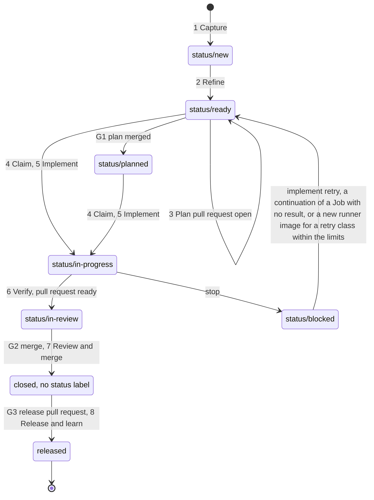

# The roadmap workflow

This page is the one place that names the steps of an issue's life, from the first report to the release. Other documents link here and do not repeat the steps. A test (`tests/invariants/test_roadmap_workflow_doc.py`) keeps this page in step with `.github/labels.yml` and with the code. The modules of the jobs are in the subpackages of `src/devops_cli/roadmap/`, and [the package layout](roadmap/package-layout.md) lists them.

## Purpose

An issue that the roadmap tracks is an Item ([CONTEXT.md](../CONTEXT.md)). Three kinds of actor move an Item through the same eight steps:

- **Service job**: a row of the roadmap Service ([k8s/README.md](../k8s/README.md), Roadmap service), or the runner Job that the Service makes.
- **Agentic coder**: an AI agent that works in a worktree of this repository.
- **Person**: a human developer or the owner.

The state of an Item is in labels on its issue ([ADR 0016](adr/0016-labels-hold-the-roadmap-items-fields.md)). Each actor reads the same labels. Each actor follows the same steps. A person makes the three decisions that no other actor makes: the gates.

## The eight steps

| Step | State after it | Service job | Agentic coder | Person | Gate |
| :--- | :--- | :--- | :--- | :--- | :--- |
| 1. Capture | `status/new` | Row `intake` places each candidate ([intake page](roadmap/intake.md)) | `devops roadmap intake --title "<title>" --body-file <file> --confirm` | The same command, or a new issue on GitHub | None |
| 2. Refine | `status/ready` | Rows `refine` and `alternatives` ([refine page](roadmap/refine.md), [alternatives page](roadmap/alternatives.md)) | `devops roadmap refine --item <number> --confirm` | The same command, and an answer to each open question in the issue | None |
| 3. Plan | `status/ready` while the plan pull request is open, then `status/planned` | Row `stage` opens a draft plan pull request ([stage page](roadmap/stage.md)). Row `stage_ready` marks it ready when its checks pass and it holds no `plan/needs-fix` label | Write the change folder `openspec/changes/<issue>-<slug>/` as the first commit of the implementation branch | The same | G1 |
| 4. Claim | One `owner/*` label | Row `implement` sets `owner/service` when it makes a Job | `devops repos worktrees add <issue> --type <type> --slug <slug>` sets `owner/agent` | `devops roadmap claim <number> --as human --confirm` | None |
| 5. Implement | `status/in-progress` | The runner Job runs one step for each task group ([implement page](roadmap/implement.md)) | Tests first, then code, in a draft pull request made with `devops pr create` | The same | None |
| 6. Verify | `status/in-review` | The runner Job watches the checks, runs bounded fix steps, and asks the readiness function to mark the pull request ready | `devops pr monitor <pr_number>`, then `devops pr ready <pr_number>`, which asks the same function | The same | None |
| 7. Review and merge | The issue is closed | None | None | Review, then merge | G2 |
| 8. Release and learn | The release is out | Row `release_comments` comments `Released in <version>` and `Live since <time>` on each closed issue that the release carries | None | The release pull request merges by itself every 6 hours, or a person merges it. Read the release. File each problem as a new candidate | G3 |

Notes on the table:

- A plan that an agent or a person writes is part of the one pull request that closes the issue. It has no separate gate G1. G1 exists for a plan that the Service stages.
- A person can do every step of an agent or of the Service. A person's claim beats the Service's claim.
- The command `devops roadmap explain <number>` says why the refine job, the stage job and the implement job take an Item or leave it out. It names the first rule that fails for each job, among them the limit `roadmap.stage.planned_limit` on Planned items (the stage job plans only items with the priority `P0-Critical` or `P1-High` while the count is at the limit). For refine it names the wait of the Item. It calls no model and writes nothing. It also reports the tokens, the seconds, the repair rounds and the outcome counts of the last implement run, and the count of dropped events. With `--json`, it prints those totals as a JSON object, and it refuses the option together with `--trace`. With `--trace`, it prints the trace of the last run of the implement job from the record of the issue, and no verdict. The option `--why` on `devops roadmap stage` and `devops roadmap implement` lists the open Items that the filter does not name.
- The command `devops roadmap plan-check <pull-request>` runs the stage gates and the checks of the pull request on a plan pull request that already exists. It calls no model and writes nothing. The job `Plan Check` of `pr-title.yml` runs it on each plan pull request of the Service, as an advisory check. [The plan-check page](roadmap/plan-check.md) tells what it checks.
- The command `devops roadmap plan-recheck` judges each change folder on the default branch again and gives it one result: `ok`, `rewrite`, `new-plan`, `delivered` or `cleanup`. Each refusal names its gate. With `--branch <ref>`, it compares the folders of a branch with the default branch and marks each refusal that the branch adds as a case to review. It judges less than the stage job, and the page lists what it leaves out. Before it judges a plan, it applies a mechanical rewrite in memory (a `Verification:` line, a bare name for a sample path, a `design.md` stub), and a plan gets `rewrite` only when the rewritten plan passes every check. It calls no model. It writes nothing, unless you give `--confirm` with `--source`: then it writes the rewritten files of the `rewrite` folders to that checkout and makes no commit. A plan with no way forward leaves the implement queue with the reason of the plan check, and `devops roadmap explain` names it. A new gate on merged plans only reports until this pass has run. [The plan-recheck page](roadmap/plan-recheck.md) tells the results and the policy.
- The command `devops roadmap inbox` lists what waits for a person, in the order of the gates. Each line shows the one command or action that clears it. [The inbox page](roadmap/inbox.md) tells what it lists and reads.
- The command `devops roadmap repair` lists the Items that a placeholder reply of a model stalled, and with `--confirm` it sets them back. It leaves each Item that a person set or answered. [The repair page](roadmap/repair.md) tells what it lists and writes.
- The command `devops roadmap return <number> --comment "<evidence>" --confirm` sends an Item back to `status/new` when it cannot be built as written.
- Refine moves a part of an Item that cannot be built or decided now to new issues when the rest of the Item is Ready (#2423). [The refine page](roadmap/refine.md) tells how.

## The transitions

Each row is one change of the Status label of an Item. A job never reverts a label that a person set ([ADR 0016](adr/0016-labels-hold-the-roadmap-items-fields.md)).

| From state | Event | To state | Actor |
| :--- | :--- | :--- | :--- |
| No state | A candidate is placed by intake | `status/new` | Service job, agentic coder or person |
| `status/new` | Refine finds the Item whole | `status/ready` | Service job or person |
| `status/ready` | Refine finds the proposal not ready: a gap, an open question, a split or a block | `status/new` | Service job |
| `status/ready` or `status/planned` | A person returns the Item with evidence | `status/new` | Person or agentic coder |
| `status/ready` or `status/new` | The stage job finds a plan pull request that a person closed with no merge | `status/new`, with `stage.rejected` | Service job |
| `status/ready` | The stage job opens a draft plan pull request | `status/ready` | Service job |
| `status/ready` | A person merges the plan pull request (G1) and the Service finds the change folder on the default branch | `status/planned` | Service job |
| `status/ready` or `status/planned` | The Service makes a runner Job for the Item | `status/in-progress` | Service job |
| No state, `status/new`, `status/ready` or `status/planned` | `devops pr create` opens a pull request that closes the Item | `status/in-progress` | Agentic coder or person |
| `status/in-progress` | The checks pass and the pull request is marked ready | `status/in-review` | Runner Job, or `devops pr ready` |
| No state, `status/new`, `status/ready` or `status/planned` | `devops pr ready` marks a pull request that closes the Item | `status/in-review` | Agentic coder or person |
| `status/blocked`, with `implement.stopped` | `devops pr create` opens a pull request that closes the Item. The Item keeps the stop on record. A `status/blocked` label that a person set by hand stays | `status/in-progress` | Agentic coder or person |
| `status/blocked`, with `implement.stopped` | `devops pr ready` marks a pull request that closes the Item. A `status/blocked` label that a person set by hand stays | `status/in-review` | Agentic coder or person |
| `status/in-progress` | A step stops, or the Job ends with the Item not finished | `status/blocked`, with `implement.stopped` | Runner Job or Service job |
| `status/blocked`, with `implement.stopped` | A trusted person (the owner, a member or a collaborator) comments `implement: retry` after the stop comment | `status/ready`, or `status/planned` when the plan is on the default branch. The same round of row `implement` takes the Item, then it is `status/in-progress` | Person, then Service job |
| `status/blocked`, with `implement.stopped` as `job` | The class in `implement.failure` has the action `retry`, and `implement.continuations` is less than `roadmap.implement.continuations_per_item` | `status/ready`, or `status/planned` when the plan is on the default branch, and `implement.continuations` goes up by 1. The same round of row `implement` takes the Item | Service job |
| `status/blocked`, with `implement.stopped` | The digest in the template of CronJob `devops-cli-runner` is not the digest in `implement.job_digest`, the digest of the Job that stopped, and the class in `implement.failure` has the action `retry`. The class and item limits in `implement.digest_clears` allow a clear | `status/ready`, or `status/planned` when the plan is on the default branch. The same round of row `implement` takes the Item | Service job |
| `status/in-review` | A person merges the pull request (G2) and the issue closes | Closed, with no `status/*` label | Person, then the workflow `clear-status.yml` |
| Closed | The release pull request merges (G3) | Released | Scheduled merge or person, then release-please |
| Any state | A person sets a `status/*` label by hand | That label | Person |

Claims are a second family of labels. An Item has at most one `owner/*` label.

| From state | Event | To state | Actor |
| :--- | :--- | :--- | :--- |
| No owner | The Service makes a runner Job | `owner/service` | Service job |
| No owner | An agent makes a worktree for the issue, or claims it | `owner/agent` | Agentic coder |
| No owner | A person claims the Item | `owner/human` | Person |
| `owner/service` | A person claims the Item | `owner/human` | Person |
| `owner/service` | The Job ends and a round reports it | No owner | Service job |
| `owner/agent` or `owner/human` | A person or an agent runs `devops roadmap release` | No owner | Person or agentic coder |
| `owner/agent` or `owner/human` | Another actor claims the Item | Refused. The Service takes no claimed Item | Service job, agentic coder |
| Any owner | The issue closes | No owner | Workflow `clear-status.yml` |

A claim of an agent or a person ends a running Job at its next task group. The Job pushes nothing and opens no pull request. No job releases the claim of an agent or a person.

## Labels and record keys

When the premise probe finds a cited path that the staging commit lacks, the stage job checks the open plans. If the plan of an open item marks that path `(new)`, the job returns the item to New. It records that open item in `refine.blocked_by`. It sets `refine.next_step` to `blocked`. It comments the dependency on the item. It makes no model call for the item.

A person who closes a plan pull request with no merge rejects the plan. The stage job reads the plan pull request of each staged Item and copies the reason to the issue. It returns the Item to New and records the rejection in `stage.rejected`. It deletes the staged branch when only the Service wrote to it. A run that stages the Item again keeps its Status. [The stage page](roadmap/stage.md#a-plan-that-a-person-rejected) tells how.

The stage selection leaves out the item while a recorded blocker is open. Refine waits in the same way, until each recorded blocker closes. A closed item and an archived change create no dependency. The stage check refuses a plan that creates a path that another open plan also creates. The problem names that item and that path. The plan context lists matching registry and ratchet places that the item cites, with their `path:line`. The stage check refuses a plan that adds a counted item and names no task for the declared path.

The labels on the issue hold the state. The job record holds the facts behind it. The job record is a hidden block at the end of the issue body, a JSON object ([ADR 0016](adr/0016-labels-hold-the-roadmap-items-fields.md)). It also holds the last value that a job set for each field (`Status`, `Owner`), so a job can tell its own label from a person's.

| State | Label | Set by | Record keys that hold the facts |
| :--- | :--- | :--- | :--- |
| New | `status/new` | Intake, or `devops roadmap return` | `refine.body_hash`, `refine.section_hash`, `refine.next_step` |
| Ready | `status/ready` | Refine, a clear of a stop, or the status sync | `stage.pr`, `stage.branch` (Staged) |
| Planned | `status/planned` | The status sync of the Service | The change folder on the default branch, or a merged `stage.pr` |
| In progress | `status/in-progress` | The Service, `devops pr create`, or the runner Job | `implement.job` with no `implement.job_state` |
| In review | `status/in-review` | The runner Job, or `devops pr ready` | `implement.pr` |
| Blocked | `status/blocked` | A stop of the runner Job or of the Service, or a person | `implement.stopped`, `implement.job_digest` (stopped). A person who sets it by hand records nothing |
| Done | The issue is closed | The close of the issue | None |
| Owned by the Service | `owner/service` | Row `implement` | `implement.job` |
| Owned by an agent | `owner/agent` | `devops repos worktrees add`, or a claim | None |
| Owned by a person | `owner/human` | `devops roadmap claim` | None |

A closed issue holds no `status/*` and no `owner/*` label, because the workflow `.github/workflows/clear-status.yml` removes them. No label holds Done.

These are all the keys of the job record, by the job that writes them:

| Job | Keys | What they hold |
| :--- | :--- | :--- |
| Refine | `refine.body_hash`, `refine.section_hash`, `refine.failed_body_hash` | The hashes of the issue body and of the refine section, to see a change of text |
| Refine | `refine.needs_split`, `refine.next_step`, `refine.blocked_by`, `refine.block_paths` | Whether the Item needs a split, who acts next, and the open items and paths that block it |
| Refine | `refine.capped_after`, `refine.alternatives_asked` | The comment cap of refine, and the covering tool that refine asked a person about |
| Refine | `refine.deferred` | The numbers of the issues that refine filed for the deferred parts of the Item |
| Refine | `refine.judge` | The verdict of the review of a Ready proposal for an Item that a bot opened, `approved` or `refused`. The stage, implement and alternatives jobs take such an Item only when it is `approved` and its body hashes as `refine.body_hash` and `refine.section_hash` record |
| Refine | `refine.returned_body_hash` | The body hash of a round that looked again at an Item after the stage job returned it; a second return on that body waits on a person |
| Refine | `refine.tries`, `refine.failed_check`, `refine.failure` | The count of rounds whose job failed on the same body, the names of the failed checks, and the last error. `refine.next_step` is then `retry`, and `failed` at 3 tries (`CONST_ROADMAP_REFINE_MAX_TRIES`). Only a decision marked `(a person decides)` makes refine wait on a person |
| Refine | `refine.comments_seen`, `refine.commented_at`, `refine.wait_refs` | What the last read of the comments of a waiting item gave: the count of comments of the issue listing, the time of refine's last comment, and the issues and paths that the wait text names. A round reads the comments again only when the count moves |
| Alternatives | `alternatives.checked_at`, `alternatives.body_hash`, `alternatives.verdict`, `alternatives.tool`, `alternatives.failed_at`, `alternatives.failed_error` | When the check ran, the text it read, its verdict and the tool it found; when the last check failed and the class of its error, until a check is written |
| Retitle | `retitle.skipped` | A hash of the title, the body and the `stage.pr` mark that the retitle job read when it left an Item with a long title (a person's edit, no plan title, or no usable reply of the model). The job writes it once, and does not select the Item again while the hash holds. A change to the title, the body or `stage.pr` selects the Item again; a comment does not |
| Stage | `stage.branch`, `stage.pr`, `stage.sha` | The staged branch, its draft pull request and its last commit |
| Stage | `stage.groups`, `stage.needs_split`, `stage.file_cap` | The task groups with their size, the group over the budget, and the cap of that measure |
| Stage | `stage.ready` | The plan pull request that the Service has seen leave the draft state |
| Stage | `stage.needs_fix` | The plan pull request that the Service told about the label `plan/needs-fix` |
| Stage | `stage.pending` | The intent mark of the stage job, as JSON with the branch name and the time. The job writes it before the push and clears it with the record after the draft. An open Item with the mark, a pushed branch and no `stage.pr` is an orphan: a round at least 1 hour later closes its draft, deletes its branch and clears the record, unless another author wrote to the branch |
| Stage | `stage.text_hash` | The hash of the text of the Item that the plan came from |
| Stage | `stage.rejected` | A plan that a person rejected, as JSON. It holds the pull request, the time of the close, the files that the reason names, and the text hash. The job leaves the Item out until the text or one of those files changes. A staged plan clears it |
| Stage | `stage.failed_at`, `stage.failed_error`, `stage.failed_step`, `stage.failed_class` | When the last plan or write of the Item failed, the type of its error, the step that failed (`plan` or `apply`) and the failure class (a value of the taxonomy, such as `provider` or `plan_defect`). The class comes from the type of the error. The job leaves the Item out for the wait of its class (1 hour for `provider` and `ci_infra`, 6 hours for `parser` and `plan_defect`, none for `head_moved`); a staged Item or an Item stopped on the budget clears all four |
| Implement | `implement.group`, `implement.sha`, `implement.branch`, `implement.pr` | The last group that passed, the last commit, the branch and the pull request |
| Implement | `implement.stopped`, `implement.failure`, `implement.spend`, `implement.trace` | The step that stopped the Item, the class of its failure, the spend of its steps with the input tokens of the first request of each step (`steps`, kept apart from the trace, which drops its oldest events), and the trace of its last run |
| Implement | `implement.check`, `implement.check_log` | The check that failed in the stop, and the masked end of its log (at most 2000 characters). A retry and a clear rule of the Service remove both with the stop |
| Implement | `implement.conflict` | The files that a rebase conflict left unmerged, as a JSON list of masked paths (at most 20). A retry and a clear rule of the Service remove it with the stop |
| Implement | `implement.wip` | The work in progress that a step kept: its group, the tasks done, the tasks of the group and the last commit as JSON. The job removes it when the group passes |
| Implement | `implement.job`, `implement.job_state`, `implement.job_digest` | The runner Job that the Service made, its state after a round reported it, and the digest of the runner image that the Job ran |
| Implement | `implement.continuations` | The count of the Jobs that the Service made to continue a run that ended with no result. It holds a count and no other data, and it stays after a clear |
| Implement | `implement.digest_clears`, `implement.digest_clear_commented_at` | The clears of a stop by a new runner image (the class, the digest and the time of each), which stay after a clear, and the time of the last comment of such a clear |

## The stop and retry path

The log comment, the suspension of a row and the other details are in [k8s/README.md](../k8s/README.md), Roadmap service step 16, and Runner Jobs.

1. A step stops, a conflict arises, a command fails, or a check fails twice. The runner Job pushes the commits that passed and comments the stop on the issue.
2. The Job sets `status/blocked` and records the step in `implement.stopped` and the class of the failure in `implement.failure`. The Status function of the Service derives Blocked from that record, so the runner and the Service name the Status in one place.
3. A Job that ends with the Item still in progress, or Ready or Planned with no stop, is a stop that the runner could not write. The next round of row `implement` sets the Item to Blocked and records `implement.stopped` as `job`, and the class of the log in `implement.failure`.
4. The Service records the digest of the runner image in `implement.job_digest` when it makes a Job. The report comment of the Job names that digest. This is the digest of the stop.
5. The Service makes no Job for a Blocked Item. Three rules take it out of Blocked, and a comment of the Service names the rule that ran:
   - **retry**: a trusted person comments `implement: retry` after the stop comment. The next round clears the stop at once, whatever the digest.
   - **continue**: the stop is `job`, and the class of the stop in `implement.failure` has the action `retry` in `ACTION_BY_CLASS`. The Job ended with no result. Examples are a pod that the kernel killed or evicted, a stalled Job that the Service ended, and a Job that no longer exists. The count in `implement.continuations` is less than `roadmap.implement.continuations_per_item`. The Service makes a new Job at once. This rule runs before **digest**, reads no template and spends no clear by digest.
   - **digest**: the digest in the template of CronJob `devops-cli-runner` is not the digest in `implement.job_digest`, and the class of the stop in `implement.failure` has the action `retry` in `ACTION_BY_CLASS`. A new image may fix the cause of such a stop, so the Service clears it. A new image cannot fix a plan, a premise, a refused tool, a failed test or a lost test, so a stop of another class waits for the retry rule.
6. A clear removes `implement.stopped` and sets `status/ready`, or `status/planned` when the plan is on the default branch. The same round takes the Item again, with its branch and its draft pull request.

Each new Job overwrites `implement.job_digest`. So a second stop on the same image finds equal digests, and only a retry clears it. A stop with no digest on record, a stop with no class on record, and a template with no digest wait for a retry. The exception is a stop `job` with a class whose action is `retry`: a continuation needs no digest.

Each continuation adds 1 to `implement.continuations`. The count stays after a clear, and a retry of a person does not reset it. The setting `roadmap.implement.continuations_per_item` (default 2) bounds it, and 0 turns the rule off. The comment of the Service says "continuation n of N", and at the limit it adds "No continuation is left". At the limit, a retry comment still clears the stop. A new runner image also clears it by the rule **digest**, within the limits of that rule.

The new Job takes the branch from `origin`. So it keeps the `wip:` commits that the run pushed for a group with more than one task (#3054). A group of one task that passed, and that no push kept, runs again. A branch that holds the archived change, which a stop in the scoped checks leaves, is taken too: its plan passed the plan check before the archive (#3645).

A class with another action waits for a retry. For example, `oom` has the action `raise_limit`, and a second run on the same limit ends the same way. Only a sign in the log gives the class `oom`. The Service reads no pod status, so a kill with no text in the log is continued as `ci_infra` (follow-up #3727). A stop that the runner wrote, with a step in `implement.stopped`, is no continuation.

Each clear by digest adds an entry (the class, the new digest and the time) to `implement.digest_clears`, and the list stays after the clear. The setting `roadmap.implement.digest_clears_per_class` (default 1) bounds the entries of one class, and `roadmap.implement.digest_clears_per_item` (default 3) bounds the entries of the Item. A stop at a limit stays Blocked until a retry comment, also for `ci_infra`. The Service writes at most one comment for a clear by digest in 24 hours for an Item (`implement.digest_clear_commented_at`), and it records the clear either way. The rule reads no image content, because the Service holds digests and no map from a digest to commits. When the Service takes an Item, it sorts by priority, then an Item with no digest clear before an Item with one, then by number. So a retried Item does not keep new Items from running, and a retried Item of a higher priority still goes before a new Item of a lower priority. The Service takes no Item that an agent or a person claimed, and it never clears a `status/blocked` label that a person set. The ledger of failed rounds is a different thing: it suspends a row after three failed rounds on the same input, and the stop path does not change it.

## The failure classes

A stop has a class (`roadmap/failure.py`, #3065). A stop site that knows its cause passes the class itself (#3476): the classes `no_change_in_fix`, `tests_lost`, `head_moved`, `output_cap`, `limit_reached` and `outside_plan` come from the step, and no rule makes them. For any other stop, the classifier is a pure function of the error text, the exit status, the refusal of a tool, the name of the check and the log of the check. It never reads the last message of the agent, which is a claim that no check verified. A failure that no rule matches is `ci_infra`. The stop comment starts with the failed check and the end of its log, then names the class, the action taken and the action left. It shows the last message of the agent as a claim that no check verified. The Job log holds one line with the class and the action left. The Service adds 1 to `devops_cli_service_implement_failures_total` with the labels `class` and `repo` when a round reports the Job. A Job that left the Item with no result gets the class of the tail of its log.

| Class | Default action | Meaning |
| :--- | :--- | :--- |
| `provider` | `retry` | The model provider answered with an error or did not answer |
| `parser` | `change_tier` | The provider could not parse a call of the model, or the output did not validate |
| `test` | `repair` | A test failed |
| `lint` | `repair` | A lint, format, hook or static check failed |
| `types` | `repair` | `mypy` or another type check failed |
| `plan_defect` | `amend` | The plan cannot be run as written: a group step changed no file, its inputs do not fit the window, an archived change holds an unticked task, or the model review of the stage found an open finding. A plan with an open finding stays in draft with `plan/needs-fix` and counts as no staged plan |
| `premise_false` | `return` | The premise of the Item is false |
| `oom` | `raise_limit` | A process was killed for memory |
| `timeout` | `retry` | A command, a model call or the watch of the checks ran out of time |
| `refused_tool` | `wait` | A tool refused the calls of the agent, or came back as a retry too often |
| `conflict` | `wait` | A rebase or the pull request has a merge conflict |
| `ci_infra` | `retry` | The infrastructure failed, and every failure that no other class matches |
| `no_change_in_fix` | `wait` | A fix step changed no file, so the failed check is as it was. A person reads the failed check in the stop |
| `tests_lost` | `wait` | The agent removed or renamed a test that existed at the start of the step, and the plan on the default branch does not record it in `## Weakened checks` |
| `head_moved` | `retry` | The agent moved HEAD, and `git reset --soft` could not put it back. A step makes the only commit |
| `output_cap` | `raise_limit` | A model reply reached the output cap of the step |
| `limit_reached` | `raise_limit` | A step spent a token budget or a time limit of `roadmap.implement`. The reason names the setting and its value. See [the budgets](#checks-of-the-implement-job) |
| `read_only_path` | `wait` | A command wrote to a path that the Job mounts read-only. A new attempt or a new runner image writes to the same path, so a person fixes the cause |
| `outside_plan` | `wait` | A fix step changed, added or deleted a path that the plan does not name (a path in a code span of any group, or a file of the change folder). The stop names the paths and holds the discarded diff. A person decides whether the plan changes |

The Job runs these actions by itself:
- the fix rounds of `roadmap.implement.repair_rounds` for a failed check,
- `amend` for a request of the kinds `path`, `command` and `task`,
- `return` for a `premise` request, and for a behavior group that adds a guard which the branch already defines ([the premise of a group](roadmap/implement.md)),
- the split of a group whose inputs exceed the context window.

A plan can order the removal or the rename of a test (#3490). Its `proposal.md` names the old test as `path::name` (`path::Class.test_x` for a test of a class) in the `check` of an entry of `## Weakened checks`, and the entry says what the test stopped and what safeguard takes its place: `- **<check>**: Stopped: <stopped> Safeguard: <safeguard>`. The step guard allows that test. It refuses any other lost test, with the class `tests_lost`. AGENTS.md rule 5 lets only the owner lower a threshold, and only a person merges a pull request, so the Job reads the record from `origin/<default>` and never from its checkout. An entry that the agent writes waives nothing, and a plan that is only on its staged branch records nothing. A step that a person runs with `devops roadmap implement --item <number> --group <group>` reads no record, so it refuses each lost test. The plan reader refuses a line of the section in another form.

The action left is the default of the class, or `wait` when the Job took that default already. A person runs the other actions. The issues #3060, #3062 and #3098 own their dispatch.

## Amendments

A stopped step can request a small change of its plan. The last message of the step must end with a JSON block that has the info string `plan-request`. The job judges the request with deterministic rules before it stops the item.

The judge applies only these kinds of requests:
- `path`: replace a missing path with a tracked file that has the same file name. The old path must not be marked `(new)` in the group.
- `command`: replace a verification command with a permitted program that starts with `uv run devops`. The new command must keep the paths in the same order.
- `task`: append one unticked task at the end of the group, with the next task number.

An amendment changes only the text of an unticked group in `tasks.md` and the section `## Amendments`. It never changes `proposal.md`, `design.md`, files under `specs/`, the section `## Criteria`, a ticked task or files outside the change folder. The job applies at most one amendment for each group. It commits the change, adds a bullet to `## Amendments`, and runs the group again.

When the input tokens of a group exceed the limit, the job splits the group once for each item. It calls the stage split prompt to make new groups under the limit. It renumbers the later groups and criteria, records the amendment, and runs the new groups.

A `scope` request, an empty premise, a second request for a group, or a request that breaks a rule stops the item. The job sets `status/blocked`, records `implement.failure` as `plan_defect`, and leaves the action `wait`. The stop comment asks a person the question and quotes the request, the defect and the evidence. The plan does not change.

## The three gates

Only a person passes a gate. No agent and no Service job merges a pull request.

| Gate | Decision | What happens after it |
| :--- | :--- | :--- |
| G1 | A person merges the plan pull request | The change folder is on the default branch. The Service sets `status/planned` |
| G2 | A person merges the implementation pull request | The squash commit closes the issue. The workflow `clear-status.yml` removes the labels |
| G3 | The workflow `release-merge.yml` merges the release pull request every 6 hours, or a person merges it | release-please makes the release. The images roll ([RELEASE_CYCLE.md](../RELEASE_CYCLE.md)) |

## The manual path

A person can run the work of the Service for one Item. The Item must be Staged or Planned, and nobody may hold its claim. A Blocked Item is not startable: comment `implement: retry`, and the next round of row `implement` clears the stop. The command `devops k8s run-job --template runner` makes the Job. Its options, and the rule for `--repo`, are in [k8s/README.md](../k8s/README.md), Runner Jobs. The same stop and retry path applies.

## The diagram



## The shell of a step

The agent of a step has a shell that runs only the programs of the first table. The access column is the most that a program does by itself. The shell refuses a command that chains a second command. It admits a pipe only when each program after a `|` is one of `CONST_ROADMAP_IMPLEMENT_READ_PIPE_PROGRAMS` (`head`, `tail`, `grep`, `wc`) and writes no file, and it admits the exact prefix `cd <checkout> &&` and runs the command without it. A `|` in quotes or after a backslash, such as the alternation in `grep 'a\|b'`, is part of a word. The wrapper `ShellRefusal` reads the pipe, and the harness gets the denied operators without `|`, because the harness matches an operator as plain text. The shell refuses a redirect to a file (`>`, `>>`) for a program with access `read`, so that access means no file changes. `2>&1` and `>/dev/null` run. It refuses `find` with an argument that runs a program or writes a file, and with a word that holds `$`, because the shell expands such a word after the check. Any program that is not in the first table gets a refusal, and the refusal names what to run instead. A refusal comes back to the model as a tool result, so it adds no tool retry. The step stops when the shell refuses more than `CONST_ROADMAP_IMPLEMENT_MAX_REFUSALS` commands in the step. The tables below are the text of `SHELL_PROGRAMS`, `LOCAL_COMMANDS` and `SHELL_REFUSALS` in `src/devops_cli/roadmap/implement/implement_shell_policy.py`. The prompt of the step reads all three. The shell and the refusal hint read `SHELL_PROGRAMS` and `SHELL_REFUSALS` only. A test fails when this document differs from them.

| Program | Access | Use |
| :--- | :--- | :--- |
| `git` | write | Read and change the repository. |
| `uv` | network | Run the commands of the project: `uv run ...`. |
| `ruff` | write | Check the style of Python files. |
| `mypy` | write | Check the types of Python files. |
| `grep` | read | Search the text of files. |
| `cat` | read | Print files. |
| `ls` | read | List a directory. |
| `head` | read | Print the start of a file. |
| `tail` | read | Print the end of a file. |
| `wc` | read | Count the lines, words and bytes of files. |
| `find` | read | List paths. The arguments `-exec`, `-execdir`, `-ok`, `-okdir`, `-delete`, `-fprint`, `-fprint0`, `-fprintf` and `-fls` are refused. |

The shell holds no key, and `uv` is allowed, so the agent runs the commands of the project through `uv run`. The prompt lists the commands below, and a call of one is no refusal because `uv` is in the first table. The shell does not read this table. None of these commands needs a key or makes a request to a service. Each one is a command of the `devops` app, and a test fails when one is not. A command that needs a key or a cluster is not in the table (`devops review` and the RAG query: [#3563](https://github.com/dan-petty/devops-cli/issues/3563); `kubectl` and `kube-linter`: [#3562](https://github.com/dan-petty/devops-cli/issues/3562)). The table is the text of `LOCAL_COMMANDS`.

| Command | Access | Use |
| :--- | :--- | :--- |
| `uv run devops ci test` | write | Run the tests of one file: `uv run devops ci test <file>`. It writes cache files in the checkout. |
| `uv run devops ai repomap` | read | Print a compact map of the symbols of the repository. |
| `uv run devops ai ast` | write | Parse one source file (`parse`) or build the symbol graph of the repository (`graph`). `graph --output <path>` writes a file: give it a path in the checkout. |
| `uv run devops docs generate` | write | Write the generated documents in the docs directory of the checkout: pass no `--output-dir`. Run it with `--sync-readme` after a change to a command or a setting. |
| `uv run devops openspec check` | read | Check the changes and the specs of OpenSpec. |

The programs that the shell refuses, and what to run instead:

| Program | Instead |
| :--- | :--- |
| `python` | `uv run python`. Do not run `python -m pip`: the lockfile gives the dependencies |
| `python3` | `uv run python`. Do not run `python -m pip`: the lockfile gives the dependencies |
| `pytest` | `uv run pytest` |
| `pip` | nothing. The lockfile gives the dependencies |
| `pip3` | nothing. The lockfile gives the dependencies |
| `rg` | the tool `grep`, or `grep` in the shell |
| `cd` | nothing. Every command runs in the checkout |
| `!` | `git grep -n <literal> -- <paths>`. Read no output as a pass. The step runs a verification command that starts with `!` itself, after your run |

The runner image holds the tools that the gate and the hooks need, listed in `RUNNER_TOOLS` in `src/devops_cli/roadmap/runner_tools.py`. The image leaves out `actionlint`, `shellcheck` and Trivy, because the image scan fails on the newest release of each (#3108), and it leaves out npm, so a Job cannot run the `audit` row, the `actionlint` row or the IaC scan of Trivy. The pull request runs them. The shell can start only the programs above. The checks of a group run them through `uv run`.

## The open plans in the stage context

Before the planner writes a change, the stage job reads the open pull requests of the repository and the files that each one changes, in one GraphQL request for each 100 open pull requests. It lists each pull request whose files meet a path that the item body cites, with its number, title, state, plan mark and shared paths. For each metric name that the item body cites and that `INSTRUMENTS` holds, it lists the other files that hold the name at the staged commit. The stage prompt tells the planner to write each entry into `dependencies`, and the gate refuses a plan whose `dependencies` field is empty when the context lists an overlap. The comment of the staged item states the number of GraphQL requests.

## Measure the stage job

The stage job has a golden set: the plans of 2026-11-01 and later plans, each with the defects a review found in it, and the good plans, which have none. It lives in `tests/fixtures/roadmap_eval/stage/`, one folder for each plan. A change of the stage prompt or of the checks needs a measure, and this set gives it.

Run the live eval on demand. It calls a model through the gateway and is no part of `devops ci`:

```text
uv run devops roadmap eval stage --model <model>
uv run devops roadmap eval stage --model <model> --no-toolbox
uv run devops roadmap eval stage --case 2260 --dry-run
uv run devops roadmap eval stage --replay
```

- **The live run** plans each case with the real stage planner and a checkout of the commit the plan was staged on. The planner has the read-only toolbox of the job (#3037): it reads the files of that commit, searches them, reads the git log and the base specs, and then gives its plan. It prints one row for each type of defect, and a score. It stores the report as JSON under the data directory, in `roadmap_eval/stage/`. `--no-toolbox` plans with one call and no tool, as the job did before the toolbox. Both modes print the same table and store a report of the same shape. A case whose `base_commit` is `NO_COMMIT` (forty zeros) holds no commit, because the change of its plan was never merged as that plan. The live run leaves it out and names it in the report (`left_out`), and it does not change the exit code. A commit that git cannot check out ends only its own case as `failed`, and the report of the other cases is stored.
- **How to read the score.** The planner sends a refused reply back, so the plan it ends with always passes the gates. The score therefore judges the first reply of the model. For a type of defect that a gate catches, `Cases` counts the plans that had it, `Avoided` counts the first replies that passed the gate, `Caught` counts the first replies that the gate refused, and `Rate` is `Avoided` over `Cases`. A type that no gate judges yet shows its count and a dash, because only a reviewer can judge it. `Score` is the share of avoided defects over all scored rows. A first reply that breaks the schema is sent back inside the client, so the run cannot see it. The `kind` row therefore shows its count and a dash too, and the replay measures that gate. A case whose model breaks the schema twice ends `failed`, and it counts as neither avoided nor caught.
- **The replay** calls no model and reads no git. It runs the recorded plans through the gates and lists, for each gate, the known defects it catches. The `paths` gate is `check_proposal`, the check that the job runs on a reply: the path rule, the rules of the spec delta (#3013) with the capabilities of the case, and the form of the `verify` commands and of the new test files (#3015). It is one gate, as the job runs it, so it judges the defects of the types `missing_path`, `spec_delta_wrong` and `verify_form`; a defect that it refuses for another reason than a missing path holds the text of the problem as its `message`. The `criteria` gate (#3019) checks that the `criteria` list of the reply maps each acceptance criterion of the issue to a group or to `pending-person`. An acceptance criterion is a top-level item of the list under the heading `Acceptance criteria` in the text that a person wrote, before the refine block; an issue with no such list has none. The check reads the whole issue body, and a refused reply names the exact text to copy. A recorded plan has no `criteria` list, so the replay does not judge it, and its dropped-criterion defects have the gate `none`; the run of the model judges the gate on the first reply. It exits 1 when a gate stops refusing a known-bad plan, or refuses a good plan. The test suite runs it on the whole set. A defect for a gate that does not exist yet is marked `pending`: the replay lists it and fails nothing. No defect has this mark now. When a gate lands, its pull request sets the gate in the case files, and the replay checks it from then on. A recorded plan cannot show some defects of a type that a gate catches: the facts of a case hold a thinned tree and no text of the base specs, and the replay reads no code and no git. Such a defect has the gate `none` and a `reason` in `case.json`. This holds for the code that a plan ignores (`ignores_existing_code`: #3012 gives that code to the model as input and checks nothing on the reply) and for the order of the work (`task_order`: #3017 refuses only a path that a later group creates). The report prints, for each type of defect, the defects that a gate caught and missed, and the defects that no gate judges, and then the share of all the known defects that a gate judges. A change of a gate states these counts before and after.
- **The rule for a new gate.** A plan or a pull request that adds a gate to the stage job gives two results before it merges. The first is the refusals of the gate over the merged plans: run `uv run devops roadmap plan-recheck --source . --branch HEAD` in the checkout of the branch, copy the lines under the name of the gate (a member of `ProposalGate`), and mark each one as a hit or as a false refusal. A refusal on a merged plan is a case to review, not a proven false refusal. The second is a replay of the defect that the gate cites, with `uv run devops roadmap eval stage --replay`. The pull request states both in a comment. `plan-recheck` gives the gates no premise probe, no open pull request, no recorded search and no plan of another open item, and it measures no group, so a gate that needs one of these shows no hit in it ([the plan-recheck page](roadmap/plan-recheck.md) lists the rest).
- **The rule.** A pull request that changes the stage prompt (`roadmap_stage_change.md`) or a check of the stage job (`check_proposal` and the gates it calls) states the score of the same model before and after the change. Use one model for both runs, and say which. To measure the toolbox, run the same model with and without `--no-toolbox` on the whole set, and state both scores. The stage job refuses a plan that changes `src/devops_cli/ai/tasks/roadmap_stage_change.md`, `src/devops_cli/roadmap/stage/stage_change.py`, `src/devops_cli/roadmap/stage/stage_form.py`, `src/devops_cli/roadmap/stage/stage_paths.py`, `src/devops_cli/roadmap/stage/stage_criteria.py` or `src/devops_cli/roadmap/stage/stage_eval_gates.py` unless one group task holds `uv run devops roadmap eval stage --replay` with the words `score`, `before` and `after`. `check_proposal` in `src/devops_cli/roadmap/stage/stage_change.py` holds the rule.

### What an acceptable stage score is

A plan is acceptable when a person merges it without rework. The golden set measures this before a plan reaches a person. A model, a prompt or a cap is acceptable for the stage job when the golden set shows all of these:

- **Recall.** After the gates and the verification pass, the job finds at least 90% of the known defects of the severities `blocker` and `major`. `devops roadmap eval verify` prints this recall and the floor, which is `CONST_ROADMAP_VERIFY_RECALL_FLOOR` (0.9), and states whether the recall reaches it. The verification pass returns a plan at most two repair rounds (`CONST_ROADMAP_STAGE_VERIFY_REPAIR_ROUNDS`, #3039).
- **Good plans.** The verification pass makes no finding on the good plans of the golden set.
- **Live plans.** At least 80% of the plan pull requests that the job opens in a period are merged without a hold. A person reads the pull requests and records the share.

A cheaper model or a lower cap must keep the score of the baseline on the same eval. The score of the current model is no bar, because that model fails the live plans that a person reviewed on 2026-11-02.

### The model of the stage planner

The setting `ai.tasks.stage.model` sets the model of the stage planner, of the call that splits the groups, and of `devops roadmap eval stage`. The variable is `DEVOPS_CLI_AI_TASK_STAGE_MODEL`. A field of `ai.tasks.stage` that is not set takes the value of `ai.tasks.analysis`. So the planner moves to another model without a move of refine, intake and alternatives, and the planner reads the `context_window` of its own task. Only a person changes this setting in the deployed config.

### Find the cheapest model that is acceptable

Measure first. Park each cost change, such as a budget (#3066), the model ladder (#3060) and a lower cap, until the baseline passes: a cap set before the baseline hides the cause of a failure.

1. **The baseline.** Run the eval with a cloud model that is likely to pass, for example `claude-sonnet-5-5`. Run it with the toolbox and without it, and run the verification eval with the same model. Each report holds the tokens and the spend in USD of its run, and the file is under `roadmap_eval/stage/` or `roadmap_eval/verify/` in the data directory.

   ```text
   uv run devops roadmap eval stage --model claude-sonnet-5-5
   uv run devops roadmap eval stage --model claude-sonnet-5-5 --no-toolbox
   uv run devops roadmap eval verify --model claude-sonnet-5-5 --source <repository>
   ```

2. **The gap.** Run the same commands with the current model. The difference of the two scores is the gap, as a number.
3. **The cheaper models.** Only when the baseline passes, try a cheaper model or a lower cap, one change at a time, with the same eval. Keep a change only when the score holds. Record the score and the spend in the pull request.
4. **The live setting.** A person sets `ai.tasks.stage.model` in the deployed config to the cheapest model that passes.

A run makes at least one model call for each case of the set. With the toolbox it makes more, because each tool call is one more request that holds the whole earlier text. Read the spend of a first run from its report before a second run.

### Measure the verification pass

After the gates, the stage job asks a model of the task `ai.tasks.verification` to review the plan with the issue, the start of each file that the plan cites (#3153) and the read tools of the planner (#3039). The same golden set measures it:

```text
uv run devops roadmap eval verify --model <model> --source <repository>
uv run devops roadmap eval verify --case 2260 --dry-run
```

- **The cost.** An agent run reads until it has its findings, so the cost of a run depends on the model. On 2026-11-05 one case with the local verification model used 27 model requests, 18 tool calls and 578,119 input tokens in about 6 minutes, so a run of the whole set costs that amount times the number of cases. `--dry-run` lists the runs and not the tokens.
- **The run** reads the files that each recorded plan cites from the commit it was staged on, so `--source` must be a repository that holds those commits. It runs the pass of each case as an agent with the read tools of the planner, on the checkout of the case (#3039). It leaves out a case that holds no commit and names it in the report (`left_out`). It matches each finding to one labeled defect of the same type, the most serious defect first, and prints the recall of all labeled defects, the recall of the blocker and major ones, the recall for each type, and the findings on the good plans. It stores the report, with the findings of each case, as JSON under the data directory, in `roadmap_eval/verify/`.
- **How to read the score.** The match is by type and not by text, so a finding of the right type on the wrong spot counts. Read the findings in the report before you trust a high recall. A finding on a good plan is a false alarm. The score also counts those that would send the plan back to the planner.
- **The rule.** A pull request that changes the verification prompt (`roadmap_stage_verify.md` or `roadmap_stage_verify_tools.md`) or the model of the task states the score of the model before and after the change.

## Checks of the implement job

The runner Job runs the checks that a person runs in the devcontainer, from the same definitions (#3043).

- **Hooks.** The Job runs the stages of `.pre-commit-config.yaml` with `pre-commit run`, in a child that holds no token. It installs no git hook: git would run a hook with the token of the session, and the agent can edit the configuration. For the same reason every run reads a copy of the configuration of the default branch (`--config`), not the file of the checkout, so an edit of the agent skips no hook. It installs the hook environments once, before the first step. A failure stops the item at the step `hooks`. A hook run that runs out of time is a stop, not a repair round.
- **Each step.** The `pre-commit` stage runs on the staged changes after `ruff` and `mypy`. A hook that fixes a file is staged and runs again. A hook that still fails goes to the agent with its output.
- **Repair rounds.** The setting `roadmap.implement.repair_rounds` (default 3) bounds the extra turns of a step. A failed `ruff`, `mypy` or hook takes one round. A missing tick takes none, because the job ticks the group when its checks pass. Only a used budget stops the step, and then the reason ends with a line that names `roadmap.implement.repair_rounds` and its value. A failure that no attempt can fix, such as a group that changed no file (`plan_defect`), gets no round. The comment on the pull request shows the rounds of each step. The trace holds one `attempt` event for the first run and for each round, with its outcome, its class and its evidence (`devops roadmap explain <issue> --trace`).
- **Budgets.** Four settings bound the work (#3053). `step_token_budget` (default 8000000) and `item_token_budget` (default 20000000) bound the input tokens that the replies report, summed over all requests of a step and of the steps of a run. `step_time_limit_seconds` (default 5400) and `item_time_limit_seconds` (default 12600) bound the seconds of a step and of a run. The item limit must not be above `deadline_ceiling_seconds`. Before each model request, the step compares its count with the four limits. A step that has spent one makes no request and stops with the class `limit_reached`, and the reason names the setting and its value, as `roadmap.implement.step_token_budget=8000000`. The defaults come from the measured spend: done steps used up to 5.9 million input tokens, and stopped steps ran on to 10.5 million. A new run after a stop starts a new count.
- **Project steps.** The Job regenerates the documents (`docs`) and archives the change (`archive`) with the commands of devops-cli. A target repository that is not devops-cli has no such documents, and the commands fail there (#3484). So the Job runs a step only where the default branch of the target declares it in `.devops/roadmap.toml`, with `[implement.steps]` and `docs = true` or `archive = true`. The Job reads the file from the default branch, as it reads the hooks, so an edit of the checkout adds or removes no step. A default branch with no file declares no step, and a file that is not valid stops the item. The comment on the pull request names each skipped step. A target that skips `archive` needs no archived change to be ready.
- **Before the push.** After the last group, the docs (where declared), the archive (where declared) and the final rebase, the Job runs the `pre-push` stage, `devops ci --check --only constructs,docs,openspec`, and `devops ci test` with the test modules that cover the changed files. The test check stays small: above 30 test modules, which a change to a shared module such as the constants gives, it runs only the changed test modules, and it does not run when no test covers the change. The comment on the pull request says so. A failed check starts a fix step, up to `repair_rounds` times. The Job pushes a finished item only after the checks pass. Any stop in this phase keeps the finished work (#3645): a used budget at the step `scoped checks`, a fix step that stops, an error, and a command that runs out of time. The Job pushes the item branch to `origin`, as it does at any other stop, so the commits of the finished groups and the archive stay on the branch, and the draft pull request stays a draft. The Job stops before the ready mark, and `draft_readiness` decides it from the checks of the pushed head. The stop comment names the branch and its last commit. A retry takes the branch from `origin`, runs no group again, and runs the scoped checks. The branch is the place of the kept work: the required checks of the pull request are the gate, and the scoped checks only filter what the Job pushes at the end of a run.
- **After the push.** The checks of the pull request stay the gate. The watch reads check runs only, because the App token holds no `statuses` permission, which the commit status endpoint needs (#2877). A failed check gets a fix step, a push and a new watch, up to `repair_rounds` times. Each round has a comment on the pull request. A check that still fails after the last round stops the item.
- **Time.** The hooks add about 10 s to each step, and the install about 9 s. The scoped checks add about 35 s for the first two, and for the tests at most 30 test modules. On 2 CPUs, as in a Job, 12 test modules of the roadmap ran in 88 s, so the tests add at most about 3.5 minutes. The comment on the pull request gives the seconds of each scoped check.

Tests hold the drift: each local hook runs a tool that the runner image holds, each scoped row is a row of `devops ci`, and the branches of the Job pass the branch-name hook.

A change that removes, renames or tightens a setting that `k8s/devops/configmap.example.yaml` or the live ConfigMap names says in its OpenSpec proposal and in a comment on its pull request how the live ConfigMap changes first ([Go-live check](../k8s/README.md#go-live-check)).

## Measure the implement job

The implement job has a baseline score. The command that gives it calls a model through the gateway, so it runs on demand and is no part of `devops ci`.

`devops roadmap eval implement` runs one step of each fixture in `tests/fixtures/roadmap_eval/implement/`. A fixture is a real item: the issue text, its plan, a commit of this repository, the group to run, and the recorded results of earlier runs. The command makes a scratch clone at that commit, runs the step with the model that `--model` names, through the same step that the runner Job runs, and checks six properties of the result.

| Property | It passes when |
| :--- | :--- |
| `tests_pass` | The commands that name the tests of the fixture exit 0 in the tree of the result |
| `tests_kept` | The diff deletes no test, renames none, takes no assertion line from a test on balance, and adds no skip or xfail to an existing test. `allow_lost_tests` of the fixture and the `## Weakened checks` section of its plan waive a test by `path::name` |
| `diff_scope` | The diff touches only the paths of the `Changes:` line of the group, and the `tasks.md` of the change |
| `verify_passes` | The verification commands of the group exit 0 in the tree of the result |
| `no_scratch` | The diff adds no file at the root, under `.data/`, or with a scratch suffix |
| `tasks_ticked` | Every task of the group is ticked |

The report lists each property as pass, fail or skipped, the tokens, the model requests, the tool calls and the wall time of each fixture, and the property that failed first. A run writes the same report as JSON under `eval/implement` in the data directory. The command reads no GitHub state, writes none and pushes nothing. The scratch clone has no remote and goes away after the run.

The fixtures hold the diffs of real runs: deliveries, and stops with a scratch file in the root. `--check-only` evaluates those recorded diffs with no model and no clone, and exits 1 when a diff fails other properties than its record says. `--check-only --run-commands` also applies each diff in a clone, runs the two properties that run commands, and compares all six with the record. A record may name a command property as failed. `--dry-run` lists the fixtures and the model requests, and makes no request.

A change to the implement prompt (`src/devops_cli/ai/tasks/roadmap_implement_step.md`) or to the tool set of the step states its score before and after in its pull request. Run the command on the base and on the branch with the same model, and give both totals of properties passed. A change that cannot beat the score of the base does not merge.

## Planned changes

Tracker [#2908](https://github.com/dan-petty/devops-cli/issues/2908) holds the work that is not built yet. This section is the one place that names it. When an item merges, change its line here and the text above.

| Issue | Step | What it will change |
| :--- | :--- | :--- |
| #2913 | The manual path | `devops roadmap implement` outside the runner makes the runner Job, and `--repo` is needed once |
| #2867 | 6 Verify | A model evaluator marks a draft ready when it matches its issue and the project rules |
| #2919 | All | Metrics show the age of stuck Items, and one alert fires |
| #2968 | All | The counts of `devops roadmap inbox` are gauges with a Grafana panel, and the inbox lists an image digest that is not rolled |
| #3028 | 3 Plan | A sister command of the group `devops roadmap eval` scores the stage job on a golden set of plan cases |
