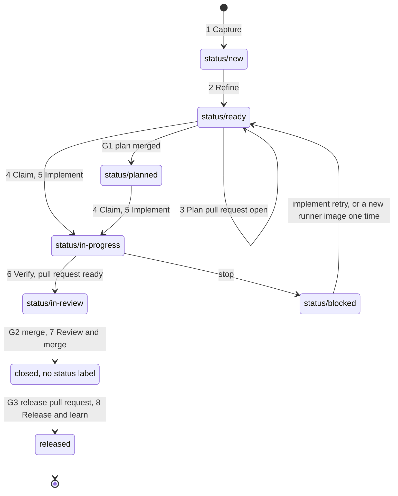

# The roadmap workflow

This page is the one place that names the steps of an issue's life, from the first report to the release. Other documents link here and do not repeat the steps. A test (`tests/invariants/test_roadmap_workflow_doc.py`) keeps this page in step with `.github/labels.yml` and with the code.

## Purpose

An issue that the roadmap tracks is an Item ([CONTEXT.md](../CONTEXT.md)). Three kinds of actor move an Item through the same eight steps:

- **Service job**: a row of the roadmap Service ([k8s/README.md](../k8s/README.md), Roadmap service), or the runner Job that the Service makes.
- **Agentic coder**: an AI agent that works in a worktree of this repository.
- **Person**: a human developer or the owner.

The state of an Item is in labels on its issue ([ADR 0016](adr/0016-labels-hold-the-roadmap-items-fields.md)). Each actor reads the same labels. Each actor follows the same steps. A person makes the three decisions that no other actor makes: the gates.

## The eight steps

| Step | State after it | Service job | Agentic coder | Person | Gate |
| :--- | :--- | :--- | :--- | :--- | :--- |
| 1. Capture | `status/new` | Row `intake` places each candidate | `devops roadmap intake --title "<title>" --body-file <file> --confirm` | The same command, or a new issue on GitHub | None |
| 2. Refine | `status/ready` | Rows `refine` and `alternatives` | `devops roadmap refine --item <number> --confirm` | The same command, and an answer to each open question in the issue | None |
| 3. Plan | `status/ready` while the plan pull request is open, then `status/planned` | Row `stage` opens a draft plan pull request. Row `stage_ready` marks it ready when its checks pass | Write the change folder `openspec/changes/<issue>-<slug>/` as the first commit of the implementation branch | The same | G1 |
| 4. Claim | One `owner/*` label | Row `implement` sets `owner/service` when it makes a Job | `devops repos worktrees add <issue> --type <type> --slug <slug>` sets `owner/agent` | `devops roadmap claim <number> --as human --confirm` | None |
| 5. Implement | `status/in-progress` | The runner Job runs one step for each task group | Tests first, then code, in a draft pull request made with `devops pr create` | The same | None |
| 6. Verify | `status/in-review` | The runner Job watches the checks, runs one fix step, and marks the pull request ready | `devops pr monitor <pr_number>`, then `devops pr ready <pr_number>` when the checks pass | The same | None |
| 7. Review and merge | The issue is closed | None | None | Review, then merge | G2 |
| 8. Release and learn | The release is out | None | None | Merge the release pull request. Read the release. File each problem as a new candidate | G3 |

Notes on the table:

- A plan that an agent or a person writes is part of the one pull request that closes the issue. It has no separate gate G1. G1 exists for a plan that the Service stages.
- A person can do every step of an agent or of the Service. A person's claim beats the Service's claim.
- The command `devops roadmap explain <number>` says why the stage job and the implement job take an Item or leave it out. It names the first rule that fails for each job. It calls no model and writes nothing. The option `--why` on `devops roadmap stage` and `devops roadmap implement` lists the open Items that the filter does not name.
- The command `devops roadmap inbox` lists what waits for a person, in the order of the gates. First the ready plan pull requests of the jobs (G1), the ready implementation pull requests of the jobs (G2) and the release pull request (G3). Then the Items in `status/blocked` with their cause, the claims with no activity for 7 days, and the labels of `.github/labels.yml` that the repository lacks. Each line has the number, the age and the one command or action that clears it. The pull requests of people and agents are in a second list. The command reads GitHub only and writes nothing. It does not list an image digest that is not rolled: `devops argo cd apps status devops` reads it.
- The command `devops roadmap return <number> --comment "<evidence>" --confirm` sends an Item back to `status/new` when it cannot be built as written.

## The transitions

Each row is one change of the Status label of an Item. A job never reverts a label that a person set ([ADR 0016](adr/0016-labels-hold-the-roadmap-items-fields.md)).

| From state | Event | To state | Actor |
| :--- | :--- | :--- | :--- |
| No state | A candidate is placed by intake | `status/new` | Service job, agentic coder or person |
| `status/new` | Refine finds the Item whole | `status/ready` | Service job or person |
| `status/ready` | Refine finds the proposal not ready: a gap, an open question, a split or a block | `status/new` | Service job |
| `status/ready` or `status/planned` | A person returns the Item with evidence | `status/new` | Person or agentic coder |
| `status/ready` | The stage job opens a draft plan pull request | `status/ready` | Service job |
| `status/ready` | A person merges the plan pull request (G1) and the Service finds the change folder on the default branch | `status/planned` | Service job |
| `status/ready` or `status/planned` | The Service makes a runner Job for the Item | `status/in-progress` | Service job |
| No state, `status/new`, `status/ready` or `status/planned` | `devops pr create` opens a pull request that closes the Item | `status/in-progress` | Agentic coder or person |
| `status/in-progress` | The checks pass and the pull request is marked ready | `status/in-review` | Runner Job, or `devops pr ready` |
| No state, `status/new`, `status/ready` or `status/planned` | `devops pr ready` marks a pull request that closes the Item | `status/in-review` | Agentic coder or person |
| `status/in-progress` | A step stops, or the Job ends with the Item not finished | `status/blocked`, with `implement.stopped` | Runner Job or Service job |
| `status/blocked`, with `implement.stopped` | A trusted person (the owner, a member or a collaborator) comments `implement: retry` after the stop comment | `status/ready`, or `status/planned` when the plan is on the default branch. The same round of row `implement` takes the Item, then it is `status/in-progress` | Person, then Service job |
| `status/blocked`, with `implement.stopped` | The digest in the template of CronJob `devops-cli-runner` is not the digest in `implement.job_digest`, the digest of the Job that stopped | `status/ready`, or `status/planned` when the plan is on the default branch. This happens one time for each digest. The same round of row `implement` takes the Item | Service job |
| `status/in-review` | A person merges the pull request (G2) and the issue closes | Closed, with no `status/*` label | Person, then the workflow `clear-status.yml` |
| Closed | A person merges the release pull request (G3) | Released | Person, then release-please |
| Any state | A person sets a `status/*` label by hand | That label | Person |

Claims are a second family of labels. An Item has at most one `owner/*` label.

| From state | Event | To state | Actor |
| :--- | :--- | :--- | :--- |
| No owner | The Service makes a runner Job | `owner/service` | Service job |
| No owner | An agent makes a worktree for the issue, or claims it | `owner/agent` | Agentic coder |
| No owner | A person claims the Item | `owner/human` | Person |
| `owner/service` | A person claims the Item | `owner/human` | Person |
| `owner/service` | The Job ends and a round reports it | No owner | Service job |
| `owner/agent` or `owner/human` | A person or an agent runs `devops roadmap release` | No owner | Person or agentic coder |
| `owner/agent` or `owner/human` | Another actor claims the Item | Refused. The Service takes no claimed Item | Service job, agentic coder |
| Any owner | The issue closes | No owner | Workflow `clear-status.yml` |

A claim of an agent or a person ends a running Job at its next task group. The Job pushes nothing and opens no pull request. No job releases the claim of an agent or a person.

## Labels and record keys

The labels on the issue hold the state. The job record holds the facts behind it. The job record is a hidden block at the end of the issue body, a JSON object ([ADR 0016](adr/0016-labels-hold-the-roadmap-items-fields.md)). It also holds the last value that a job set for each field (`Status`, `Owner`), so a job can tell its own label from a person's.

| State | Label | Set by | Record keys that hold the facts |
| :--- | :--- | :--- | :--- |
| New | `status/new` | Intake, or `devops roadmap return` | `refine.body_hash`, `refine.section_hash`, `refine.next_step` |
| Ready | `status/ready` | Refine, a clear of a stop, or the status sync | `stage.pr`, `stage.branch` (Staged) |
| Planned | `status/planned` | The status sync of the Service | The change folder on the default branch, or a merged `stage.pr` |
| In progress | `status/in-progress` | The Service, `devops pr create`, or the runner Job | `implement.job` with no `implement.job_state` |
| In review | `status/in-review` | The runner Job, or `devops pr ready` | `implement.pr` |
| Blocked | `status/blocked` | A stop of the runner Job or of the Service, or a person | `implement.stopped`, `implement.job_digest` (stopped). A person who sets it by hand records nothing |
| Done | The issue is closed | The close of the issue | None |
| Owned by the Service | `owner/service` | Row `implement` | `implement.job` |
| Owned by an agent | `owner/agent` | `devops repos worktrees add`, or a claim | None |
| Owned by a person | `owner/human` | `devops roadmap claim` | None |

A closed issue holds no `status/*` and no `owner/*` label, because the workflow `.github/workflows/clear-status.yml` removes them. No label holds Done.

These are all the keys of the job record, by the job that writes them:

| Job | Keys | What they hold |
| :--- | :--- | :--- |
| Refine | `refine.body_hash`, `refine.section_hash`, `refine.failed_body_hash` | The hashes of the issue body and of the refine section, to see a change of text |
| Refine | `refine.needs_split`, `refine.next_step`, `refine.blocked_by`, `refine.block_paths` | Whether the Item needs a split, who acts next, and the open items and paths that block it |
| Refine | `refine.capped_after`, `refine.alternatives_asked` | The comment cap of refine, and the covering tool that refine asked a person about |
| Alternatives | `alternatives.checked_at`, `alternatives.body_hash`, `alternatives.verdict`, `alternatives.tool` | When the check ran, the text it read, its verdict and the tool it found |
| Stage | `stage.branch`, `stage.pr`, `stage.sha` | The staged branch, its draft pull request and its last commit |
| Stage | `stage.groups`, `stage.needs_split`, `stage.file_cap` | The task groups with their size, the group over the budget, and the cap of that measure |
| Stage | `stage.ready` | The plan pull request that the Service has seen leave the draft state |
| Implement | `implement.group`, `implement.sha`, `implement.branch`, `implement.pr` | The last group that passed, the last commit, the branch and the pull request |
| Implement | `implement.stopped`, `implement.spend` | The step that stopped the Item, and the spend of its steps |
| Implement | `implement.job`, `implement.job_state`, `implement.job_digest` | The runner Job that the Service made, its state after a round reported it, and the digest of the runner image that the Job ran |

## The stop and retry path

The log comment, the suspension of a row and the other details are in [k8s/README.md](../k8s/README.md), Roadmap service step 16, and Runner Jobs.

1. A step stops, a conflict arises, a command fails, or a check fails twice. The runner Job pushes the commits that passed and comments the stop on the issue.
2. The Job sets `status/blocked` and records the step in `implement.stopped`. The Status function of the Service derives Blocked from that record, so the runner and the Service name the Status in one place.
3. A Job that ends with the Item still in progress, or Ready or Planned with no stop, is a stop that the runner could not write. The next round of row `implement` sets the Item to Blocked and records `implement.stopped` as `job`.
4. The Service records the digest of the runner image in `implement.job_digest` when it makes a Job. The report comment of the Job names that digest. This is the digest of the stop.
5. The Service makes no Job for a Blocked Item. Two rules take it out of Blocked, and a comment of the Service names the rule that ran:
   - **retry**: a trusted person comments `implement: retry` after the stop comment. The next round clears the stop at once, whatever the digest.
   - **digest**: the digest in the template of CronJob `devops-cli-runner` is not the digest in `implement.job_digest`. A new image may fix the cause, so the Service clears the stop one time.
6. A clear removes `implement.stopped` and sets `status/ready`, or `status/planned` when the plan is on the default branch. The same round takes the Item again, with its branch and its draft pull request.

Each new Job overwrites `implement.job_digest`. So a second stop on the same image finds equal digests, and only a retry clears it. A stop with no digest on record, and a template with no digest, are cleared by a retry only. The Service takes no Item that an agent or a person claimed, and it never clears a `status/blocked` label that a person set. The ledger of failed rounds is a different thing: it suspends a row after three failed rounds on the same input, and the stop path does not change it.

## The three gates

Only a person passes a gate. No agent and no Service job merges a pull request.

| Gate | Decision | What happens after it |
| :--- | :--- | :--- |
| G1 | A person merges the plan pull request | The change folder is on the default branch. The Service sets `status/planned` |
| G2 | A person merges the implementation pull request | The squash commit closes the issue. The workflow `clear-status.yml` removes the labels |
| G3 | A person merges the release pull request | release-please makes the release. The images roll ([RELEASE_CYCLE.md](../RELEASE_CYCLE.md)) |

## The manual path

A person can run the work of the Service for one Item. The Item must be Staged or Planned, and nobody may hold its claim. A Blocked Item is not startable: comment `implement: retry`, and the next round of row `implement` clears the stop. The command `devops k8s run-job --template runner` makes the Job. Its options, and the rule for `--repo`, are in [k8s/README.md](../k8s/README.md), Runner Jobs. The same stop and retry path applies.

## The diagram



## Measure the stage job

The stage job has a golden set: the 37 plans of 2026-11-01, each with the defects a review found in it, and 3 good plans. It lives in `tests/fixtures/roadmap_eval/stage/`, one folder for each plan. A change of the stage prompt or of the checks needs a measure, and this set gives it.

Run the live eval on demand. It calls a model through the gateway and is no part of `devops ci`:

```text
uv run devops roadmap eval stage --model <model>
uv run devops roadmap eval stage --case 2260 --dry-run
uv run devops roadmap eval stage --replay
```

- **The live run** plans each case with the real stage planner and a checkout of the commit the plan was staged on. It prints one row for each type of defect, and a score. It stores the report as JSON under the data directory, in `roadmap_eval/stage/`.
- **How to read the score.** The planner sends a refused reply back, so the plan it ends with always passes the gates. The score therefore judges the first reply of the model. For a type of defect that a gate catches, `Cases` counts the plans that had it, `Avoided` counts the first replies that passed the gate, `Caught` counts the first replies that the gate refused, and `Rate` is `Avoided` over `Cases`. A type that no gate judges yet shows its count and a dash, because only a reviewer can judge it. `Score` is the share of avoided defects over all scored rows. A first reply that breaks the schema is sent back inside the client, so the run sees it only when the second reply breaks it too. The `kind` row therefore stays near 100 percent.
- **The replay** calls no model and reads no git. It runs the recorded plans through the gates and lists, for each gate, the known defects it catches. It exits 1 when a gate stops refusing a known-bad plan, or refuses a good plan. The test suite runs it on the whole set. A defect for a gate that does not exist yet is marked `pending`: the replay lists it and fails nothing. When the gate lands, its pull request sets the gate in the case files, and the replay checks it from then on.
- **The rule.** A pull request that changes the stage prompt (`roadmap_stage_change.md`) or a check of the stage job (`check_proposal` and the gates it calls) states the score of the same model before and after the change. Use one model for both runs, and say which.

## Planned changes

Tracker [#2908](https://github.com/dan-petty/devops-cli/issues/2908) holds the work that is not built yet. This section is the one place that names it. When an item merges, change its line here and the text above.

| Issue | Step | What it will change |
| :--- | :--- | :--- |
| #2913 | The manual path | `devops roadmap implement` outside the runner makes the runner Job, and `--repo` is needed once |
| #2916 | 6 Verify | One function decides when any draft pull request is ready |
| #2867 | 6 Verify | A model evaluator marks a draft ready when it matches its issue and the project rules |
| #2917 | 8 Release and learn | A release comments its version and its deploy time on each issue it carries |
| #2919 | All | Metrics show the age of stuck Items, and one alert fires |
| #2968 | All | The counts of `devops roadmap inbox` are gauges with a Grafana panel, and the inbox lists an image digest that is not rolled |
