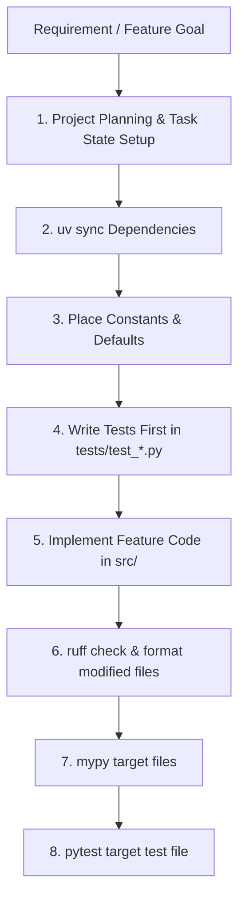
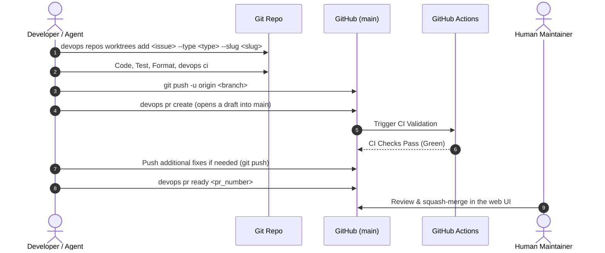

# Routine Tasks, Order, Frequency & Methodology — devops-cli

This document serves as the authoritative operational manual for developers, maintainers, and AI agents contributing to `devops-cli`. It defines the exact **order of operations**, **execution frequency**, and **engineering methodology** across all routine maintenance, development and security workflows. A person merges the release pull request: [`RELEASE_CYCLE.md`](../RELEASE_CYCLE.md) tells how.

---

## 1. Engineering Principles & Methodology

All routine operations in `devops-cli` adhere to six core engineering tenets:
1. **Deterministic Execution**: Workflows run through standardized CLI commands (`devops ci`, `devops docs`, `uv`) to guarantee reproducible outcomes across local DevContainers and GitHub Actions CI.
2. **Zero-Plaintext Credentials**: No token is stored in git, configuration or logs. Tokens (GitHub, OpenAI, Claude, Grafana, ArgoCD) come from a secret store. Examples are the OS Keyring (`devops config set`, Python `keyring`), the credential store of the owning tool and a Kubernetes Secret in the cluster.
3. **Strict Quality Assurance**: Changes must pass every check that `devops ci` runs before merging ([`SDLC.md`](SDLC.md), Phase 4, lists them).
4. **Target Branch & Non-Merge Policy**: Every topic PR targets `main`. Direct pushes to `main` are blocked. AI agents stage commits and open/update PRs, while PR merge actions are strictly reserved for human maintainers.
5. **Dynamic Documentation Freshness**: Command matrices, CLI reference guides, and FastMCP schemas are generated dynamically through code introspection (`devops docs generate`) and verified in CI (`devops docs check`).
6. **Mandatory Defect Incident Tracking (Zero Unrecorded CLI Errors/Warnings)**: Whenever a CLI command produces an unhandled error, subcommand failure, crash, diagnostic warning, or unexpected behavior, agents and maintainers must first search the open issues (`devops gh api "search/issues?q=repo:<owner>/<repo>+is:issue+is:open+<check or error text>"`) and, when one covers the defect, comment there with the new evidence and file nothing. Else they must promptly file it as a candidate (`devops roadmap intake --title "fix(<scope>): …" --body-file <file> --confirm`), in the shape of the standardized bug report template. Intake checks it for a duplicate, labels its type, Status, Value, Effort and Priority, and puts it in the backlog; nobody sets a milestone or priority on the new issue by hand.


---

## 2. Master Routine Tasks Matrix

The following matrix categorizes all project routine tasks by operational layer, defining their exact sequence, cadence, and verification criteria:

| Operational Cadence | Routine Task | Sequence Order | Primary Command(s) | Methodology & Scope | Success Verification Gate |
| :--- | :--- | :--- | :--- | :--- | :--- |
| **Inner Loop (Daily / Per Edit)** | Task Grounding | Step 1 | `devops gh project audit` && `devops roadmap intake` | Query project tracking, and verify the issue's labels or file the work through intake | Task grounded in an open issue with a `priority/*` label |
| **Inner Loop (Daily / Per Edit)** | Dependency Synchronization | Step 2 | `uv sync` | Synchronizes virtual environment with `uv.lock` | Clean exit; all dependencies resolved |
| **Inner Loop (Daily / Per Edit)** | Constant & Config Placement | Step 3 | Manual / Refactor | Put each table beside its one owner, and in `config/` once a second package imports it; put messages in `lang/en/` | No hardcoded string literals in command code |
| **Inner Loop (Daily / Per Edit)** | Targeted Linting & Formatting | Step 4 | `uv run ruff check --fix <file>` | Fast focused linting on modified files | `ruff check` reports 0 errors |
| **Inner Loop (Daily / Per Edit)** | Targeted Type Checking | Step 5 | `uv run mypy --strict <file>` | Strict type validation on modified modules | 0 type errors across modified files |
| **Inner Loop (Daily / Per Edit)** | Targeted Unit Testing | Step 6 | `uv run devops ci test <test-file>` | Fast isolated testing of active features/fixes, with xdist workers sized to the selection | Targeted tests pass |
| **Inner Loop (Daily / Per Edit)** | Telemetry, Log & CLI Output Review | Step 7 | `devops telemetry status` / log inspection | Inspect CLI command outputs, `.data/logs/`, metrics, and tracing spans for performance bottlenecks, misconfigurations, and warnings | Clean logs, no warnings, nominal latencies |
| **Final Pre-Commit / Pre-PR** | Documentation & README Sync | Step 1 | `uv run devops docs generate --sync-readme` | CLI introspection & README Command Matrix update | `uv run devops docs check` passes |
| **Final Pre-Commit / Pre-PR** | Full Parallel Test Suite | Step 2 | `uv run pytest` | Complete parallel test run (`addopts`' `-n logical --dist worksteal`) | All tests pass |
| **Final Pre-Commit / Pre-PR** | Full CI Validation Suite | Step 3 | `uv run devops ci` | Runs the full automated verification suite by hand, when you want it before the push. The required checks of CI gate the merge | All checks show `✓ pass` |
| **Final Pre-Commit / Pre-PR** | Observability, Log & Trace Audit | Step 4 | `devops telemetry status` / `.data/logs/` | Audit CLI command outputs, application logs, metrics, and OpenTelemetry tracing data for performance issues and misconfigurations | Zero unhandled exceptions or warnings in logs/spans |
| **Feature / PR Lifecycle** | Branch Creation | Step 1 | `devops repos worktrees add <issue> --type <type> --slug <slug>` | Dedicated worktree and topic branch off the fetched `origin/main`, named as [CONTRIBUTING.md](../CONTRIBUTING.md#5-naming) says; the command takes over a staged branch that the App pushed for the issue, and refuses an issue that a worktree or any other pushed branch already holds | Clean worktree based on `origin/main` |
| **Feature / PR Lifecycle** | PR Submission | Step 2 | `devops pr create --title "<type>(<scope>): <summary>"` | Opens a draft PR into `main`; the title becomes the changelog line | Draft PR opened with Conventional Commit title |
| **Feature / PR Lifecycle** | Taxonomy Linking | Step 3 | `devops gh labels audit` | Audits open PRs for mandatory `type/*` and `scope/*` labels | Zero taxonomy audit findings |
| **Feature / PR Lifecycle** | Project Field Sync | Step 4 | `devops gh project sync` | Reconciles Status and Priority on the cards already on the board; the board's built-in `Pull request linked to issue` workflow moves the issue's card to In Review | Issue card fields populated; the PR gets no card |
| **Feature / PR Lifecycle** | PR Monitoring & Review Resolution | Step 5 | `devops pr monitor <pr_number>`, then `devops pr ready <pr_number>` | Actively monitors checks and any review a person requested, remediates in-thread, then marks the draft ready | All checks green, requested reviews settled, 0 unresolved threads |
| **Feature / PR Lifecycle** | AI Code Review | Step 6 | `devops ai review branch <name> --dry-run` | Automated review and group analysis | Findings inspected in `.data/reviews/` |
| **Feature / PR Lifecycle** | Human Squash Merge | Step 7 | GitHub web UI (a person) | Maintainer squash-merges the approved PR into `main` | PR merged and topic branch deleted |
| **Feature / PR Lifecycle** | Remote Branch Audit & Pruning | Step 8 | `git fetch --prune origin` | Prunes merged, closed, or superseded remote tracking branches | Zero orphan remote branches on origin |
| **Release (a person)** | Release Pull Request Merge | Step 1 | GitHub web UI | A person reads the version and changelog of the release-please pull request and squash-merges it; `release.yml` then publishes. Agents have no step ([`RELEASE_CYCLE.md`](../RELEASE_CYCLE.md)) | GitHub release, tag, packages and images published |
| **Security & Audits** | Dependency Security Audit | Weekly | `uv run devops ci audit` (`uv audit`, `npm audit`) | Scans installed packages and the lockfile of each Node tool in `tools.lock` for known vulnerabilities | 0 known vulnerabilities |
| **Security & Audits** | Static Security Scan (SAST) | Weekly | `uv run devops ci security` (`bandit`) | Static security scan for code vulnerabilities | 0 issues in `src/`; 0 high/medium issues in `tests/` |
| **Security & Audits** | Kubernetes Manifest Scans | Per Manifest Change | `devops k8s lint` / `devops k8s check-deprecated` / `devops scan trivy <dir> --type config` | Validates manifests against K8s security best practices (cluster health: `devops k8s audit`) | Zero deprecated APIs or misconfigurations |
| **Security & Audits** | Codebase Deduplication & Invariant Audit | Weekly / Pre-PR | `uv run ruff check --config pyproject.toml .` && `uv run devops ci test tests/test_architectural_invariants.py tests/test_ruff_complexity_cap.py` | Ruff `C901` enforces complexity <= 10 and the tests hold its configuration; the tests enforce nesting <= 5, the `C901` marker ceiling and shared helper adoption | Zero invariant violations |
| **Observability & Diagnostics** | Command Output, Logs, Metrics & Trace Audit | Continuous / On Execution | `devops telemetry status` / `devops telemetry logfire` | Comprehensive review of command outputs, application logs (`.data/logs/`), metrics, and tracing spans for latency, misconfigurations, and warnings | Nominal latencies, zero unhandled errors/warnings |
| **Workspace & Sync** | DevContainer Lifecycle Hooks | Daily / On Start | `devops devcontainer run-lifecycle --post-start` | Cross-platform container initialization tasks | All lifecycle tasks complete successfully |
| **Workspace & Sync** | Multi-Repo Synchronization | Daily / On Demand | `devops repos sync` / `devops repos list` | Pulls upstream changes across all managed repos | All repositories up to date |
| **Workspace & Sync** | GitHub Pages Publishing & Readiness Audit | Pre-PR | `devops gh pages status` / `devops gh pages verify` | Inspects live publishing health, HTTPS enforcement, and validates `docs/_config.yml`, the site settings that the Pages build reads, and `docs/` | Clean verification; HTTPS strictly enforced |
| **Workspace & Sync** | GitHub Issues Lifecycle & Triage Audit | Daily / Pre-PR | `devops gh issues triage` / `devops gh issues status` | Audits open issues for mandatory taxonomy labels (`type/*`, `scope/*`) and a `priority/*` label, and reports those with no `priority/*` label as awaiting intake | Zero untriaged open issues; `devops roadmap intake` clears those awaiting intake |
| **Workspace & Sync** | GitHub Projects & Issues Views Sync & Audit | On Demand / Pre-PR | `devops gh project sync` / `devops gh project audit` / `devops gh views audit` | Provisions and links the board, reconciles card fields, and audits the 4 declarative project views | All projects and views populated with zero drift or empty state (`projects` & `issues/views`) |
| **Workspace & Sync** | SSH Keys & Host Audit | On Demand | `devops ssh status` / `devops ssh audit` | Validates ED25519 keys, permissions, and GitHub keys | No keys past rotation_days |
| **Workspace & Sync** | Roadmap Implement Job (Service) | Every 10 minutes (row `implement`) | `kubectl -n devops get jobs -l implement-repo` / `devops roadmap implement --repo <owner/name> --item <number> --confirm` | The Service makes one runner Job per repository at a time for a Staged or Planned item, reports each Job that ended on its item, and stops an item whose Job left it eligible | No Job ends without a comment on its item; no item runs twice after a failed Job until a person comments `implement: retry` |


---

## 3. Detailed Workflow Methodologies

### Cadence A: Inner Loop (Test-First Iterative Feature Development)

The Inner Development Loop follows a strict **Test-First Development (TDD)** methodology. Author tests first as living specifications of intended functionality before writing implementation code. Run targeted tests and linters for immediate feedback; do NOT run the full test suite during this inner loop.



#### Step-by-Step Order:
1. **GitHub Project Bootstrap, Issue Grounding & Task State Setup**:
   - **Inspect Project Status**: Inspect the project template via `devops gh project status` and the live board via `devops gh project audit` (or FastMCP `gh_project_status`) and triage queue via `devops gh issues triage` (or FastMCP `gh_issues_triage`).
   - **Ground Requirement in a GitHub Issue**: Every feature, bug fix, or refactor must map to an open issue that is a roadmap item: it holds a `priority/*` label.
     - If a matching issue exists: link task to it and verify taxonomy labels. `devops gh project sync` sets its card to In Progress once a draft PR is open.
     - Without a matching issue: **FILE THE TASK AS A CANDIDATE** (`devops roadmap intake --title "<conventional title>" --body-file <file> --confirm` or FastMCP `roadmap_intake` with `mode="confirm"`). Intake files it (a possible duplicate too, which its reason comment names for a person to close), labels its type, Status, Priority, Value and Effort, and puts it in the backlog; set no milestone or priority on it yourself.
   - Plan the item as an OpenSpec change, `openspec/changes/<issue>-<slug>/` ([`openspec/config.yaml`](../openspec/config.yaml)). The labels of the issue hold the Status of the item, and the change folder holds none.
2. **Sync Dependencies (`uv sync`)**: Always ensure `.venv` is aligned with `uv.lock` before starting work.
3. **Place Constants, Config & Defaults**:
   - Put configuration options and environment variable schemas in [`src/devops_cli/config/settings.py`](../src/devops_cli/config/settings.py).
   - Put a constant, regex, protocol string, timeout or numeric default beside its one owner. Move it to [`src/devops_cli/config/constants.py`](../src/devops_cli/config/constants.py) or [`src/devops_cli/config/defaults.py`](../src/devops_cli/config/defaults.py) only when a second package imports it ([CONTRIBUTING.md](../CONTRIBUTING.md), "Closed Lists and Standard Parsers").
   - Put user-facing messages, summaries, and error logs in [`src/devops_cli/lang/en/`](../src/devops_cli/lang/en/).
4. **Leverage Shared Domain Helpers & Declarative Frameworks**:
   - Before writing ad-hoc subprocess calls, path containment checks, binary verification, or secret sanitization, always leverage the shared helper ecosystem:
     - `devops_cli.core.binaries.check_binary` / `require_binary` for external tool checks.
     - `devops_cli.core.paths.safe_resolve_subpath` for filesystem containment and traversal prevention.
     - `devops_cli.core.process.run_json_subprocess` and `devops_cli.core.serialization.extract_json_block` for robust JSON subprocess handling.
     - `devops_cli.security.sanitizer.mask_secrets` for credential masking.
     - `devops_cli.dry_run.decorator.dry_run_command` for state-mutating command dry-runs.
     - `devops_cli.security.base.BaseSecurityScanner` for security linters.
5. **Write Tests First (Living Functional Specification)**:
   - Write the tests that state the intended behaviour, edge cases and error conditions before the code, following [`docs/TESTING.md`](TESTING.md) for where they go, what they may double and what they assert.
6. **Implement Feature Logic**:
   - Author clean, concise, domain-driven implementation code in `src/` specifically to satisfy the pre-written tests with zero extraneous boilerplate.
7. **Format & Lint Target Files**:
   ```bash
   uv run ruff check --fix <modified_paths>
   uv run ruff format <modified_paths>
   ```
8. **Verify Static Types for Target Files**:
   ```bash
   uv run mypy --strict <modified_paths>
   ```
9. **Run Targeted Unit Tests**:
   ```bash
   uv run devops ci test tests/test_<feature>.py -k <test_name>
   ```
10. **Review CLI Command Outputs, Application Logs, Metrics & Tracing Data**:
   - Actively inspect terminal command outputs, application logs (under `.data/logs/`), metrics, and distributed tracing spans (`@trace_span` / Logfire / OpenTelemetry) emitted during execution.
   - Check for performance regressions, latency bottlenecks, misconfigurations, unhandled exceptions, and deprecation or diagnostic warnings.
   - If any error or warning is discovered, immediately file a tracking issue per Tenet 6 and resolve before proceeding.

---

### Cadence A (final stage): Pre-Commit / Pre-PR Validation

Executed at the final stage of work after all iterative feature modifications and targeted tests pass:

1. **Regenerate Documentation & Check Freshness**:
   ```bash
   uv run devops docs generate --sync-readme
   uv run devops docs check
   ```
2. **Optional: Run the Full Local CI Validation Suite by Hand**: The pre-push hook runs only the fast static checks, and the required checks of CI gate the merge ([`docs/SDLC.md`](SDLC.md), Phase 4).
   ```bash
   uv run devops ci
   ```
3. **Audit Observability, Telemetry & Application Logs**:
   - Review execution durations, OpenTelemetry spans, metric gauges, and application log output generated during test runs and CLI executions.
   - Verify absence of performance bottlenecks, resource leaks, configuration warnings, or suppressed exceptions.
4. **Validate GitHub Governance, Pages Readiness & Issues Triage**:
   - Verify the syntax and the required keys of `docs/_config.yml`, the one file of site settings that the Pages build reads, and the `docs/` publishing root, with `devops gh pages verify`.
   - Audit open issues for mandatory taxonomy labels (`type/*`, `scope/*`) and a `priority/*` label via `devops gh issues triage`, and run `devops roadmap intake` for those it reports as awaiting intake.
   - Inspect issue portfolio distribution via `devops gh issues status`.
   - Validate remote project views template compliance via `devops gh views audit`.


---

### Cadence B: Feature & Pull Request Lifecycle

Executed for every new feature, bug fix, refactor, or documentation update.



#### Rules & Methodology:
- **Dedicated Branch Naming**: Name a branch as [CONTRIBUTING.md](../CONTRIBUTING.md#5-naming) says.
- **Base Branch Targeting**: Every PR targets `main`. The PR title is a Conventional Commit, and the squash commit takes it as the changelog line.
- **Strict Remote Branch Lifecycle & PR Governance (Zero Orphan Remote Branches)**:
  - Every remote topic or feature branch on `origin` MUST have an associated, open Pull Request targeting `main`. `devops pr create` opens it as a draft.
  - **Immediate Deletion of Merged or Superseded Branches**: Once a PR is merged into its target branch, or if a branch's changes have been incorporated or superseded, the remote branch MUST be deleted immediately (`git push origin --delete <branch>`) and local tracking references pruned (`git fetch --prune origin`).
  - **No Orphan Remote Branches**: Remote branches without an active PR or active development purpose are strictly prohibited. If updates from an old or dormant branch are still required, apply or cherry-pick them to the active PR, and delete the obsolete remote branch immediately.
- **Sequential Pull Request Processing Queue (Strict Oldest-to-Newest / FIFO Execution)**:
  - When multiple open pull requests exist across the repository, AI agents and automated workflows **MUST ALWAYS process and advance pull requests in strict chronological order from oldest to newest** (FIFO queue determined by creation date ascending / lowest PR number first).
  - Addressing review feedback, fixing CI check failures, resolving merge conflicts, and verifying merge readiness on older PRs **strictly takes precedence** over authoring, advancing, or reviewing newer PRs.
  - When a PR is squash-merged into `main`, agents MUST immediately prioritize updating, rebasing, and verifying the next oldest open pull request to prevent cascading merge conflicts and branch divergence.
- **Every PR Opens as a Draft & Two-Stage Review Lifecycle**:
  - Agents open every pull request with `devops pr create`, which always opens a draft.
  - **Transition to Ready for Review**: Once all implementation logic, tests (the coverage floor and the changed-line gate pass), docs synchronization (`devops docs generate --sync-readme`), and CI quality gates pass cleanly, and initial review comments are addressed, agents MUST convert the draft pull request to ready for review (`devops pr ready <pr_number>`). It is the only path to ready.
- **Agent Non-Merge Rule**: AI agents must push commits and create/update PRs, but never merge a PR (`gh pr merge` or the web UI).
- **Post-Ready Secondary Review & Copilot Monitoring Gate**:
  - Marking a pull request as ready for review transitions it to public review and triggers reviewer notifications (CodeQL runs on every push). Copilot reviews a pull request only when a person requests it.
  - Agents are strictly prohibited from concluding a task immediately after marking a PR ready.
  - **5-Minute Completion Allowance & 60-Second Polling Interval**:
    - AI agents **MUST ALLOW AT LEAST 5 MINUTES (300 SECONDS)** for pull request CI checks, CodeQL scans, and any requested review session to complete.
    - AI agents **MUST WAIT AT LEAST A FULL MINUTE (60 SECONDS) BETWEEN REQUEST CYCLES** when monitoring pull request status. Polling in tight loops or intervals shorter than 60 seconds is strictly prohibited to prevent hammering GitHub APIs, avoid secondary rate limits, and allow asynchronous automated review bots to execute.
  - Actively monitor pull requests via `devops pr monitor <pr_number>` (or FastMCP `pr_monitor`), inspect open threads (`devops pr threads list <pr_number> --unresolved-only`), apply test-first fixes, reply in-thread (`devops pr threads reply <thread_id> "<body>"`), and programmatically resolve each thread (`devops pr threads resolve <thread_id>`).
  - Verify that all remote CI checks remain 100% green (`devops pr monitor <pr_number>`) before considering the task complete.
- **Active PR Monitoring Gate (`devops pr monitor`) (Zero Premature Completions & Unmonitored PRs)**:
  - After opening or pushing updates to a PR, agents and developers **MUST ALWAYS** actively monitor remote GitHub Actions status and code reviews via `devops pr monitor <pr_number>` (or `devops pr wait <pr_number>`).
  - **Strict Prohibition of Premature Completion**: Never conclude a turn or declare a task done while CI checks are pending/failing, or while a requested code review session (e.g. a GitHub Copilot review) is in progress or unresolved.
  - **Wait for Requested Review Sessions to Settle**: Code review bots submit reviews asynchronously. When a person requests a Copilot review, agents wait for that review session to complete.
  - **Remediate Check Failures Immediately**: If any check fails (exit code 1), immediately inspect failed logs (`devops gh runs view <run_id> --log-failed`), apply remediation commits directly to the PR source branch with concise effect-driven commit messages, push to origin, and re-run `devops pr monitor <pr_number>`.
  - **Review Comment Remediation & Direct In-Thread Reply Mandate**: If Copilot or reviewers leave comments (exit code 2):
    1. Inspect all open threads: `devops pr threads list <pr_number> --unresolved-only`.
    2. Author test-first fixes in `src/` and `tests/`.
    3. Commit with concise message stating the direct effect and push.
    4. Post direct in-thread replies to each specific comment addressed: `devops pr threads reply <thread_id> "<body>"` (never solely via top-level PR comments).
    5. Resolve threads: `devops pr threads resolve <thread_id>` (GraphQL `resolveReviewThread`).
    6. Re-run `devops pr monitor <pr_number>` until exit code 0 is achieved.
  - **Merge Readiness Guarantee**: A PR is ONLY ready for merging when `devops pr monitor` exits with code 0: all CI checks are 100% green, any requested review session has settled, and 0 unresolved review discussion threads remain.
- **No Commits to Merged Branches**: Once a PR is merged, create a fresh topic branch from `origin/main` for the next task.
- **Updating Open PRs**: When revisions are needed, push commits directly to the active topic branch. Do not open duplicate PRs.
- **Commit Standards & Message Hygiene**:
  - All commits must follow Conventional Commits (`feat(scope): ...`, `fix(scope): ...`, `refactor(scope): ...`, `docs(scope): ...`).
  - **Short Titles and Bodies**: [`CONTRIBUTING.md`](../CONTRIBUTING.md) section 4 sets the length of the title summary and of the body, and says what goes in a comment instead.
  - **No Internal References or Numeric IDs**: Never include internal review session timestamps (e.g. `164259`, `003105`), review session IDs, subagent IDs, prompt phase numbers (`Phase 48.5`), or arbitrary numeric identifiers in commit subjects or messages. Use clear, descriptive technical terminology.
  - **No Standalone Tracking Commits**: A change to the change folder of an item goes into the pull request that delivers the item. A tick goes into the commit that completes its task, and the archive goes into the last commit.
- **Issue Linkage, GitHub Projects & Issues Views Lifecycle (`https://github.com/dan-petty/devops-cli/projects` & `https://github.com/dan-petty/devops-cli/issues/views`)**:
  - **Zero Disconnected PRs**: Every PR closes exactly one open issue with a canonical closing keyword (`Fixes #<id>`, `Closes #<id>`, `Resolves #<id>`), archives that issue's OpenSpec change (`openspec/changes/archive/<date>-<issue>-<slug>/`), and has taxonomy labels (`type/*`, `scope/*`). GitHub closes the issue when the PR merges into `main`. A PR gets no card: its progress shows on its issue's card.
  - **Automated Field Sync & State Progression**: Run `devops gh project sync` (or FastMCP `gh_project_sync`) after opening or updating PRs to reconcile `Status` on the cards already on the board. The board's built-in `Pull request linked to issue` workflow moves the issue's card to `In Review` when a PR that closes it opens. The board mirrors the milestone that a person sets. No roadmap job reads or writes the board: the labels of each issue hold its Status, Priority, Value and Effort (ADR 0016), and the board's views filter by them.
  - Verify that the board follows `.github/project-template.json` across the 4 canonical views (*Sprint Kanban*, *Roadmap Timeline*, *Triage & Quality Table*, *Value vs Effort Priority Matrix*) displayed under `https://github.com/dan-petty/devops-cli/issues/views`. The labels of the issue, not a change folder, hold the Status of each item.
  - Ensure the project board is linked to the repository via `devops gh project link <number>` so it appears on `https://github.com/dan-petty/devops-cli/projects` and its views on `https://github.com/dan-petty/devops-cli/issues/views`. Audit views via `devops gh views list`, `devops gh views audit`, and `devops gh views spec`.
  - Enforce taxonomy labels via `devops gh labels audit`, and inspect milestone progress via `devops gh milestones list`. GitHub is the roadmap's source (ADR 0001), and a milestone is a planning bucket that never names a version.

---

### Cadence C: Releases (a Person Merges)

release-please opens and updates the release pull request from the pull request titles on `main`. A person reads the version and the changelog in it, then squash-merges it. `release.yml` then creates the GitHub release and its tag, and publishes the packages and images. release-please writes `CHANGELOG.md`, `.release-please-manifest.json` and the version lines, so nobody edits those by hand. Agents change `release.yml` and the release-please configuration through ordinary pull requests, as any other file. [`RELEASE_CYCLE.md`](../RELEASE_CYCLE.md) is the procedure.

---

### Cadence D: Security, Vulnerability & Dependency Audits

Executed weekly, or when dependencies are updated.

#### 1. Dependency Vulnerability Audit (`uv audit`, `npm audit`)
- **Frequency**: Weekly & in every CI run.
- **Methodology**: Scans packages in `uv.lock` against Open Source Vulnerabilities (OSV) database, and the `package-lock.json` of each Node tool in `tools.lock` against npm's advisory database, without installing it.
- **Command**: `uv run devops ci audit`, or `uv audit` and `npm audit --package-lock-only --json --prefix src/devops_cli/tools_lock/<tool>`.

#### 2. Static Application Security Testing (SAST - `bandit`)
- **Frequency**: Pre-commit / CI gate.
- **Methodology**: Analyzes AST for common security pitfalls (unsafe subshell calls, hardcoded passwords, weak crypto).
- **Scope**: `src/` at low severity and above, and `tests/` at medium and above: the targets `.bandit` names, with the four low rules it skips (B404, B603, B110, B112) and the reasons it gives. A `# nosec` in `src/` names its rules and, after a second `#`, the reason.
- **Command**: `uv run devops ci security`, or `uv run bandit -r src --ini .bandit --severity-level low` and `uv run bandit -r tests --ini .bandit --severity-level medium`.

#### 3. Kubernetes & IaC Security Scans
- **Frequency**: Whenever `k8s/` or `tf/` manifests are modified.
- **Methodology**: Uses Kube-linter, Pluto (deprecated API versions), Popeye (cluster sanitization), and Trivy (misconfigurations and vulnerabilities).
- **Commands**:
  ```bash
  devops k8s lint k8s/
  devops k8s check-deprecated k8s/
  devops scan trivy k8s/ --type config
  ```

#### 4. SSRF Guardrails & OS Keyring Audit
- **Methodology**: Every HTTP client is built by the `devops_cli.http.client` factory and checked at the connect: untrusted URLs at the public level, configured services at loopback (private once `ai.allow_private_network` is set), internal infrastructure at private. Kept pre-flight checks (Qdrant, kubectl manifest apply, container engine endpoint, config init wizard) call `vet_addresses` directly at their level. Cloud metadata endpoints are always rejected; other link-local addresses only at the public and loopback levels.

#### 5. AI Code Review Verification, Feedback Export & Self-Improvement Loop
- **Frequency**: After running AI code reviews or before PR approval.
- **Methodology**:
  1. Inspect structured review findings across sessions:
     ```bash
     devops ai review findings --session <session-id>
     ```
  2. Record a person's verdict:
     - No model verifies a finding; a person verifies or invalidates each with specific rationale:
     ```bash
     devops ai review verify <session-id> --index 1 --status INVALIDATED --reason "False positive on valid exception tuple"
     ```
  3. Append the verdicts to the feedback dataset for prompt tuning, DPO alignment, and model calibration:
     ```bash
     devops ai review export-feedback --status ALL
     ```
  4. Continuous Self-Improvement Loop:
     - Regularly analyze the feedback dataset, `.data/feedback_dataset.jsonl` (`data.feedback_dataset_path`), to identify recurring false positives; record each as a `[[suppressions]]` entry in `.devops/review.toml` with a reason and an expiry, or refine the persona domain prompts (`devsecops`, `architect`, `auditor`, `pm`, `qa`).

---

### Cadence E: Workspace & Infrastructure Synchronization

Executed on workspace initialization (DevContainer startup) or on-demand.

#### 1. DevContainer Lifecycle Hooks
- **Frequency**: On container creation (`postCreateCommand`) and container startup (`postStartCommand`).
- **Methodology**: Runs the Python lifecycle engine: bootstraps missing tools and the keyring, configures shell history/completion, git defaults and SSH commit signing, kubeconfig, and pre-commit hooks.
- **Commands**:
  ```bash
  devops devcontainer run-lifecycle --post-create
  devops devcontainer run-lifecycle --post-start
  ```

#### 2. Multi-Repository Synchronization
- **Frequency**: Daily or before multi-repo reviews.
- **Methodology**: Discovers all configured git repositories in workspace, pulls latest commits from tracked remotes, and reports branch statuses.
- **Commands**:
  ```bash
  devops repos sync
  devops repos list
  ```

#### 3. SSH Key & Host Security Audit
- **Frequency**: On-demand / Monthly.
- **Methodology**: Lists the managed SSH keys of the project prefix with age and rotation status (`devops ssh audit`/`list`, or `--all` for the keys of all projects) and shows the active key and days until rotation (`devops ssh status`).
- **Commands**:
  ```bash
  devops ssh status
  devops ssh audit
  ```

#### 4. GitHub Governance, Pages, Issues & Views Auditing
- **Frequency**: Pre-PR or On-Demand.
- **Methodology**:
  - Validates GitHub Pages deployment health and verifies local publishing assets (`docs/_config.yml` and `docs/`).
  - Audits live open issues for missing taxonomy labels (`type/*`, `scope/*`) or a missing `priority/*` label.
  - Audits remote GitHub Projects v2 boards and views against `.github/project-template.json` to prevent configuration drift.
- **Commands**:
  ```bash
  devops gh pages status
  devops gh pages verify
  devops gh issues triage
  devops gh issues status
  devops gh project audit
  devops gh views audit
  ```

#### 5. Roadmap Implement Job (Runner)
- **Frequency**: Continuous. The Service's row `implement` is due every 10 minutes ([k8s/README.md](../k8s/README.md), Roadmap service step 16).
- **Methodology**: The Service runs no step. In namespace `devops` it makes a runner Job from the suspended CronJob `devops-cli-runner` for the first Staged or Planned item (a Planned item has its plan on the default branch because a person merged the staging pull request; the job makes its branch and its draft pull request), and makes no second Job for the repository while one runs. The runner has the dev tools, 2 CPU, 4 Gi of memory (8 Gi at most) and 7200 s; its pod has no Kubernetes token, and its shell gets none of the variables of the job, except the uv paths and the worker bound of the test runner. The Service's ServiceAccount has a Role that creates and reads Jobs, lists pods and reads pod logs in that namespace, and nothing else ([k8s/README.md](../k8s/README.md), Runner Jobs). A later round comments the state and the end of the log on the item. A Job that leaves its item In Progress, or Ready or Planned with no stop, stops the item (`implement.stopped` is `job`) until a person comments `implement: retry`. A person merges the pull request.
- **Commands**:
  ```bash
  kubectl -n devops get jobs -l implement-repo
  kubectl -n devops logs job/<name>
  devops roadmap implement --repo <owner/name> --item <number> --dry-run
  devops roadmap implement --repo <owner/name> --item <number> --confirm
  ```
  The last command makes the same Job by hand with the code of `devops k8s run-job --template runner`, follows its log, and refuses a claimed item, an item that is neither Ready nor Planned, and a repository that has a runner Job that has not ended.

---

## 4. Failure Recovery & Troubleshooting Matrix

| Failure Scenario | Root Cause | Remediation Procedure |
| :--- | :--- | :--- |
| `devops ci` fails at `format` | Unformatted code or non-compliant line lengths | Run `uv run ruff format .` and re-run `devops ci`. |
| `devops ci` fails at `lint` | Unused imports, bad syntax, or sorting violations | Run `uv run ruff check --fix .` and resolve manual warnings. |
| `devops ci` fails at `typecheck` | Missing type annotations or strict type mismatch | Run `uv run mypy --strict src` to pinpoint offending line and type. |
| `devops ci` fails at `docs` | CLI commands or flags changed without updating docs | Run `uv run devops docs generate --sync-readme` and verify with `devops docs check`. |
| `pytest` intermittent test failures | Non-deterministic test ordering in multi-threaded code | Ensure assertions use order-independent checks (`any(...)` or sets) rather than fixed array indices. |
| `uv audit` reports vulnerability | A dependency has a known security advisory | Run `uv lock --upgrade-package <name>` and verify compatibility. |
| `npm audit` reports vulnerability | A package in a Node tool's `package-lock.json` has a known security advisory | Bump the tool with the runbook in the header of `src/devops_cli/tools_lock/tools.lock`. |
| `devops ci audit` says an audit could not run | The registry is unreachable or serves no advisories endpoint; npm exits 1 for this as for a finding, uv exits 2 | Read the output above the verdict, restore the network or registry configuration and re-run. |
| Agent PR targeting error | Topic PR opened against a base other than `main` | Update PR base branch via `devops pr edit <id> --base main`. |
