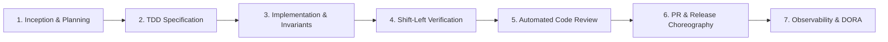
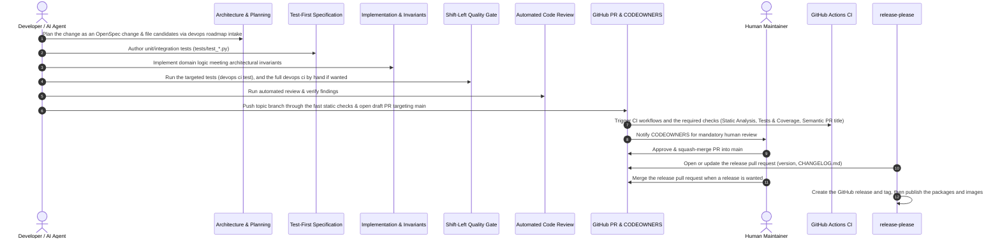
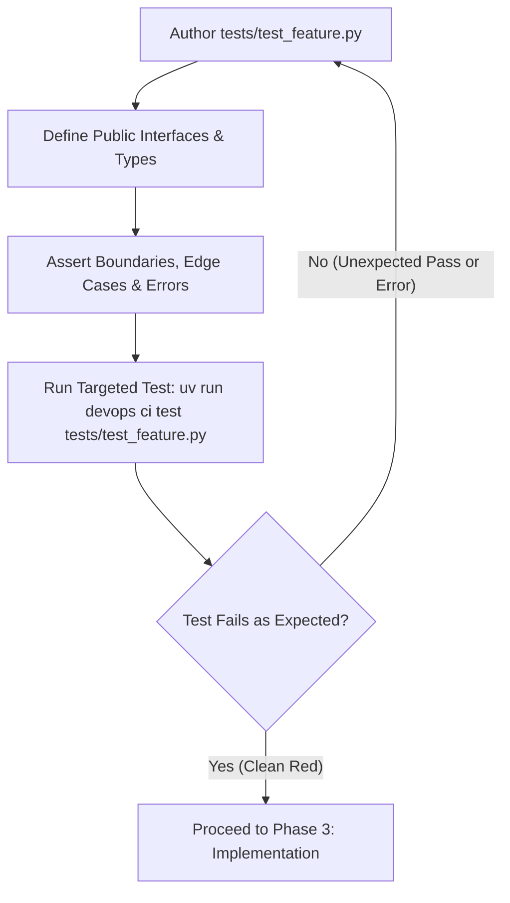
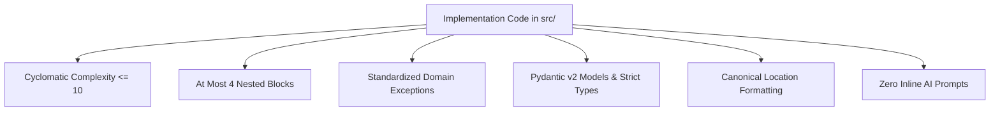
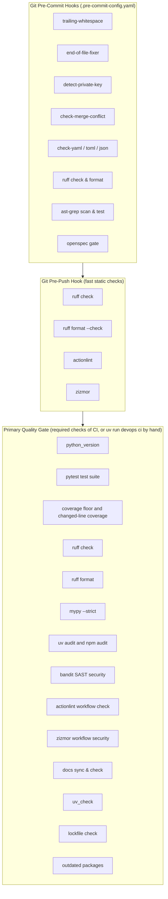
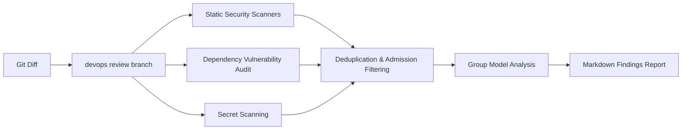
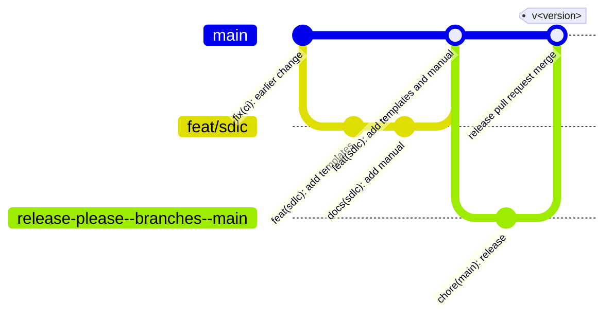
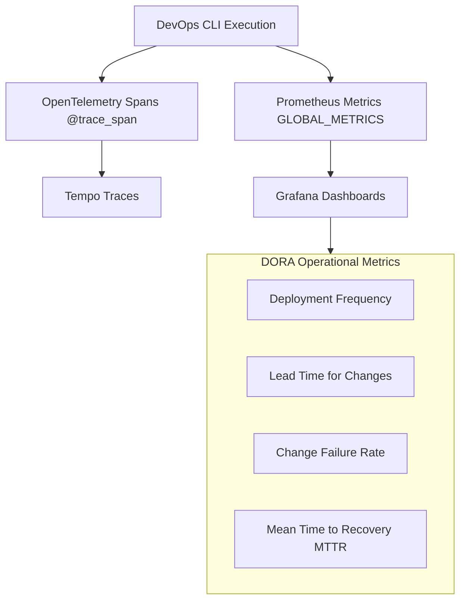

# Enterprise Software Development Life Cycle (SDLC) Framework — DevOps CLI

This document defines the comprehensive **Enterprise Software Development Life Cycle (SDLC)** architecture, operational procedures, quality gates, and governance policies governing `devops-cli`. It synthesizes industry-standard frameworks—including OpenSSF Best Practices, SLSA build provenance, Google Engineering Practices, and DORA operational metrics—into a unified, deterministic development lifecycle for human engineers and agentic AI assistants.

---

## 1. Executive Summary & Core SDLC Tenets

`devops-cli` implements a **Shift-Left, Zero-Trust, Test-First Enterprise SDLC**. All code and infrastructure changes progress through seven rigorously gated lifecycle phases:

### The Seven Pillars of DevOps CLI Engineering
1. **Test-Driven Specification (TDD as Living Contract)**: Implementation code is never written without pre-existing executable tests establishing functional expectations, interfaces, and boundary conditions.
2. **Strict Architectural Invariant Gates**: Continuous compliance verification enforces Cyclomatic Complexity $\le 10$, at most 4 nested blocks, standardized domain exceptions, and $\ge 90\%$ line code coverage.
3. **Zero-Trust Security & Egress Safety**: No plaintext secrets anywhere in code, configuration, or logs (OS Keyring / Vault isolation); SSRF endpoint validation; bounded subprocess timeouts; least-privilege containers.
4. **Supply Chain Integrity**: Locked dependency graph (`uv.lock`) audited by `uv audit`, and the `package-lock.json` of each Node tool in `tools.lock` audited by `npm audit`, in every `devops ci` run, hash-pinned tool downloads (`tools.lock`; `npm ci` checks the sha512 of every package of a Node tool), every remote GitHub Action pinned to a commit SHA and every workflow audited by `zizmor` (`devops scan workflows`, which fails on template injection, unpinned actions and excessive permissions; `devops scan report` publishes every zizmor finding to code scanning), build provenance attestations on release artifacts, and static security analysis (`bandit`, `detect-private-key`).
5. **Automated Code Review & Fact Grounding**: Tool-anchored code review pipeline evaluates all changes across static security analyzers, vulnerability audits, and secret scanning, with bounded model analysis for admitted finding groups.
6. **Branch Isolation & Human-in-the-Loop Governance**: Every change goes on a topic branch whose pull request targets `main`. AI agents cannot merge code autonomously; maintainers approve and squash-merge. release-please makes each release, and a person merges its pull request.
7. **Production Telemetry & DORA Observability**: OpenTelemetry tracing spans and Prometheus metrics instrument every CLI subcommand, background runner, and review stage.

---

## 2. Seven-Phase Enterprise SDLC Framework

---

### Phase 1: Inception, Architecture & Strategic Planning

Every significant feature, structural refactoring, or tooling upgrade begins with formal architectural planning and roadmap alignment before code is written.

#### Operational Requirements
1. **Planning Artifacts**:
   - Plan every item as an OpenSpec change, `openspec/changes/<issue>-<slug>/` ([`openspec/config.yaml`](../openspec/config.yaml), [ADR 0010](adr/0010-openspec-is-the-spec-and-change-proposal-layer.md)). The change folder is the only in-repo record of the item. The proposal records the feasibility check and the existing tool considered.
   - The pull request that closes the issue archives the change in its last commit with `uv run devops openspec archive <change>`, after every task is ticked. `devops pr check-readiness` blocks a pull request that does not add `openspec/changes/archive/<date>-<issue>-<slug>/` for its issue. It also blocks a pull request that writes `openspec/specs/` or another issue's archived folder.
2. **Roadmap & Backlog Synchronization**:
   - File new work as a candidate with `devops roadmap intake --title "<conventional title>" --body-file <file> --confirm`. Intake files it, gives it its type, Priority, Value and Effort, and puts it in the backlog. When the model judges it a possible duplicate, the report and the reason comment name the possible original, and a person closes one of the two. Never set a milestone or priority on a new issue: intake sets its `priority/*` label, and a person plans the milestones.
   - The Value and Effort intake sets place each item in the **Value vs. Effort Prioritization Matrix** (Quick Wins, Major Projects, Fill-Ins, Reconsider).
3. **Milestones Are Planning Buckets**:
   - A person groups items into milestones: each issue holds its milestone. A milestone never names a version, and no release reads one.
4. **Status Lives on GitHub**:
   - The eight steps of an issue, its states, labels and the three human gates are in [ROADMAP_WORKFLOW.md](ROADMAP_WORKFLOW.md). Follow that page; this phase does not repeat it.
   - The labels of each item hold its Status, Priority, Value, Effort and Owner (ADR 0001, ADR 0016). No roadmap job reads or writes the project board. A change folder holds no status, milestone, priority or pull request number (`tests/test_change_folders.py`).
5. **Topic Branch Creation**:
   - Create an isolated worktree on a topic branch from the fetched upstream: `devops repos worktrees add <issue> --type <type> --slug <slug>`. The command fetches `origin/main` and refuses an issue that a worktree or a pushed branch already holds. When the App staged the branch of the issue (every commit past `origin/main` has the App as author), the command takes that branch over instead, and `--type` and `--slug` come from the branch. The command then claims the issue for an agent with the label `owner/agent`, and it only warns if the claim fails. [CONTRIBUTING.md](../CONTRIBUTING.md#5-naming) gives the form of the branch name.
   - Before the first push of the branch, fetch again and rebase it onto `origin/main` if `main` moved, so the branch holds the latest `main` when the pull request opens. A pull request that is open needs no rebase to catch up with `main`. Update it when it has a conflict or a check fails (Phase 6).

---

### Phase 2: Test-First Behavioral Specification (TDD as Living Contract)

`devops-cli` strictly enforces **Test-Driven Development (TDD)** as an authoritative specification mechanism. Feature or fix implementation code in `src/` must never precede its corresponding tests.

#### Test Architecture & Standards
[`docs/TESTING.md`](TESTING.md) holds the test conventions: what a test may double, where a test file goes, how a test is named and what it asserts. [ADR 0007](adr/0007-tests-double-only-process-edges.md) records why tests double only process edges.

---

### Phase 3: Implementation, Zero Boilerplate & Architectural Invariants

Implementation code must satisfy pre-authored tests while adhering to modern Python standards and strict architectural invariants.

#### Invariant Gates & Engineering Rules
1. **Cyclomatic Complexity $\le 10$ & At Most 4 Nested Blocks**:
   - Every function and method must keep cyclomatic complexity $\le 10$ and at most 4 nested blocks.
   - Decompose multi-step branching into pure predicate helpers, table-driven dispatch dictionaries, or functional pipelines (`functools`, `itertools`, `pathlib`).
   - Complexity is Ruff `C901` (standard McCabe) at 10, set in `pyproject.toml`. `uv run devops ci` and the pre-commit `ruff-check` hook run it with `--config pyproject.toml`, and `tests/test_ruff_complexity_cap.py` checks the resolved settings and every `ruff check` command. Functions over the cap when it was turned on carry `# noqa: C901`, and `tests/test_architectural_invariants.py` keeps their count from growing. Nesting is Ruff `PLR1702` at `max-nested-blocks = 4`, a preview rule that `pyproject.toml` turns on with `explicit-preview-rules`; the same `ruff check` runs it. `devops scan complexity` reports Ruff `C901`'s McCabe count and does not gate.
2. **Standardized Domain Exception Taxonomy**:
   - Raising bare Python built-ins (`ValueError`, `RuntimeError`, `TypeError`, `Exception`) in domain logic is strictly prohibited.
   - All domain errors must inherit from `DevOpsCLIError` under `src/devops_cli/exceptions/`, and declare their codes as [CONTRIBUTING.md](../CONTRIBUTING.md) says.
   - Idiomatic multiple inheritance is permitted to preserve standard exception catches (e.g. `class KubernetesContextError(KubernetesError, ValueError): ...`).
3. **Zero Inline Prompts Policy**:
   - All LLM system prompts, task instructions, and evaluation rubrics must reside in dedicated Markdown files under `src/devops_cli/ai/` and be loaded via `load_task_prompt()`. Inline prompt strings in Python code are forbidden.
4. **Canonical Location Formatting (`filename.ext:n-n`)**:
   - All CLI terminal outputs, Rich tables, Markdown review reports, and audit logs must use the canonical `filename.ext:n-n` or `filename.ext:line` format for IDE clickability and automated parsing.
5. **Zero Hardcoded Scoring or Synthetic Confidence Metrics**:
   - Never hardcode arbitrary numerical scores or confidence weights. Scores must originate directly from external security tools (CVSS, Trivy, Bandit) or structured AI model outputs. When unavailable, values remain `None` or `0.0`.
6. **Subsystem Consolidation & Helper Architecture Standards**:
   - **Binary Pre-Flight Verification**: Always use `check_binary(name)` or `require_binary(name)` (`devops_cli.core.binaries`) rather than raw `shutil.which` to guarantee uniform exception handling, actionable install guidance, and path resolution caching.
   - **Filesystem Containment & Traversal Defense**: Always use `safe_resolve_subpath(base_dir, subpath)` (`devops_cli.core.paths`) rather than ad-hoc string-based `".."` checks or manual `.resolve()` guards to defend against path traversal, symlink escapes, and directory spoofing.
   - **Subprocess Safety & JSON Deserialization**: Always use `run_json_subprocess(cmd, ...)` (`devops_cli.core.process`) and `extract_json_block(text)` (`devops_cli.core.serialization`) rather than raw `subprocess.run` / `json.loads` procedural blocks.
   - **Declarative Security Scanner Architecture**: Security scanners must inherit from `BaseSecurityScanner` (`devops_cli.security.base`) and register with `ScannerRegistry` (`devops_cli.security.registry`), standardizing execution, fallbacks, and normalized `Finding` translation.
   - **Declarative Dry-Run Execution**: State-mutating CLI commands must declare `--dry-run` (a command previews only if it declares `--dry-run`).

---

### Phase 4: Shift-Left Verification & Pre-Commit Quality Gates

Verification occurs continuously in the local environment, shifting defect discovery as far left as possible.

#### Pre-Commit Hardening
The `.pre-commit-config.yaml` suite intercepts flawed commits before they enter git history:
- `detect-private-key`: Scans staged files for RSA, SSH, and EC private keys (excluding the synthetic keys in `tests/test_review_prompt_guardrails.py` and `tests/test_security_gitleaks.py`).
- `check-merge-conflict`: Blocks accidental commits containing unresolved conflict markers (`<<<<<<<`, `=======`, `>>>>>>>`).
- `check-yaml`, `check-toml`, `check-json`: Validates configuration syntax across all structured files.
- `ruff`: Enforces lint rules, among them the complexity cap (`C901`) and the nesting cap of 4 blocks (`PLR1702`), and code formatting.
- `ast-grep-scan` and `ast-grep-test`: Run the ast-grep rules over `src` and `tests`, and the tests of the rules.
- `openspec-gate`: Runs `devops ci --only openspec` when a commit changes `openspec/` or the committed skills.
- A commit runs no tests. The `Tests & Coverage` check of CI runs the full suite, and so does `uv run devops ci` by hand (#2086). The one exception is a pull request that only adds a plan: it runs `tests/invariants` (see [The Plan-Only Test Run](#the-plan-only-test-run-ciyml-test)).
- `devops-ci-pre-push`: Runs only the fast static checks before a push, `uv run devops ci --check --only lint,format` (#1752). The hook `devops-ci-workflows-pre-push` runs `uv run devops ci --check --only actionlint,zizmor`, only when the push changes a workflow (#3043). It is in check-only mode, so it changes no file: when it reports a lint or format problem, fix it (`uv run devops ci format`, `uv run devops ci lint`), commit, and push again. Never use `--no-verify`.

#### The Primary CI Verification Gate (`devops ci`)
CI is the authoritative gate ([ADR 0004](adr/0004-ci-is-the-authoritative-gate.md)). The required checks of the `main` ruleset, `Static Analysis`, `Tests & Coverage` and `Semantic PR title`, must pass on a pull request before it merges (Phase 6). `Static Analysis` runs `devops ci --check --no-cache --skip test,outdated`, and `Tests & Coverage` runs `devops ci --check --no-cache --only test`, or `tests/invariants` alone for a plan-only pull request. The pre-push hook runs only the fast static checks, so the full `uv run devops ci` is a manual run. Run it by hand when you want every check before a push. The default run auto-applies ruff format and lint fixes and regenerates the docs, so commit what it changes. This command runs every check `devops ci` defines:
1. `python_version`: Verifies Python runtime compatibility.
2. `test`: Executes all unit and integration tests via `pytest`.
3. `coverage`: Enforces strict $\ge 90\%$ code coverage across `src/`.
4. `lint`: Executes `ruff check` across the entire codebase.
5. `format`: Verifies formatting compliance with `ruff format --check`.
6. `typecheck`: Enforces strict static type analysis with `mypy --strict`.
7. `audit`: Validates dependencies against known vulnerabilities via `uv audit`, and the lockfile of each Node tool in `tools.lock` via `npm audit --package-lock-only --json`, which needs no install. Both commands run on every `devops ci audit`, and a vulnerable pin fails the row. Each is read by its own signal, so a finding is told from an audit that could not run, such as an unreachable registry: uv exits 1 for a finding and 2 for a failure to run, while npm exits 1 for both and its JSON report tells them apart, `metadata.vulnerabilities` counts against an `error` object.
8. `security`: Scans `src/` at low severity and above and `tests/` at medium and above, the targets `.bandit` names, for security antipatterns using `bandit`. `.bandit` skips four low rules with their reasons, and a `# nosec` in `src/` names its rules and the reason. Bandit starts under `nice` (`DEFAULT_CI_BANDIT_NICENESS`), so in the full gate it takes the CPU the test row, the gate's critical path, leaves idle.
9. `actionlint`: Validates `.github/workflows/` against GitHub Actions schema.
10. `docs`: Regenerates docs (`devops docs generate --sync-readme`) by default; `devops ci --check` verifies freshness with `devops docs check` without changing files.
11. `uv_check`: Verifies project dependencies and Python environment consistency via `uv check`.
12. `lockfile`: Verifies lockfile synchronization via `uv lock --check`.
13. `outdated`: Inspects dependency tree for outdated packages via `uv tree --outdated`.
14. `openspec`: Runs `devops openspec check`, the OpenSpec gate: `openspec validate --all --strict` and `--archived`, a regeneration of the committed skills under the isolated profile compared with the tree, the instructions of a probe change with nothing on standard error, and a check that no requirement is rewritten by two active changes. It needs Node and the pinned `openspec` (`uv run devops install-tools --tool openspec --only-missing`), runs in every `devops ci` and in the `static` job with no path filter and no exemption, and runs alone in a commit hook when a commit touches `openspec/` or the generated skills ([ADR 0010](adr/0010-openspec-is-the-spec-and-change-proposal-layer.md)).

#### The Plan-Only Test Run (`ci.yml`, `test`)
A pull request that only adds a plan under `openspec/changes/<issue>-<slug>/` changes no line that the suite tests. The full suite takes about 300 s to 370 s for it. The job `Tests & Coverage` thus finds such a pull request with `dorny/paths-filter`, and runs `uv run devops ci test tests/invariants` and nothing more of the suite. The command expands the directory to its test modules, and exits non-zero when the directory gives none, so a green step means that tests ran. Those tests read the change folders: their names and forms, private addresses in committed files, the pull request template and the architectural rules. The step `Changed-Line Coverage` does not run, because the reduced run writes no coverage data and a plan holds no Python line.

A pull request is plan-only when every changed file is a file of an active change folder, `openspec/changes/<issue>-<slug>/<file>`. The rule is a path rule. No label, title or author turns it on. These make the full suite run:
- A file in `openspec/changes/archive/`. A pull request that implements an item archives its change folder, so it runs everything.
- A file in `openspec/specs/`, the file `openspec/config.yaml`, or a file under `.github/`.
- A source, test, document or any other file. A file moved out of `src/` lists its old path as deleted, so it counts, too.
- A push to `main` or a manual run. Only a `pull_request` event runs the filter.
- A pull request with 3000 changed files or more. The REST list of the files holds 3000 files at most and gives no sign of a cut, so the filter does not run and the full suite runs.

The job keeps its name and its place. Its steps are skipped, not the job, so the required check `Tests & Coverage` reports success. The rule does not cover `docs/` or the README, because tests read those files.

#### The Docs Site Build (`ci.yml`, `docs-site`)
GitHub Pages publishes `main:/docs` when a pull request merges. The `Docs Site Build` job builds `docs/` first, with the GitHub Pages builder: the image of `actions/jekyll-build-pages` v1.0.13, pinned by digest. A Liquid or Jekyll error thus fails the pull request before it breaks the site. The job builds only when a pull request changes `docs/` or `ci.yml`. On any other pull request, the job skips the build and reports success. The container has no network and mounts `docs/` read-only, so the job needs no token and writes nothing.

#### The Image Pins (`ci.yml`, `image-pins`)
A wrong image tag under `k8s/` fails only when Argo CD syncs. The `Image Pins` job runs `devops k8s image-pins` on the pull request first. The command renders each Argo CD Application as Argo CD does: a path source with `kubectl kustomize`, and a chart source with the pinned `helm`, the value files of the repository and no test manifests. It fails on an image that has no digest and the `latest` tag or no tag, unless an `ImageUpdater` object names it. It then resolves each image once with `docker buildx imagetools inspect`, as an anonymous client, and fails on an image that its registry does not hold or refuses. It does not resolve the images that an `ImageUpdater` object names, because Image Updater moves them, or the images of a registry that only the cluster reaches. The job checks only when a pull request changes `k8s/`, the command's `image_pins.py` modules or `ci.yml`. On any other pull request, the job skips the check and reports success. Docker Hub counts each read of a Docker Hub image as an anonymous pull of the runner's address, so a run that Docker Hub limits fails with Docker Hub's own message: run the job again after the hour.

---

### Phase 5: Automated Code Review & Peer Review Governance

Code reviews combine tool-anchored automated analysis with human-in-the-loop maintainer oversight.

#### Code Review Engine
- **Tool-Anchored Defect Detection**: Static analyzers (Bandit, KubeLinter, Pluto, Semgrep), dependency vulnerability auditing, and secret scanning (Gitleaks, Trivy).
- **Group Model Analysis**: Bounded model analysis for admitted finding groups, grounded in installed-version rule documentation and secret-masked code excerpts.
- **Knowledge Base Fact Grounding**: Findings and remediations cross-reference the DevOps CLI Knowledge Base (`src/devops_cli/ai/knowledge_base/`) to eliminate false alarms (such as flagging verified dependencies like `httpx2` as suspicious).
- **Verdicts & Feedback Loop**: No model verifies a finding. A person records a verdict with `devops review verify`, a label on that session's files that ranks review history and nothing else, and `devops review export-feedback` appends every verdict to the feedback dataset (`.data/feedback_dataset.jsonl`). A false positive that recurs becomes a reviewed `[[suppressions]]` entry in `.devops/review.toml`, with a reason and an expiry.
- **Path Routing**: Path, branch and pull request reviews keep lockfiles, planning documents (`CHANGELOG.md`, `docs/adr/`, `openspec/`) and generated references (`docs/commands/*.md`, `docs/CLI_REFERENCE.md`) off persona pages. The secret scan still reads them, and a secret it finds there keeps its severity: `[severity_caps]` in `.devops/review.toml` caps a scanner finding by its path class, never a secret; a change made only of such files calls no model.
- **Executive Summary & Pattern Synthesis**: Review reports (`review.md`) lead with an Executive Summary statement detailing:
  - The reported findings counted by status, each with its severities: verified and unverified, then, listed apart, the mitigated ones. Findings rank verified first, then by severity, location and title; a model's confidence plays no part.
  - The defect classes that recur among verified findings, most severe first. A finding's category is the CWE it cites or a class from a closed taxonomy. A persona's finding is reported unverified until a person judges it, and a scanner finding's severity is its tool's, capped at admission by its path class's `[severity_caps]` entry unless it is a secret.
  - **Static Security Analysis**: which analyzers ran, the critical findings they reported, and those on built-in patterns, failed or not installed.
  - **Key Good Patterns Observed**: Verified tool observations (dependencies queried with 0 CVEs, network endpoints); omitted when unqueried.
  - **Key Anti-Patterns / Bad Patterns Observed**: The defect classes that recur among verified findings, or confirmation that none recurs.

---

### Phase 6: Pull Request & Release Choreography

Every change reaches `main` through a squash-merged pull request. release-please derives each release from the pull request titles on `main` ([`RELEASE_CYCLE.md`](../RELEASE_CYCLE.md)).

#### Branch Governance & Hierarchy
- **Zero Direct Commits to `main`**: All work occurs on dedicated topic branches, named as [`CONTRIBUTING.md`](../CONTRIBUTING.md#5-naming) says.
- **PR Base Branch Targeting**: Topic PRs and Renovate's PRs target `main`. release-please opens the one release pull request, and a person merges it. Agents change the release workflow and its configuration through ordinary pull requests ([`RELEASE_CYCLE.md`](../RELEASE_CYCLE.md)).
- **Required Checks Gate the Merge**: The `main` ruleset requires `Static Analysis`, `Tests & Coverage` and `Semantic PR title`. A pull request merges only when the three checks pass on the pull request. The release pull request runs the same checks on each new `main`, so its status shows a defect that two pull requests make together ([`RELEASE_CYCLE.md`](../RELEASE_CYCLE.md)). CI is the authoritative gate ([ADR 0004](adr/0004-ci-is-the-authoritative-gate.md)): the pre-push hook runs only the fast static checks (Phase 4), so these checks are the first run of the test suite on a branch, unless the author runs `uv run devops ci` by hand ([ADR 0014](adr/0014-required-checks-gate-the-merge-and-the-pre-push-hook-runs-the-fast-static-checks.md)).
- **Strict Remote Branch Lifecycle Governance**: Every remote branch on `origin` must have an associated open Pull Request targeting `main`. Remote branches must be deleted immediately upon PR merge or supersession (`git push origin --delete <branch>` and `git fetch --prune origin`). Orphan remote branches are strictly prohibited.
- **Atomic Conventional Commits & PR Titles**: All commit messages and PR titles must follow Conventional Commits: `feat(scope): ...`, `fix(scope): ...`, `docs(scope): ...`, `refactor(scope): ...`, `chore(scope): ...`. The `Semantic PR title` check enforces the PR title, and its scope must be one that `.github/labels.yml` declares. The squash commit takes the title, and release-please writes it as the changelog line ([`CONTRIBUTING.md`](../CONTRIBUTING.md) lists the types that add a line).
  - **Short Titles and Bodies**: [`CONTRIBUTING.md`](../CONTRIBUTING.md) section 4 sets the length of the title summary and of the body, and says what goes in a comment instead.
  - **No Internal References or Numeric IDs**: Never include internal review session timestamps (e.g. `164259`, `003105`), review IDs, subagent IDs, or arbitrary numbers.
- **Declarative Code Ownership (`.github/CODEOWNERS`)**: Pull requests automatically assign reviews based on touched file paths (Core CLI, AI/MCP, K8s, Security, CI/CD).
- **Automated Dependency Updates (`.github/renovate.json`)**: The configuration has Renovate propose `github-actions`, `docker`, `kubernetes` and `argocd` updates with mandatory `type/chore` taxonomy labels. An update of a base image in the service image's `Dockerfile` has the prefix `fix(deps)`, so that it adds a changelog line to the next release pull request. Every other update has the prefix `chore(deps)`. The `kubernetes` manager matches no file by default, so the configuration gives it the pattern `^k8s/.+\.ya?ml$`: Renovate opens one pull request for each image tag that a manifest under `k8s/` pins. The `argocd` manager also matches no file by default, so the configuration gives it the pattern `^k8s/argocd/apps/.+\.ya?ml$`: Renovate opens one pull request for each Helm chart version that an Argo CD Application pins, and it leaves the sources that track `main` alone. Renovate has no manager for Grafana plugins, so a regex custom manager reads the `<id>@<version>` pins of the `plugins` value in `k8s/monitoring/grafana-values.yaml`, and a custom datasource reads each plugin's releases from `https://grafana.com/api/plugins/<id>/versions`. Renovate opens one pull request for each plugin, held to the pinned major. A plugin release names the Grafana that it needs as `grafanaDependency`, which Renovate cannot read, so the pull request links the release's record: a person checks it against the Grafana image of the `grafana` chart before the merge. A chart update fails two checks until a person or an agent completes it in the same pull request: `deploy-stack` must install the chart at the same version (`_HELM_RELEASES_BY_STACK`), and `_CHART_TOKENS` must name the new version after its pods are read again from that version. The `tools.lock` pins and the Helm chart values stay deliberate bumps. Renovate acts only where its GitHub App is installed for the repository. Python and `uv` dependencies are updated deliberately as part of the project workflow with synchronized `uv.lock`.
- **GitHub Project Governance, Views & Labeling Standards**:
  - **Declarative Taxonomy (`.github/labels.yml`)**: Every PR must carry `type/*` and `scope/*` labels, audited manually via `devops gh labels audit` (not enforced in CI).
  - **GitHub-Sourced Roadmap (ADR 0001)**: Issues are the roadmap's items, milestones are planning buckets that a person sets, and labels hold their Status, Priority, Value and Effort (ADR 0016).
  - **Standardized Projects v2 & Issues Views (`https://github.com/dan-petty/devops-cli/projects` & `https://github.com/dan-petty/devops-cli/issues/views`)**: Four standardized views (*Sprint Kanban*, *Roadmap Timeline*, *Triage & Quality Table*, *Value vs Effort Priority Matrix*) track features across lifecycles (`New` -> `Ready` -> `In Progress` -> `In Review` -> `Done`, or `Blocked` while waiting on something outside the roadmap), audited via `devops gh views list` / `spec` / `audit` and synced via `devops gh views sync` (card fields via `devops gh project sync`; a person or the board's own workflows add the cards, and no roadmap job reads or writes the board) with mandatory repository board linkage (`devops gh project link <number>`) so projects appear under `https://github.com/dan-petty/devops-cli/projects` and views under `https://github.com/dan-petty/devops-cli/issues/views`.
- **Human-in-the-Loop Merging**: AI agents prepare PRs, monitor remote GitHub Actions CI, and remediate failures. AI agents **never merge PRs autonomously**. Maintainers approve and squash-merge.
- **Human Review Round (`tuicr`)**: A person can review the diff of an agent in `tuicr`, a terminal program that `tools.lock` pins. The person reads the diff and the commit message, and adds comments of the type `issue`, `question` or `nit` (`.devops/tuicr.config.toml`). The agent then follows these steps:
  1. Find the session. Run `tuicr review list --repo <worktree>`. Use the entry with `"active": true`, which means that tuicr is open on it. If no entry or two entries are active, ask the person which slug to use.
  2. Read the comments. Run `tuicr review comments --repo <worktree> --session <slug>`. Read only this JSON. Do not read the clipboard text or the session file.
  3. Handle all comments in one round. For `issue`, change the code. For `question`, answer in chat and keep the code. For `nit`, change the code if the change is small, or say why not. Treat a comment with `"comment_type": "none"` as a question.
  4. Reply in chat to each comment with the first 8 characters of its `id` and its `location`: `Addressed <id8> (<location>): <change>` or `Not changed <id8> (<location>): <reason>`.
  5. Commit the change. Tell the person to start a new session on the new range with `tuicr -r <base>..HEAD`. A comment holds a line number, so an old session does not match the new code.
  - **Never run**: An agent never starts `tuicr` or `gh-dash`. An agent never runs `tuicr review clear`, `clearc`, `delete` or `add`, `tuicr update` or `tuicr pr`. The first four commands change or delete the comments of the person. `tuicr update` skips the pin in `tools.lock`. `tuicr pr` runs the bare `gh` command outside `run_gh`.
  - **No verdicts**: A tuicr comment type carries no verdict. An agent records no verdict, and a person records verdicts with `devops review verify` (Phase 5).
  - **Errors and hidden files**: If `tuicr review comments` fails, the agent shows the message to the person and does not look for the session file. `.tuicrignore` hides `docs/commands/*.md` and `docs/CLI_REFERENCE.md` from the person, so no comment is on them.
- **Sequential Pull Request Processing Queue (Strict Oldest-to-Newest / FIFO Execution)**:
  - When multiple open PRs exist across the repository, AI agents and contributors **MUST ALWAYS process and advance pull requests in strict chronological order from oldest to newest** (FIFO queue: lowest PR number / earliest creation date first).
  - Remediating review comments, fixing CI failures, resolving merge conflicts, and verifying merge readiness on older PRs **strictly takes precedence** over authoring, advancing, or reviewing newer PRs to eliminate cascading merge conflicts, branch divergence, and PR starvation.
  - Process only your own pull requests.
- **Two-Stage PR Review Lifecycle & Post-Ready Copilot Monitoring**:
  - **Stage 1 (Draft)**: Every pull request opens as a draft: `devops pr create` always opens one. CI checks are monitored on every push.
  - **Stage 2 (Transition to Ready for Review)**: Once all work is completed, CI checks pass, and comments are addressed, agents convert the draft pull request to ready for review (`devops pr ready <pr_number>`), the only path to ready.
  - **Post-Ready Secondary Review & Copilot Gate**: Marking a pull request ready transitions it to public review state and triggers CI workflows and reviewer notifications (CodeQL runs on every push). Copilot reviews a pull request only when a person requests it, because an automatic review of every pull request would spend the monthly token budget. Agents MUST NOT consider tasks complete upon marking ready; agents must allow at least 5 minutes (300 seconds) for checks and reviews to complete, wait at least a full minute (60 seconds) between request cycles when monitoring PR status, inspect open threads (`devops pr threads list <pr_number> --unresolved-only`), apply test-first fixes, reply directly in-thread, resolve threads, and re-verify checks until 100% green.
- **Mandatory PR Monitoring Gate (`devops pr monitor`) & Review Remediation Mandate**:
  - AI agents and developers **MUST ALWAYS** monitor remote CI checks and any review a person requested via `devops pr monitor <pr_number>` (or `devops pr wait <pr_number>`) immediately after opening or updating PRs.
  - **Cadence & Timeout Standards**: Allow at least 5 minutes (300s) for remote CI checks and review bots to complete, and wait at least a full minute (60s) between request cycles when monitoring check status. Never poll in rapid or sub-minute intervals.
  - **Zero Premature Completions**: Never conclude a turn or declare a task done while CI checks are pending/failing or a requested review session is unresolved.
  - **Wait for Requested Reviews to Settle**: When a person requests a Copilot review, agents wait for that review session to complete.
  - **Remediate Check Failures Immediately**: Inspect failed logs (`devops gh runs view <run_id> --log-failed`), apply concise test-first fixes, push, and re-monitor.
  - **Mandatory Direct In-Thread Replies & Resolution**: When review comments are submitted (exit code 2), inspect threads via `devops pr threads list <pr_number> --unresolved-only`, author test-first fixes, reply **directly within each specific review discussion thread** (`devops pr threads reply <thread_id> "<body>"`), and resolve the thread (`devops pr threads resolve <thread_id>`). Never post solely top-level summary comments.
  - **Merge Readiness Guarantee**: A PR is ready for merging ONLY when `devops pr monitor` exits with code 0 (all checks green, any requested review settled, 0 unresolved threads).
- **Automated & Peer Code Review Remediation Mandate**:
  - AI agents and developers must actively evaluate all review feedback (from GitHub Copilot, linters, or human reviewers) on open pull requests.
  - Review feedback must be addressed iteratively via Test-First Development (author/update tests first in `tests/`, implement clean fixes in `src/`, ensuring zero zombie code).
  - **Mandatory Direct In-Thread Replies**: AI agents MUST reply **directly within each specific review discussion thread** on the exact comment being addressed (`devops pr threads reply <thread_id> "<body>"` or GraphQL `addPullRequestReviewThreadReply`). Never post solely a general, top-level PR summary comment.
  - **Conversation Resolution**: Once committed, pushed, and verified, AI agents MUST resolve the conversation thread on GitHub via GraphQL `resolveReviewThread` (or `devops pr threads resolve <thread_id>`).
  - **Continuous Check Verification**: Run the tests that a fix changes (`uv run devops ci test <paths>`), push through the pre-push hook, and monitor the required checks via `devops pr monitor <pr_number>` until 100% green.

---

### Phase 7: Observability, DORA Metrics & Continuous Improvement

The SDLC cycle closes with real-time operational telemetry and DORA performance tracking.

#### Distributed Tracing & Telemetry
- All CLI subcommands, background tasks, and AI pipeline stages are instrumented with OpenTelemetry distributed spans via `@trace_span`.
- Distributed context propagates across network boundaries using W3C `traceparent` headers.
- Real-time command durations, error frequencies, and LLM token usage are tracked in-memory and emitted to Prometheus endpoints.

#### DORA Metrics Standards
| Metric | Definition | DevOps CLI Target | Measurement Mechanism |
| :--- | :--- | :--- | :--- |
| **Deployment Frequency (DF)** | Rate of successful releases | A person decides when to release | GitHub Releases tag frequency (`v<version>`) |
| **Lead Time for Changes (LT)** | Time from commit creation to release tag | $< 48$ hours | Git commit timestamp to GitHub Release event |
| **Change Failure Rate (CFR)** | Percentage of releases requiring a regression fix | $< 5\%$ | Releases that needed a regression fix, divided by all releases |
| **Mean Time to Recovery (MTTR)** | Time to resolve pipeline or release defects | $< 2$ hours | GitHub issue and critical-fix pull request duration |

---

## 3. Routine Operations & Quality Gate Reference Matrix

| SDLC Phase | Activity | Primary Tool / Command | Verification Gate |
| :--- | :--- | :--- | :--- |
| **1. Inception** | Planning | The issue and its OpenSpec change | The issue holds a `priority/*` label |
| **2. Specification** | Test-First Authoring | `uv run devops ci test tests/test_<feature>.py` | Clean initial failure (asserting new behavior) |
| **3. Implementation**| Invariant Enforcement | `tests/test_architectural_invariants.py` | Complexity $\le 10$, Nesting $\le 5$, zero bare exceptions |
| **4. Verification**  | Full CI Suite | `devops ci` (or `uv run devops ci`) | All Gated quality checks green, coverage $\ge 90\%$ |
| **4. Pre-Commit**    | Git Hook Interception | `uv run pre-commit run --all-files` | All pre-commit hooks passing |
| **5. AI Review**     | Automated Code Review | `devops review branch <branch> --dry-run` | Zero high/critical unmitigated findings |
| **6. PR Lifecycle**  | Branch Governance | `devops pr create` (opens a draft into `main`) | CODEOWNERS notified; remote CI checks green |
| **6. Release**       | Release | A person merges the release-please pull request | Tag, GitHub Release, packages and images published |
| **7. Observability** | Telemetry Audit | `devops telemetry status` | Active trace spans and Prometheus counters |

---

## 4. Related Architecture & Documentation References

- **Routine Operations Manual**: [`docs/ROUTINE_TASKS.md`](ROUTINE_TASKS.md)
- **Release Cycle**: [`RELEASE_CYCLE.md`](../RELEASE_CYCLE.md)
- **Vision & Principles**: [`docs/VISION.md`](VISION.md)
- **Contributing Guidelines**: [`CONTRIBUTING.md`](../CONTRIBUTING.md)
- **Enterprise Security Policy**: [`SECURITY.md`](../SECURITY.md)
- **AI Agent Rules & Routing**: [`AGENTS.md`](../AGENTS.md)
