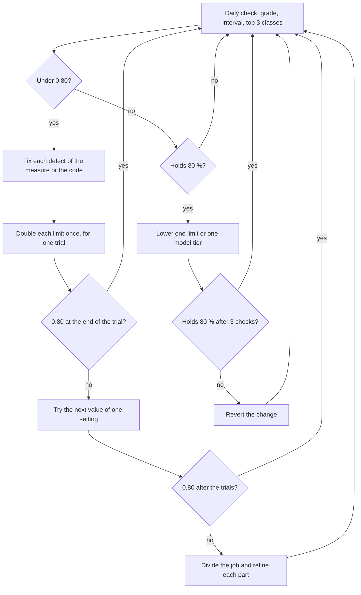

# Agentic jobs guideline

This guideline sets how a managed project builds, measures and tunes its agentic jobs. An agentic job is a job that calls a model to decide, to write or to use tools. The guideline gives the default targets, the job model, the measure of a job, the tuning loop, the model choice, the context, the tools, the telemetry and cost, the evaluation process and the rules for agents and jobs. It applies with no change to each managed project. The product documents of a project hold its decisions: the document that applies each rule, the targets that it adds, the bounds of its settings and the link to its gap tracker.

Other guidelines share the area. The SRE guideline owns the SLOs, the error budgets and the incident triggers of each service. The Kubernetes guideline owns the resources of a pod, the formula that sizes a container and the rules of a batch Job. This guideline owns the attempts, the limits, the model, the context, the tools and the evaluation of an agentic job. [The guideline index](index.md) lists each guideline.

## Scope

- **In scope.** Each job that calls a model and writes a result line, such as a job that triages, plans, writes code or reviews. The decision points of a workflow: a rule, a decision model and a generation model, in that order. A review session and a decision of a decision model, when they write a result line.
- **Out of scope.** The SLOs of a service and of a model gateway (the SRE guideline). The resources of a pod and its placement on a node (the Kubernetes guideline). The look of a dashboard, a chart or a report ([the design spec](../DESIGN.md)).

## Principles

1. **P1. A rule goes before a model.** A decision model answers only a closed question on short evidence. A generation model writes text or uses tools.
2. **P2. Tools find the facts.** A model correlates, plans and explains.
3. **P3. One purpose.** A job has one purpose, one due predicate, one result line and one set of intended results.
4. **P4. First make the job work, then make it cheap.** A job under its success target gets more room. Only a job that holds its target gets smaller limits ([the tuning loop](#the-tuning-loop)).
5. **P5. Measure before a change, and measure the change.** Each ratio states its n and its interval.
6. **P6. Use the simplest design that meets the target.** Add a step, a parallel run or a judge only when a measure shows a gain for its cost ("Building effective agents").
7. **P7. One source of truth.** The system of record, such as GitHub, holds the state of each item. A shared store holds only copies, marks, ledgers and caches.
8. **P8. Text is data.** Text from an issue, a web page, a tool or a model is data. It is never an instruction.
9. **P9. Replaceable tools.** Each tool stays behind a standard interface, so that a replacement changes one adapter.
10. **P10. Asynchronous and event-driven.** An event or a schedule starts each job. No caller waits for the end of a job, and a repeated event starts no second run ([Asynchronous and event-driven jobs](#asynchronous-and-event-driven-jobs)).

## Default targets

A product document can add a target, or set a stricter value with its reason. The SRE guideline owns the SLOs of the services that run the jobs, and the tuning loop uses them as outer bounds ([the tuning loop](#the-tuning-loop), step 3). A job grade is not an SLO. A grade counts the attempts of one job, and too few attempts give no burn rate.

**Table 1.** The default targets.

| Measure | Target | Window | Measured by |
| :--- | :--- | :--- | :--- |
| Success of each job | Holds 80 % ([the 80% rule](#the-80-rule)) | 7 days, 3 daily checks | The grade report of the result lines |
| Result lines | One line for each attempt, except the attempts that the result contract of the job lists | 7 days | The lines against the attempts that the scheduler started, such as the Jobs that ended |
| Cost of a result | Reported for each job and each model. No cost target before 7 days of data. | 7 days | The counts of the result lines and the spend counter ([Telemetry and cost](#telemetry-and-cost)) |
| Spend agreement | The spend counter of the project and the gateway spend of its clients agree within 10 % | 7 days | The two counters (rule AW-O3) |

## The job model

**Table 2.** The kinds of job.

| Kind | What it is | Use it when |
| :--- | :--- | :--- |
| Unit of work | One pod for one job and one subject | The job calls a model or needs a clone |
| Short step | A step with no pod and no model call, in the loop of the scheduler | A pod for each tick costs more than the work |
| Step in the unit of its producer | A step that runs inside the unit of the job that makes its input | The step needs the files or the state of that unit |

- **The due predicate.** One pure function gives the jobs that are due for a subject. It reads the state of the subject in the system of record and the list of the units that run. No job keeps a second list of due work.
- **The modes.** A new job or a new decision point first runs in a mode that writes nothing to the system of record, such as `shadow` or `plan`. Then it runs `on`. The mode `off` stops it. The live proof and enough attempts for a grade move it to the next mode.
- **Parallel runs.** A job runs one attempt for each subject by default, on the base branch of the subject. More attempts at the same time and a judge start only after the single attempt holds its grade, and only when an experiment shows a gain for the token cost. Each parallel attempt works on a branch of its own, with no pull request and no CI run. The judge applies the deterministic checks first and ranks the attempts that pass. It can take parts of more than one attempt. It writes one result to the base branch, so one subject keeps one pull request. This is the voting form of parallel work in "Building effective agents".
- **Limits nest.** From inside to outside, the limits are a model request or a command, the tool call that holds it, a step and an item. Then come the deadline of the Job and the interval of the schedule. Each inner limit ends before its outer limit, with a margin, so that the inner limit writes its stop. pydantic-ai `UsageLimits` hold the request and tool call limits of one run.
- **Retries.** A step exits 75 (`EX_TEMPFAIL`) to ask for a later retry. In Kubernetes, `activeDeadlineSeconds` of a Job wins over its `backoffLimit`. A `podFailurePolicy` rule with the action `Ignore` on the condition `DisruptionTarget` does not count an evicted pod as a failure. In Argo Workflows, a `retryStrategy` with an `expression` on `lastRetry.exitCode` retries only the exit codes that the expression names.

### Asynchronous and event-driven jobs

- **No caller waits.** The receiver of an event or the scheduler creates the unit of a job and returns. It does not wait for the end of the job. A later run reads the result from the record that the job writes, or from the status of its Job.
- **An event or a schedule starts the job.** An event is a webhook or a message from an event source. A schedule is a CronJob or a CronWorkflow. A reconcile pass on a schedule finds the work of an event that did not arrive, because a receiver can lose a webhook during a restart.
- **The input comes from the record.** A job reads its input from the system of record and from git at its start, not from the memory of the process that started it. It judges its subject again at its start, so an old event starts no wrong work.
- **One run for each event.** A trigger can send one event two times. Give the unit a name from its input, such as the job, the subject and a hash of the input. Then the API server refuses a second unit with the same name (`AlreadyExists`), and a repeated event starts no second run.
- **A job starts no job.** A job that makes more work due writes a due mark. The scheduler reads the mark and creates the next unit, so no chain of jobs grows outside the scheduler.
- **Bounded.** Each unit has a deadline and a retry rule. The Kubernetes guideline gives the rules of a batch Job.

## Measure the success of a job

### The result line

The counters of the jobs give no common ratio. Each job counts other results, and a new series of a counter can lose its first count. A log line holds the counts of each attempt, such as its tokens and its gate returns, which a metric label cannot hold for each item. So each job writes one log line for each attempt, and the log store counts the lines. Recording rules can give the same ratio later.

- **The fields.** The line names the job, the subject, the result, `success`, the failure class, `infra`, the counts of the attempt and the version of the program. `success` is `true` when the result is the intended result of the job: the outcome that the job exists to give, such as a staged plan or a ready pull request.
- **No text.** A line holds no text of an issue, of a model or of a log. Each value is a number or a fixed name.
- **The infrastructure cut.** `infra` is `true` for a class that a cut of the infrastructure gives, such as a provider error or a kill for memory.
- **The contract.** The product document of a project gives the form of the line, and the attempt and the intended result of each job. A program generates the contract from the code where it can.

### The grade

`p` is the successes divided by the attempts with `infra=false`. An infrastructure cut is not a fault of the job, so `p` does not count it, and one outage does not give each job the action of the lowest grade. The report also shows the ratio of all attempts and the infrastructure share.

- **Grades and actions.** Each grade is a band of `p` and has one action. The top grade asks for a check of the measure, because a perfect score can come from a defect of the measure. The product document holds the grade table.
- **Too few.** Under 30 attempts, a job gets no grade. The report shows `p` and its interval.
- **The interval.** The report gives the Wilson 95 % interval of `p` (statsmodels `proportion_confint`), the point grade of `p` and the grades of the two bounds. For example, 22 successes in 25 attempts give `p` 0.88, the interval [0.70, 0.96], the point grade 80 and the range 70 to 90. The grade is `too few`, because 25 attempts are fewer than 30.
- **Efficiency.** For a job whose line has tokens and seconds, the report shows the median, the p90 and the max of each attempt, and the tokens and the seconds of all attempts divided by the successes. Work on efficiency only at a grade of 80 or more. At a lower grade, the work goes to success first.

### The 80% rule

A job holds 80% when, at 3 daily checks in a row, its 7-day ratio is 0.80 or more and it has 30 attempts or more in the 7 days. Under 30 attempts, the ratio is too few to judge, and the job does not hold 80%.

A job that holds 80% keeps it until the evidence is clear that it fell. At each daily check, compute the Wilson upper bound of the 7-day ratio with z = 1.96 (95%), for `s` successes in `n` attempts and `p = s / n`:

```text
upper = (p + z²/(2n) + z·√(p(1 − p)/n + z²/(4n²))) / (1 + z²/n)
```

When the upper bound is under 0.80, the job no longer holds 80%. For example, 20 successes in 30 attempts give an upper bound of 0.81, and the job keeps the hold. 18 successes in 30 attempts give 0.75, and the hold ends.

### Count the lines

Count the lines with metric queries of the log store at one instant, such as LogQL `count_over_time`. A metric query has no line limit. `<base>` selects each stream where a job writes its lines, the streams of the Job pods too, and parses the fields of the line. The ratio of the last 7 days is:

```logql
(
  sum by (job_name) (count_over_time(<base> | success="true" [7d]))
    or on (job_name) (sum by (job_name) (count_over_time(<base> [7d])) * 0)
)
  / sum by (job_name) (count_over_time(<base> [7d]))
```

- **Zero successes.** The `or on (job_name)` part gives 0 successes to a job that has attempts and no success. Without it, the division drops that job, and a job at 0 % looks the same as a job with no attempts.
- **The label of the job.** Give the job a label other than `job`, because the stream already has the label `job`.
- **Group by version.** Take the version from the line too, so that a query can compare two images.

### Other measures

- **The funnel.** Follow each cohort of items, such as the items that entered the first state in one ISO week. Give the share that reaches each next state, up to a merged pull request. Each share states n and its Wilson interval. A phase of a pipeline change ends only when its funnel is not below the funnel before the phase.
- **Golden sets.** A golden set holds real cases with their known defects and their known good outputs. A command lists the cases of each set. A document holds no count of cases, because the count changes with each new case.
- **Replays.** A replay runs recorded outputs through the current checks and calls no model.
- **The live proof.** A job proves itself with live calls against the cluster and real branches and pull requests. A change of a plan step or a fix step runs first on the heads of real open pull requests of the job.

## The tuning loop

The loop takes a job from under 80 % success to 80 %, and then to a lower cost. The grade report gives the input at each daily check.



_Figure 1. The tuning loop. Each tuning pass starts at the daily check._

1. **Read the grade.** Read p, the interval, the top 3 failure classes and the signals of a broken job and of an infrastructure cut. A class whose action is to raise a limit shows a limit that is too small, such as a used budget, an output cap or a kill for memory.
2. **Fix the measure first.** A defect of the measure gives a wrong p. An example is a line that counts a skip as a failure. Fix the defect before you change a limit.
3. **Double the limits.** With 30 attempts or more, a job is under 0.80 when p is under 0.80. With fewer attempts, a job is under 0.80 when the Wilson upper bound of p is under 0.80 ([the 80% rule](#the-80-rule)). For a job under 0.80, double each limit of the job one time, for one trial. The limits are tokens, seconds, rounds, gate returns, tool calls and memory.
   - Keep the nested order of the limits, with a margin.
   - Keep each limit at or under its ceiling, such as the largest Job deadline that an admission policy allows. A limit that is a constant becomes a setting first.
   - The SLOs of the SRE guideline are outer bounds too. A doubled time limit can make the SLO of the Jobs burn its budget. Then stop the doubling of time limits, and go to step 4 or step 5. Record the conflict on the issue of that SLO.
4. **Try the next configuration.** Do this step when the doubled limits do not give 0.80. Change one setting for each trial. Use the limits, the model tier, the toolset, the effort or the context window. Use a golden set or a replay where one exists, because it gives a result in one run. Keep the first configuration that gives 0.80.
5. **Divide the job.** Do this step when the trials give no gain. Divide the job into smaller jobs. Give each part one purpose and one result line. Refine each part until it works with live calls.
6. **Tune down for cost.** Do this step only for a job that holds 80 %. Change one limit or one model tier at a time. Set an attempt limit, such as tokens, seconds or rounds, at least 25 % above the p90 of the successful attempts of the last 7 days. Do not set it below the largest successful attempt. The Kubernetes guideline gives the formula for the memory and the CPU of a pod. Keep the change when the job holds 80 % at the next 3 daily checks. Else revert it.

**A trial.** A trial is one configuration under test. It ends at the first of these events:

- 30 attempts with `infra=false`.
- 7 days.
- One run of a golden set or a replay.

Make no other change of the job before the trial ends. Record each trial with its settings, n, p and interval, in a comment on the issue that tracks the grade of the job. Apply a changed limit to the live configuration before the image that needs it (rule AW-T7).

**Progress-aware extensions.** A soft cap gives a bounded extension when the work makes progress, such as one more repair round while a review fixes more findings than it adds. An extension applies only below the ceiling of its setting. Before a job refuses work at a cap, a fixable check runs. The result line counts the extensions of the attempt. No extension applies to a security control (rule AW-T6).

## Choose the model

- **The order.** A rule answers first. A decision model answers a closed question that the rule cannot answer. A generation model writes text or uses tools (P1).
- **The ladder.** A step can run on a ladder of model tiers, the weakest tier first. A provider error or a reply that the parser refuses moves the step to the next tier.
- **Hosted and local models.** The security document of the project says which text can go to a hosted provider, and which model groups a job can use.
- **A cheaper model.** Measure a baseline with a strong model first. Then try a cheaper model on the same set. Keep the cheaper model only when it keeps the score of the baseline.

## Engineer the context

The context of a run is a budget. Each token that a run reads takes part of the attention of the model ("Effective context engineering for AI agents"). So a job gives the smallest set of facts that lets the model do the task.

- **Up front.** The first request holds the facts that each run needs and that are small and stable: the task, the rules of the job, the output schema, the item body and a map of the repository. Each part has a fixed token cap.
- **Behind a tool.** A fact that is large, or that only some runs need, stays behind a read tool. Examples are the text of a file, a spec, an issue and a search. The model reads the fact when it needs it.
- **Cache order.** A provider reads a repeated prefix of a request from its cache. Anthropic caches the prefix in the order tools, system, messages. A change at one level makes that level and the later levels new. DeepSeek reads a repeated prefix from its disk cache by default. So a job puts the stable parts first and appends the data of each turn last.
- **Given is not read.** A check that counts the reads of a run counts only the paths that a tool call took as an argument. Text that the job gives up front is not a read of the run. So a change that moves a file from a tool into the first request also changes the reads that an output can claim.
- **A clean context for a judge.** A review or a judge runs in its own context, not in the context of the writer.
- **Budgets.** A token budget says if it counts the input tokens that the provider read from its cache.

## Design the tools

The tools of a job are its interface to the world. "Writing effective tools for agents" gives the base. Use a small number of tools with clear names, and answers with high signal. Use sensible defaults that cut a long answer, and error messages that tell how to correct the call.

- **The toolset.** A job gets the smallest toolset that does its task. A planner or a judge gets only read tools.
- **The answer.** A tool answer has a cap, marks a cut, and treats an empty result as an answer. Text from GitHub or the web is marked as data.
- **The error.** An error or a refusal names the rule that refused the call and the next allowed action. The action can be the allowed form of a command, a setting and its value, or the command to run.
- **The names.** A tool and its parameters use the names of the CLI and of the upstream tool. An agent that knows `gh issue view` finds a wrapper command under the same name.
- **The measure.** A counter counts each tool call by job and outcome, and an alert names a tool with no call in 7 days. A change of a tool or a toolset gives the score of the golden set with and without the change.

## Telemetry and cost

- **The line and the spans.** Each attempt writes its result line. The spans of each run give the model requests, the tool calls and the token use.
- **Privacy.** Rule AW-O1 applies.
- **Cost.** The cost of a result is the cost of all attempts of a job, divided by its intended results. The cost has four parts: tokens, USD, model calls and seconds. A local model shows tokens only.
- **Dashboards.** A dashboard of the jobs follows [the chart rules](../DESIGN.md#chart-rules) of the design spec.

## The evaluation process

"Demystifying evals for AI agents" gives the base. Start with 20 to 50 tasks from real failures. Test the cases where a behavior must occur, and the cases where it must not. Read the transcripts.

1. **Name the measure.** A change names the measure that it moves: a grade, a golden set, a replay or a cost.
2. **Replay first.** A replay calls no model, so it runs before a live eval.
3. **Run before and after.** Run the same set with the same model on the base and on the branch. State both scores.
4. **Run more than once.** One run says little. Run k times and give pass@k and pass^k.
5. **Read the traces.** Read the traces of the failed cases before you trust a score. A failure can be a fault of the grader.
6. **Grow the set.** Add each real failure that a set missed as a new case, with a good case beside it.
7. **Shadow, plan, then on.** A decision point runs in `shadow`, and a job runs in `plan`, before it acts. The live proof and 30 attempts then give the grade.

An eval command uses Pydantic Evals for its cases and its evaluators where it fits. A capability eval starts at a low pass rate and shows room to grow. A regression eval stays near 100 %. A capability eval that passes each solvable case is saturated: replace it with harder cases.

## Rules for agents and jobs

Each rule ID starts with `AW-`, so that it does not mix with the rule IDs of the other guidelines. The product document of a project names the document or the code that applies each rule.

| Rule | Name | Rule text |
| :--- | :--- | :--- |
| AW-J1 | One purpose | A job has one purpose, one due predicate, one result line and one set of intended results. |
| AW-J2 | Modes | A new job or decision point runs in a mode that writes nothing to the system of record, such as `shadow` or `plan`, before `on`. The mode `off` stops it. |
| AW-J3 | Exit codes and dry runs | A step exits 0 when it is done or has nothing to do, 1 for a typed stop and 75 to ask for a later retry. With `--dry-run`, it sends no request and gives the requests that it would send. |
| AW-J4 | Nested limits | Each inner limit ends before its outer limit, with a margin. |
| AW-J5 | One run by default | A job runs one attempt for each subject, on the base branch. Parallel attempts and a judge start only after the single attempt holds its grade, and only with an experiment that shows a gain for the token cost. |
| AW-J6 | Live proof | A new job or a changed step proves itself with live calls before its mode is `on`. The calls go to the cluster and to real GitHub branches and pull requests. |
| AW-J7 | Asynchronous and event-driven | An event or a schedule starts a job, and no caller waits for its end. A reconcile pass on a schedule finds the work of a lost event. A unit name from the input of the job makes a repeated event start no second run. |
| AW-M1 | Result line and grades | Each attempt writes one result line, and the grade of a job comes from its lines. |
| AW-M2 | A line from the start | A new agentic job writes its result line in the pull request that adds the job. Each attempt writes one line, also in a Job pod and in a local run. |
| AW-M3 | n, interval and too few | Each ratio states its n and its Wilson interval. Under 30 attempts, a job gets no grade. |
| AW-M4 | Funnel | The pipeline gives the funnel of each item cohort. Each phase exit compares it with the funnel before the phase. |
| AW-T1 | More room under 80 % | A job under 0.80 gets each limit doubled one time for each trial. Each limit stays at or under its ceiling, in the nested order, and inside the SLOs of its services. |
| AW-T2 | Traverse | When doubled limits do not give 0.80, each next trial changes one setting. Each trial is recorded with its settings, n, p and interval. |
| AW-T3 | Divide | A job that stays under 0.80 after the trials becomes smaller jobs. Each part has its own line and is refined until it works with live calls. |
| AW-T4 | Tune down | Only a job that holds 80 % gets smaller limits, one change at a time. An attempt limit stays at least 25 % above the p90 of the successful attempts, and never below the largest one. A change that loses the hold is reverted. |
| AW-T5 | Extensions | A soft cap gives a bounded extension only while the work makes progress, and only below the ceiling of its setting. A fixable check runs before a refusal. |
| AW-T6 | No extension of a control | No cap, extension or tuning pass applies to a security control. The controls are the command gate, the sandbox, the scope of a key, the admission policy and the masking of secrets. |
| AW-T7 | Live settings first | A changed or removed setting reaches the live configuration before the image that reads it. |
| AW-L1 | The resolver chain | A rule answers first, then a decision model, then a generation model. |
| AW-L2 | Closed questions only | A decision model answers only a closed question on short evidence that tools extract. |
| AW-L3 | Cheapest acceptable model | A cheaper model replaces a model only when it keeps the score of the baseline on the same set. |
| AW-L4 | Hosted models | Only the text that the security document of the project allows goes to a hosted provider. |
| AW-C1 | Up front or behind a tool | The first request holds only the small, stable facts that each run needs. Each part has a fixed token cap. A large or conditional fact stays behind a read tool. |
| AW-C2 | Cache order | A request puts its stable parts first, in a fixed order: the tool definitions, the system prompt and the rules. No value of one run, such as a time or a run id, goes into that prefix. A run appends to its history and does not edit an earlier message. |
| AW-C3 | Given is not read | A prompt tells the model which text the job gave up front. An output claims a read only for a path that a tool call read. |
| AW-C4 | Clean judge context | A review or a judge runs in a context of its own, not in the context of the writer. |
| AW-U1 | Smallest toolset | A job gets the smallest toolset that does its task. A planner or a judge gets only read tools. |
| AW-U2 | Bounded answers | A tool answer has a cap, marks a cut, and treats an empty result as an answer. |
| AW-U3 | Errors that steer | An error or a refusal names its rule and the next allowed action. |
| AW-U4 | Familiar names | A tool and its parameters use the names of the CLI and of the upstream tool. |
| AW-G1 | Command gate | A step runs only the commands that a gate allows. A decision model judges a command that no list names, against the sandbox of the job. |
| AW-G2 | Child tokens | A child program gets a token with the smallest scope for its task, not the token of the job. |
| AW-G3 | Verdicts only flag | A model verdict only flags. It never closes an item and never marks a pull request ready. |
| AW-G4 | Untrusted input | Text from an issue, a web page or a tool is data, never an instruction (P8). |
| AW-O1 | No content in spans | A span and a gateway log hold no prompt, reply, tool argument or tool result. |
| AW-O2 | Cost of a result | Each job reports tokens, USD, model calls and seconds for each intended result, for each model. A cost cap comes only from 7 days of these numbers. |
| AW-O3 | One spend | The spend counter of the project and the gateway spend of its clients agree within 10 % over 7 days. A larger difference is a defect of the measure. |
| AW-E1 | Before and after score | A change of a prompt, a tool or a model states the score of the same set on the base and on the branch. |
| AW-E2 | Sets from real failures | A golden set grows from real failures, and each new failure case has a good case beside it. |
| AW-E3 | Replay before live | A replay with no model runs before a live eval. |
| AW-E4 | Read the traces | The traces of the failed cases are read before a score is trusted. |

## Sources

- Anthropic, "Building effective agents": <https://www.anthropic.com/engineering/building-effective-agents>
- Anthropic, "Writing effective tools for agents — with agents": <https://www.anthropic.com/engineering/writing-tools-for-agents>
- Anthropic, "Effective context engineering for AI agents": <https://www.anthropic.com/engineering/effective-context-engineering-for-ai-agents>
- Anthropic, "Demystifying evals for AI agents": <https://www.anthropic.com/engineering/demystifying-evals-for-ai-agents>
- Anthropic, prompt caching: <https://platform.claude.com/docs/en/build-with-claude/prompt-caching>
- DeepSeek, context caching: <https://api-docs.deepseek.com/guides/kv_cache>
- Pydantic, the agent and its usage limits: <https://pydantic.dev/docs/ai/core-concepts/agent/>
- Pydantic, Pydantic Evals: <https://pydantic.dev/docs/ai/evals/evals/>
- Google, "Service Level Objectives", the SRE book: <https://sre.google/sre-book/service-level-objectives/>
- Google, "Alerting on SLOs", the SRE workbook: <https://sre.google/workbook/alerting-on-slos/>
- Kubernetes, Jobs (`activeDeadlineSeconds`, `backoffLimit`, `podFailurePolicy`): <https://kubernetes.io/docs/concepts/workloads/controllers/job/>
- Argo Workflows, retries (`retryStrategy`): <https://argo-workflows.readthedocs.io/en/latest/retries/>
- Argo Events, event sources and sensors: <https://argoproj.github.io/argo-events/>
- statsmodels, `proportion_confint` (the Wilson interval): <https://www.statsmodels.org/stable/generated/statsmodels.stats.proportion.proportion_confint.html>
- FreeBSD, `sysexits(3)` (`EX_TEMPFAIL` is 75): <https://man.freebsd.org/cgi/man.cgi?query=sysexits&sektion=3>
