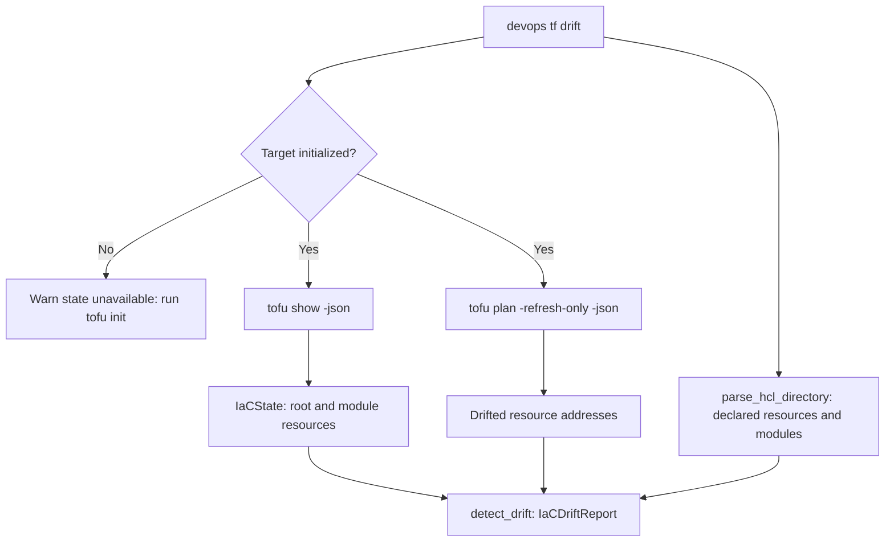

# Design

## Architecture

The OpenTofu and Terraform integration uses binary execution for state inspection and drift detection while keeping in-process HCL parsing for graph analysis.

### Components

1. `is_directory_initialized(directory: Path) -> bool`:
   Checks if `.terraform` directory exists.
   If false, drift detection reports state unavailable.

2. `parse_show_state(payload: dict[str, Any]) -> IaCState`:
   Parses `tofu show -json` output.
   Extracts resources from `values.root_module.resources` and recursively from `values.root_module.child_modules`.
   Reads `provider_name` directly without guessing.

3. `parse_plan_drift(raw_output: str | dict[str, Any]) -> list[str]`:
   Parses `resource_drift` items from JSON objects or JSON line streams produced by `tofu plan -refresh-only -json`.

4. `detect_drift(config: IaCConfiguration, state: IaCState | None, *, drifted_addresses: Sequence[str] | None = None) -> IaCDriftReport`:
   Compares declared root resources and declared modules against state resources.
   Resources in declared child modules are marked in sync, not orphaned.
   Resources present in `drifted_addresses` are marked as drifted.

## Rejected Alternatives

### In-process state file JSON parsing
- Rejected because `.tfstate` files are internal to OpenTofu and Terraform.
- Direct JSON parsing of `.tfstate` cannot decrypt client-side encrypted state files.
- Direct parsing fails to map module resources and provider aliases accurately.

### Standard `tofu plan` without `-refresh-only`
- Rejected because a standard plan compares desired configuration against state to generate mutation actions.
- Drift detection requires refreshing state against live infrastructure to identify external divergence.
