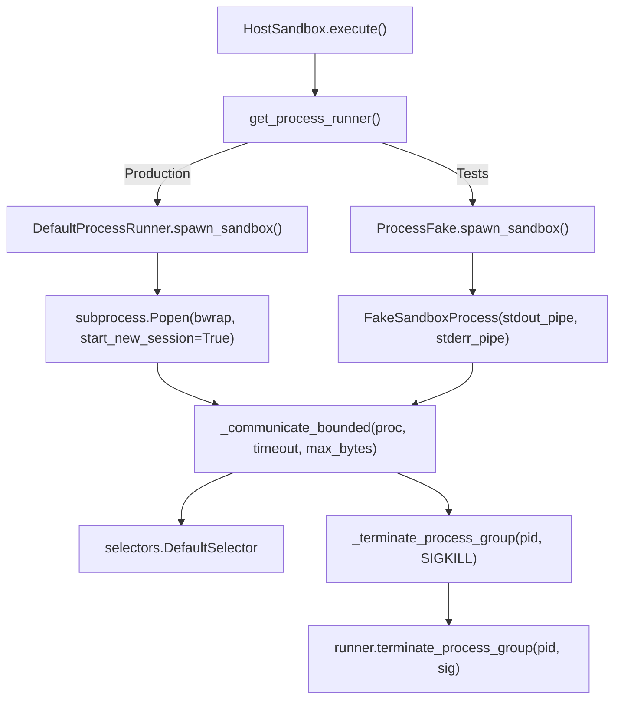

# Design: Sandbox Process Fake and Opt-In Bubblewrap Suite

## Architecture Overview

The design unifies process execution across host sandboxing, eliminates mock detection in product code, and makes live bubblewrap tests strictly opt-in:

## Component Details

### 1. `ProcessRunner` & `core/process.py`
- Protocol method: `spawn_sandbox(cmd: Sequence[str] | list[str]) -> Any`
- Protocol method: `terminate_process_group(pid: int, sig: int = signal.SIGTERM) -> bool`
- `DefaultProcessRunner` calls `subprocess.Popen(cmd, stdin=subprocess.DEVNULL, stdout=subprocess.PIPE, stderr=subprocess.PIPE, start_new_session=True)` and implements `terminate_process_group`.
- `terminate_process_group` delegates to active runner if available, with fallback to standard OS process group termination.

### 2. `sandbox/host.py`
- Remove `_is_mock_subprocess` and `_communicate_mock`.
- `_run_sandbox_process` calls `runner.spawn_sandbox(cmd)` instead of `subprocess.Popen`.
- Bounded I/O loop (`_communicate_bounded`) executes uniformly in all environments.

### 3. `tests/support/fakes/process.py`
- Define `FakeSandboxProcess`:
  - Uses `os.pipe()` for `stdout` and `stderr` binary streams.
  - Exposes `poll()`, `wait(timeout=...)`, `send_signal(sig)`, `kill()`, `terminate()`.
  - Records all signal terminations and wait calls.
  - Supports configurable behaviors: exit code, stdout/stderr byte payloads, wait hang simulation for reap testing.
- `ProcessFake`:
  - Implements `spawn_sandbox(cmd)` and maintains `sandbox_processes: list[FakeSandboxProcess]`.
  - Implements `terminate_process_group(pid, sig)` to signal matching `FakeSandboxProcess` instances and record terminated PIDs.
  - Provides helper `answer_sandbox(...)` or scriptable response.

### 4. Opt-in Bubblewrap Suite
- In `tests/conftest.py`, update `pytest_collection_modifyitems`:
  - When `-m` option does not contain `"bwrap"`, deselect all items marked with `@pytest.mark.bwrap`.
  - When `-m bwrap` is specified, preserve items and skip only if `bwrap` is not installed on the system.
