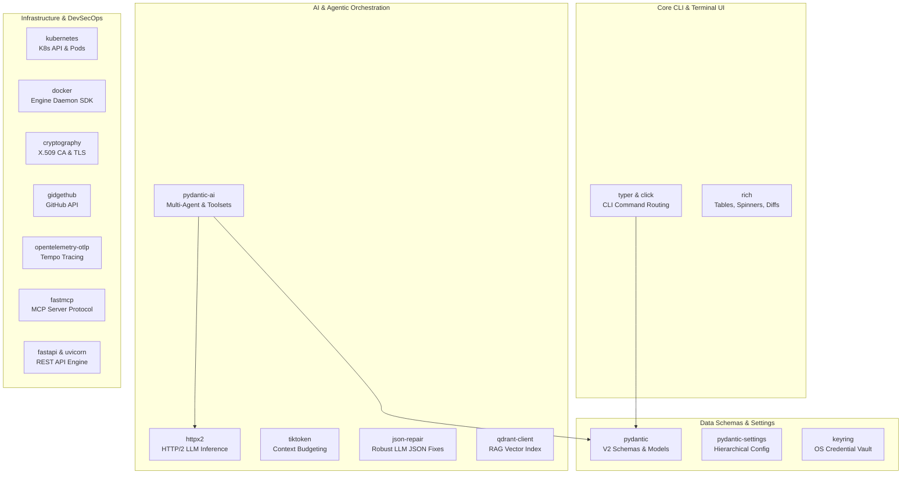

# Python Packages & Code Libraries Reference Manual

This technical reference manual provides a comprehensive, deep-dive architectural guide to every Python package and code library integrated into the `devops-cli` ecosystem. It details production runtime dependencies, development quality tools, architectural roles, code patterns, and best practices across the codebase.

---

## 📦 Package Architecture Overview

`devops-cli` implements a modern, high-performance, strictly typed Python 3.14+ runtime architecture. Dependencies are strictly categorized into:
1. **Core Runtime Packages (`dependencies`)**: Production libraries powering the CLI framework, AI multi-agent engine, Kubernetes/Docker controllers, OpenTelemetry tracing, cryptographic engine, and REST services.
2. **Development & Quality Tooling (`dependency-groups.dev`)**: High-speed testing, coverage validation, static typing, and AST security scanners enforcing the `devops ci` quality gate.
3. **Build Backend (`build-system`)**: Standard PEP 517 build system for reproducible wheel generation via `hatchling`.

`pyproject.toml` and `uv.lock` own the version of each package, and Renovate changes them. This manual names no version. To find the version of a package, read `uv.lock`.



---

## 🚀 Core Runtime Code Libraries

### 1. CLI & Terminal Interface

#### `typer` & `click` ([Dedicated Manual](libraries/typer.md))
- **Ecosystem Role**: Provides declarative CLI application scaffolding, subcommand dispatching, argument/option parsing, shell autocompletion, and type inference.
- **Codebase Integration**:
  - `devops_cli.core.cli.new_typer`: Factory creating standardized Typer apps with unified formatting, error handlers, and help text from `devops_cli.lang.HELP`.
  - Type annotations (`Annotated[T, typer.Option(...)]`) map automatically to rich terminal options and validation rules.

```python
from typing import Annotated
import typer
from devops_cli.core.cli import new_typer
from devops_cli.lang import HELP

app = new_typer(help=HELP.main.app)


@app.command("run")
def run_command(
    target: Annotated[str, typer.Argument(help=HELP.options.target_dir)],
    dry_run: Annotated[bool, typer.Option("--dry-run", help=HELP.options.dry_run)] = False,
) -> None: ...
```

#### `rich` ([Dedicated Manual](libraries/rich.md))
- **Ecosystem Role**: Terminal rendering engine providing colorized output, syntax highlighting, formatted tables, animated spinners, status displays, and progress bars.
- **Codebase Integration**:
  - `devops_cli.output`: Centralized console abstractions (`print_table`, `print_success`, `print_error`, `print_info`, `print_warning`, `print_muted`).
  - Diffs and finding locations are rendered in Rich tables using the canonical `filename.ext:n-n` syntax.

---

### 2. Data Validation, Settings & Secrets

#### `pydantic` (v2) ([Dedicated Manual](libraries/pydantic.md))
- **Ecosystem Role**: High-performance data validation, parsing, serialization, and JSON Schema generation using compiled Rust core (`pydantic-core`).
- **Codebase Integration**:
  - Domain models (`devops_cli.models`), review findings (`devops_cli.ai.review_schema.Finding`), tool schemas, and AI agent outputs inherit from `BaseModel`.
  - Enforces `Field(default_factory=...)`, strict validation, and seamless conversion to/from dict and JSON.

```python
from pydantic import BaseModel, Field
from devops_cli.ai.review_schema import Finding
```

#### `pydantic-settings` ([Dedicated Manual](libraries/pydantic.md))
- **Ecosystem Role**: Layered configuration management loading settings from environment variables, `.env` files, TOML/JSON configs, and CLI overrides.
- **Codebase Integration**:
  - `devops_cli.config.settings.Settings`: Unified singleton loading application configuration with prefix `DEVOPS_CLI_` and automatic type coercion.

#### `keyring` ([Dedicated Manual](libraries/keyring.md))
- **Ecosystem Role**: Zero-trust credential security interface integrating with native OS vaults (Secret Service on Linux, Keychain on macOS, Credential Manager on Windows).
- **Codebase Integration**:
  - `devops_cli.config.settings` (keyring helpers) and `devops_cli.security.secrets` (provider chain): Securely retrieves and stores GitHub Personal Access Tokens, LLM API keys, and sensitive credentials without storing plaintext in files or environment variables.

---

### 3. Agentic AI, LLM Client & Semantic Search

#### `pydantic-ai` ([Dedicated Manual](libraries/pydantic_ai.md))
- **Ecosystem Role**: Multi-agent framework enabling type-safe tool execution, dynamic instructions, structured output validation, model overrides, and sub-agent delegation.
- **Codebase Integration**:
  - `devops_cli.ai.client.factory.build_agent`: Unified factory constructing native Pydantic AI `Agent` instances with spend tracking hooks and capability integration.
  - `pydantic_ai.mcp.MCPToolset`: Pydantic AI's own client for an external Model Context Protocol server. devops-cli wires no outbound MCP client today; see the manual for the pattern.

#### `httpx2` (Pydantic HTTP/2 Client) ([Dedicated Manual](libraries/httpx2.md))
- **Ecosystem Role**: Advanced HTTP/2 and HTTP/1.1 client supporting connection pooling, asynchronous streaming, mTLS, and multiplexed requests.
- **Codebase Integration**:
  - `devops_cli.ai.client.unified.LLMClient`: Executes high-throughput streaming requests to LLM inference endpoints (Ollama, Claude, OpenAI-compatible, Copilot, the LLM gateway) with bounded timeouts and TLS verification.

#### `tiktoken` ([Dedicated Manual](libraries/tiktoken.md))
- **Ecosystem Role**: Fast BPE (Byte-Pair Encoding) tokenizer developed by OpenAI for token counting and context window management.
- **Codebase Integration**:
  - `devops_cli.ai.context_budget`: Accurately counts tokens in diffs, prompts, and knowledge base files, preventing LLM context window overflows and optimizing cost.

#### `pydantic-ai-harness` ([Dedicated Manual](libraries/pydantic_ai_harness.md))
- **Ecosystem Role**: Capabilities for pydantic-ai agents. `Coder` gives an agent the file and shell tools of a coding agent.
- **Codebase Integration**:
  - `devops_cli.roadmap.implement.implement_step`: Runs one task group of a staged change in one bounded agent run (`devops roadmap implement --group`).
  - `devops_cli.roadmap.implement.implement_run`: Runs the steps of a staged item to a draft pull request with the final title and body (`devops roadmap implement`), in a runner pod only.

#### `json-repair` ([Dedicated Manual](libraries/json_repair.md))
- **Ecosystem Role**: Resilient JSON parser capable of repairing malformed, unclosed, or truncated JSON responses emitted by LLMs.
- **Codebase Integration**:
  - `devops_cli.ai.response_repair` & `devops_cli.ai.client.structured`: Automatically repairs and parses structured model outputs without crashing when tokens are abruptly truncated.

#### `qdrant-client` ([Dedicated Manual](libraries/qdrant_client.md))
- **Ecosystem Role**: Vector database client supporting in-memory, local on-disk storage, and remote server connectivity for dense embeddings.
- **Codebase Integration**:
  - `devops_cli.ai.rag.qdrant`, `.indexer` and `.retriever`: Manages vector collections, cosine distance indexing, and semantic search retrieval to ground AI code reviews against knowledge base manuals.

---

### 4. Git, GitHub & DevSecOps Subsystems

#### `gidgethub`
- **Ecosystem Role**: Sans-I/O GitHub REST client. It builds each request and decodes each answer. It sends nothing itself.
- **Codebase Integration**:
  - `devops_cli.github.session` and `devops_cli.github.session_transport`: Send every REST request as the one identity of the process, read every `Link` page, and raise the typed GitHub errors. See ADR 0006.
  - `devops_cli.github.client`: Reads pull requests, the files, the merge base and the diff of a compare of two commits, files at a commit and repositories through the session. It posts review comments through the session.

#### `cryptography` ([Dedicated Manual](libraries/cryptography.md))
- **Ecosystem Role**: Industry-standard cryptographic library providing X.509 certificate generation, RSA/Ed25519 keypair creation, CSR signing, and TLS encryption.
- **Codebase Integration**:
  - `devops_cli.crypto.tls_certificates`: Automatically generates root Certificate Authorities, server certificates with SAN (Subject Alternative Names), and exports PEM/CRT bundles.
  - `devops_cli.commands.ssh`: Generates and rotates Ed25519 SSH keys with 90-day expiry naming conventions.

#### `tldextract` ([Dedicated Manual](libraries/tldextract.md))
- **Ecosystem Role**: Accurately separates domain subtotals using the Public Suffix List (PSL).
- **Codebase Integration**:
  - `devops_cli.security.reference_extractor`: Parses hosts from URLs and IP literals referenced in code (never bare words) for threat-intel lookups.

#### `pathspec` ([Dedicated Manual](libraries/pathspec.md))
- **Ecosystem Role**: Fast pattern matching utility implementing `.gitignore` style globbing rules.
- **Codebase Integration**:
  - `devops_cli.core.gitignore` & `devops_cli.core.repo`: compile `.gitignore` patterns with `PathSpec.from_lines("gitignore", ...)` so ignored files are excluded from scans and review passes.

#### `packaging` ([Dedicated Manual](libraries/packaging.md))
- **Ecosystem Role**: Core packaging utilities for parsing Semantic Versioning (SemVer 2.0.0) and PEP 440 specification rules.
- **Codebase Integration**:
  - `devops_cli.core.validation`: Validates version strings and specifiers (PEP 440 / SemVer).

---

### 5. Kubernetes, Containers, Observability & Services

#### `kubernetes` ([Dedicated Manual](libraries/kubernetes.md))
- **Ecosystem Role**: Official Python client for the Kubernetes API (CoreV1Api, AppsV1Api, CustomObjectsApi).
- **Codebase Integration**:
  - `devops_cli.commands.k8s`: Inspects cluster nodes, queries running pods, streams container logs, creates TLS secrets, and executes in-cluster diagnostics.

#### `docker` ([Dedicated Manual](libraries/docker.md))
- **Ecosystem Role**: Docker SDK for Python interacting with the Docker Engine daemon over Unix sockets or TCP.
- **Codebase Integration**:
  - `devops_cli.commands.docker`: Collects real-time container CPU/memory statistics, checks container health, and inspects image layers.

#### `fastmcp` ([Dedicated Manual](libraries/fastmcp.md))
- **Ecosystem Role**: High-level Model Context Protocol (MCP) server framework exposing Python functions as standardized tools and prompts.
- **Codebase Integration**:
  - `devops_cli.ai.mcp.server`: Exposes `devops-cli` tools (`review_path`, `k8s_pods`, `tf_plan`, `scan_uv_audit`, `security_intel_package`) to AI assistants via stdio and SSE transports.

#### `fastapi` & `uvicorn` ([Dedicated Manual](libraries/fastapi_uvicorn.md))
- **Ecosystem Role**: Asynchronous web framework and lightning-fast ASGI server for building high-performance REST APIs with auto-generated OpenAPI documentation.
- **Codebase Integration**:
  - `devops_cli.server`: Powers `devops serve`, providing REST endpoints for health probes (`/health`, `/healthz`), Prometheus metrics (`/metrics`), status, workspaces, config and telemetry.

#### `opentelemetry-sdk` ([Dedicated Manual](libraries/opentelemetry.md))
- **Ecosystem Role**: The OpenTelemetry SDK: the `MeterProvider` that aggregates metrics as deltas before export.
- **Codebase Integration**:
  - `devops_cli.telemetry.tracer`: Builds the spans, metrics and logs of CLI subcommands, multi-agent review stages and tool executions; `devops_cli.telemetry.exporter` posts them over OTLP/HTTP to the OpenTelemetry Collector.

#### `PyYAML` & `jinja2` ([Dedicated Manual](libraries/pyyaml_jinja2.md))
- **Ecosystem Role**: YAML parsing/serialization and expressive text templating engine.
- **Codebase Integration**:
  - `devops_cli.commands.k8s` & `devops_cli.commands.devcontainer`: Dynamically renders DevContainer configurations, ArgoCD manifests, and Helm values files.

#### `ruamel.yaml` ([Dedicated Manual](libraries/pyyaml_jinja2.md))
- **Ecosystem Role**: YAML round-trip editing that keeps the comments, the order of the keys, the quotes and the unknown keys of a file.
- **Codebase Integration**:
  - `devops_cli.config.round_trip`: `save_settings` edits `config.yaml` in place and writes only the keys whose values changed (#1999).

#### `tomlkit`
- **Ecosystem Role**: TOML round-trip editing that keeps the comments and the order of the keys of a file. The standard library `tomllib` only reads TOML.
- **Codebase Integration**:
  - `devops_cli.roadmap.implement.implement_strength`: the mutation run of the strength check adds the scoped test modules to `pytest_add_cli_args_test_selection` of `[tool.mutmut]` in `pyproject.toml`, and writes the bytes of the file back after the run (#5887).

---

## 🛠️ Development, CI Quality & Verification Tooling

The development environment leverages modern Python engineering tools managed via Astral `uv`:

| Tool | Quality Gate Role | Execution Command |
| :--- | :--- | :--- |
| **`ruff`** | Extreme-speed linter and code formatter running the rule families selected in `pyproject.toml` `[tool.ruff.lint]`. | `uv run ruff check .` / `uv run ruff format .` |
| **`mypy`** | Strict static type checker validating 100% type coverage with Pydantic v2 plugin. | `uv run mypy src` |
| **`ty`** | Type checker that `uv check` runs. The `dev` group pins it, and `uv check` uses the version in `uv.lock`, so a new release cannot fail `main` with no change in the repository. | `uv check` |
| **`pytest`** | Comprehensive unit and integration test runner. | `uv run pytest` |
| **`pytest-asyncio`** | Asyncio fixture and test execution plugin for asynchronous tool loops. | Included in pytest suite |
| **`pytest-mock`** | Thin wrapper around standard library `unittest.mock` for clean fixture patching. | Included in pytest suite |
| **`pytest-cov`** | Code coverage measurement enforcing strict $\ge 90\%$ minimum threshold project-wide. | `uv run pytest --cov=src` |
| **`pytest-xdist`** | Multi-core parallel test execution distribution across worker subprocesses. | `uv run pytest -n auto` |
| **`pytest-randomly`** | Shuffles test order and reseeds `random` for each test; blocked in `addopts` (`-p no:randomly`) and enabled only by `devops ci test --repeat`. | `uv run devops ci test --repeat 3 <test files>` |
| **`pytest-timeout`** | Fails a test that hangs at the per-test bound in `[tool.pytest.ini_options]` (`timeout`, `timeout_method = "signal"`), so a stuck test fails in its own process and the run carries on. | `@pytest.mark.timeout(<seconds>)` for a test that needs longer |
| **`bandit`** | AST-based Python security analyzer detecting insecure patterns (CWE checks). | `uv run devops ci security` (`bandit -r src` at low, `bandit -r tests` at medium, with `--ini .bandit`) |
| **`pre-commit`** | Multi-hook manager orchestrating git commit quality gates. | `uv run pre-commit run --all-files` |
| **`hatchling`** | Build backend complying with PEP 517 / PEP 621 for wheel generation. | `uv build` |

---

## 🔒 Engineering Standards & Integration Principles

1. **Deterministic Version Pinning**: All package versions are strictly pinned with exact versions (`==`) in `pyproject.toml` and verified in `uv.lock` to guarantee reproducible builds across workstations, CI runners, and DevContainers.
2. **Automated Vulnerability Audits**: The `devops ci` quality gate automatically audits dependencies for known CVEs via `uv audit`, and the root `package-lock.json` of the Node tools via `npm audit`.
3. **Lazy Subsystem Loading**: High-overhead modules (e.g. `fastmcp`, `qdrant-client`, `docker`, `kubernetes`, `fastapi`, `cryptography`) are imported lazily within subcommand execution functions to ensure CLI cold-start latency remains low.
4. **Standard Library Leverage First**: Ad-hoc helper loops or custom workarounds are avoided in favor of standard library modules (`functools`, `itertools`, `pathlib`, `ipaddress`, `urllib.parse`) and established libraries.
5. **Strict Type Safety**: All external library integrations must provide complete type annotations compatible with `mypy --strict`.
