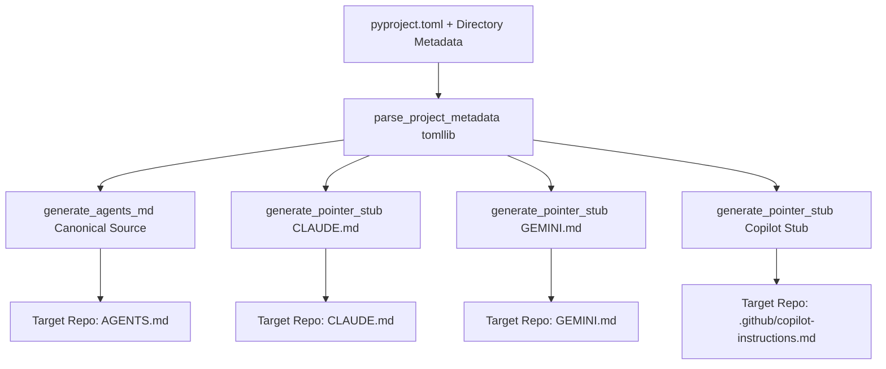

# Knowledge Base Task: AI Agent Instructions Scaffolding & Pointer Stubs

## 1. Overview & Purpose

The AI Agent Instructions Scaffolding subsystem (`devops ai agents`, `devops devcontainer init`, and `src/devops_cli/ai/instruction_generator.py`) generates the router `AGENTS.md` and the tool pointer stubs (`CLAUDE.md`, `GEMINI.md`, `.github/copilot-instructions.md`) across repositories. `AGENTS.md` gives AI coding assistants one short file that routes each task to the document that owns it. The text comes from the Jinja2 templates `src/devops_cli/templates/AGENTS.md.j2` and `pointer_stub.md.j2`.

---

## 2. Architecture & Pointer Stub Model



- **Single Source of Truth**: `AGENTS.md` holds the rules for every task and a table that routes each kind of task to the document that owns it. It stays within `CONST_AGENTS_MD_MAX_CHARS`. The table has a row for each document of `CONST_AGENTS_MD_ROUTES` that exists in the target, and the push rule names the pre-push hooks of the target, or the uv defaults. A model answer longer than the cap is replaced by the template.
- **Thin Redirection Pointers**: Tool-specific instruction files (`CLAUDE.md`, `GEMINI.md` and `.github/copilot-instructions.md`) are lightweight pointer stubs that direct tools to `AGENTS.md`, avoiding duplicated or out-of-sync documentation. One table, `POINTER_STUBS`, holds what differs between the stubs. It holds the tool name, the title and the link to `AGENTS.md`. It also holds the import line of a tool that expands one, in the form that the documentation of the tool shows: `@AGENTS.md` for Claude Code and `@./AGENTS.md` for Gemini CLI.
- **Dynamic Metadata Extraction**: Uses Python's standard `tomllib` to inspect `pyproject.toml` dynamically for project name, description, Python runtime requirements, entry points, and dependencies.

---

## 3. Useful Usage Information & Common Commands

### Scaffolding Commands
```bash
# Regenerate instruction files from the template without the LLM
devops ai agents --repo repos/my-org/my-project --template

# Overwrite an existing AGENTS.md (refused without --force)
devops ai agents --repo repos/my-org/my-project --force

# Automatically scaffolded during devcontainer initialization
devops devcontainer init

# Automatically scaffolded during container post-create hook if missing
devops devcontainer post-create
```

---

## 4. Best Practice Guidance

1. **Put Each Rule in Its Owner**: Write a new rule in the document that owns its subject. Change `AGENTS.md` only for a rule that every task needs, or for a route to a new document. In devops-cli, `--force` replaces the hand-written `AGENTS.md` with the generic router.
2. **Never Duplicate Content in Stubs**: Always keep `CLAUDE.md`, `GEMINI.md` and `.github/copilot-instructions.md` as thin pointers redirecting to `AGENTS.md`.
3. **Idempotent Scaffolding**: `scaffold_agent_instructions` checks for existing files and skips generation unless `--force` is specified.
4. **Target Path Safety**: Always validate file paths to prevent directory traversal outside the target repository root.

---

## 5. Security Recommendations & Zero-Trust Policies

- **No Secrets in Prompts or Instructions**: Never include live tokens, private keys, or credentials in `AGENTS.md` or instruction templates.
- **Zero Inline Prompts**: Multi-line LLM prompts and task instructions must reside in dedicated Markdown files under `src/devops_cli/ai/tasks/` rather than inline Python strings.

---

## 6. General Standards & Reference Guidelines

- **Canonical File**: `AGENTS.md` at target repository root.
- **Claude Pointer**: `CLAUDE.md` at target repository root (`./AGENTS.md`).
- **Gemini Pointer**: `GEMINI.md` at target repository root (`./AGENTS.md`).
- **Copilot Pointer**: `.github/copilot-instructions.md` (`../AGENTS.md`).

---

## 7. Official References & Published Artifacts

- **DevOps CLI Agent Guidelines**: [AGENTS.md](../../../../../../AGENTS.md)
- **Instruction Generator Module**: [src/devops_cli/ai/instruction_generator.py](../../../instruction_generator.py)
- **AI Command Module**: [src/devops_cli/commands/ai.py](../../../../commands/ai.py)
