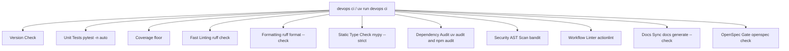

# Knowledge Base Task: Local CI Quality Gate & Validation

## 1. Overview & Purpose

The Local CI Quality Gate (`devops ci`) provides a local quality gate that runs every check `devops ci` reports (Python version, tests, coverage, ruff lint, ruff format, mypy --strict, uv audit and npm audit, bandit, actionlint, docs, devcontainer, openspec, uv check, uv lock --check, outdated deps). The pre-push hook runs only the fast static checks (ruff lint, ruff format, actionlint and zizmor), so a push goes only when they pass. The required checks of CI (`Static Analysis`, `Tests & Coverage` and `Semantic PR title`) must pass on a pull request before it merges, and the release pull request runs the same checks on each new `main`. The full `devops ci` is a manual run (#1752).

---

## 2. Architecture & The Local Quality Gate



---

## 3. Useful Usage Information & Common Commands

### CI Commands
```bash
# Execute full local quality gate
devops ci

# Execute with automatic fixes for linting and formatting
devops ci --fix

# Run targeted checks
devops ci test -v
devops ci lint
devops ci format
devops ci typecheck
devops ci security
devops ci docs
```

### Progressive Verification Strategy
During active development loops, run isolated, fast checks rather than the full suite:
```bash
# 1. Fast Lint Inspection
uv run ruff check path/to/file.py

# 2. Fast Strict Typecheck
uv run mypy path/to/file.py

# 3. Fast Targeted Unit Test
uv run devops ci test tests/test_feature.py

# 4. The full gate, by hand (the required checks of CI run it before a merge)
devops ci
```

---

## 4. Best Practice Guidance

1. **Fix Errors Progressively**: Resolve linting and formatting first, then type checking, then unit tests, and finally documentation sync.
2. **Synchronize Docs**: If the docs gate reports discrepancies, run `devops docs generate --sync-readme` to regenerate markdown reference files.
3. **Parallel Test Execution**: `devops ci test` runs the full suite on every logical CPU via `pytest-xdist`; a run narrowed to a few test files (`devops ci test <paths>`) runs serially, and a larger selection on a few workers. pytest-timeout fails a test that hangs, so no run stalls on one.
4. **Pre-Commit Enforcement**: Pre-commit hooks run essential subsets of `devops ci` on `git commit`. The pre-push hooks run `uv run devops ci --check --only lint,format`, and `uv run devops ci --check --only actionlint,zizmor` when the push changes a workflow. Push only when they pass, and never use `--no-verify`.

---

## 5. Security Recommendations & Zero-Trust Policies

- **Lockfile Enforcement**: CI validation verifies that `uv.lock` is clean, synchronized, and free of known vulnerability advisories.
- **Reporting & Exit Policy**: Every check runs and is reported; the gate exits non-zero when any check failed (`_handle_ci_results` at `src/devops_cli/commands/ci.py:914-937`). There is no fail-fast abort.

---

## 6. General Standards & Reference Guidelines

- **Gate**: The fast static checks pass before a push, and the required checks of CI pass before a merge. A check that averages more than 5 minutes is a P0 bug.
- **Coverage Floor**: The line coverage of `src/devops_cli/` must stay at or above `fail_under` in `pyproject.toml`. A pull request must also cover most of its changed lines (the `Changed-Line Coverage` step of CI).

---

## 7. Official References & Published Artifacts

- **DevOps CLI Repository**: [github.com/dan-petty/devops-cli](https://github.com/dan-petty/devops-cli)
- **CI Quality Gate Command**: [src/devops_cli/commands/ci.py](../../../../commands/ci.py)
- **GitHub Actions CI Workflow**: [.github/workflows/ci.yml](../../../../../../.github/workflows/ci.yml)
