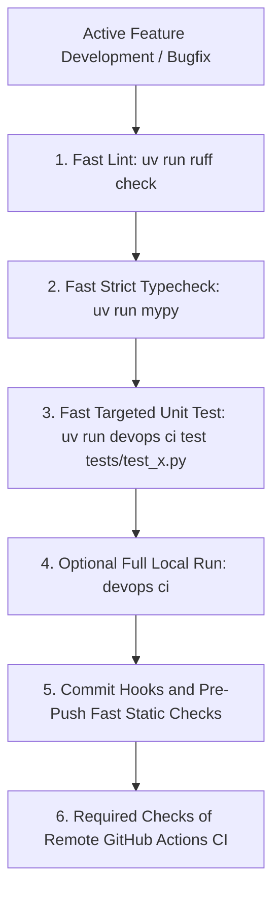

---
applies_to:
  - "python>=3.14"
sources:
  - "https://github.com/rhysd/actionlint"
  - "https://docs.pytest.org/"
reviewed: "2026-10-15"
tags:
  - "ci"
  - "testing"
  - "verification"
---

# Knowledge Base Topic: Continuous Integration & Progressive Verification

## 1. Overview & Domain Architecture

Continuous Integration (CI) and Progressive Verification ensure that software modifications maintain high code quality, strict static type safety, thorough test coverage, zero security regressions, and synchronized documentation. In `devops-cli`, continuous integration is governed by a progressive testing strategy paired with a local quality gate (`devops ci`) and remote GitHub Actions workflows.



---

## 2. Key Concepts & Theoretical Foundations

- **Progressive Verification Philosophy**:
  - **Iterative Feedback Loop**: During active development, run isolated checks on modified files to keep developer feedback loops under 2 seconds.
  - **The Fast Checks Before a Push**: The pre-push hook runs only the fast static checks (ruff lint, ruff format, actionlint and zizmor). A push goes only when they pass.
  - **The Full Gate**: The required checks of CI run `devops ci` before a merge, and `uv run devops ci` runs it by hand (#1752).
- **The Gate**: every check that `devops ci` runs ([docs/SDLC.md](../../../../../../docs/SDLC.md), Phase 4, lists them).

---

## 3. Operational Patterns & Workflows in DevOps CLI

### Pre-Commit & Local CI Commands
```bash
# Execute the complete local quality gate
devops ci

# Execute with automatic fixes for linting and formatting
devops ci --fix

# Run targeted subset checks
devops ci test -v
devops ci lint
devops ci typecheck
devops ci security
devops ci docs
```

### Remote CI Monitoring
When creating or updating pull requests, `devops-cli` provides active remote check monitoring through rate-managed GitHub CLI calls:
```bash
# Watch pull request checks in real-time until green
devops pr monitor 17

# View recent workflow runs on main
devops gh runs list --branch main --limit 5
```

---

## 4. Best Practice Guidance

1. **Never Merge Failing Code**: The pre-push hook runs the fast static checks, and a pull request merges only when the required checks of CI pass. Never use `--no-verify`.
2. **Test Conventions**: What devops-cli's tests may double, where they go and what they assert is set in [`docs/TESTING.md`](../../../../../../docs/TESTING.md).
3. **Synchronize Docs Automatically**: If `devops ci docs` detects differences, run `devops docs generate --sync-readme` to regenerate markdown reference files.
4. **Fix Errors Systematically**: Resolve formatting and linting first, then static typing, then unit tests, and finally documentation.

---

## 5. Security Recommendations & Zero-Trust Governance

- **Lockfile Integrity**: Always install dependencies in CI with frozen lockfiles (`uv sync --frozen`) to prevent supply chain tampering.
- **Automated Workflow Linting**: Run `actionlint` locally to prevent script injection vulnerabilities inside GitHub Actions expressions.

---

## 6. General Standards & Engineering Guidelines

- **Quality Threshold**: 100% pass on all quality gates.
- **Test Execution**: Multi-core parallel execution via `pytest-xdist`.
- **Workflow Path**: `.github/workflows/ci.yml`.

---

## 7. Official References & Published Artifacts

- **DevOps CLI CI Module**: [src/devops_cli/commands/ci.py](../../../../commands/ci.py)
- **GitHub Actions Workflow**: [.github/workflows/ci.yml](../../../../../../.github/workflows/ci.yml)
- **Actionlint Project**: [github.com/rhysd/actionlint](https://github.com/rhysd/actionlint)
- **Pytest Documentation**: [pytest.org](https://docs.pytest.org/)
- **Ruff Documentation**: [astral.sh/ruff](https://astral.sh/ruff)
